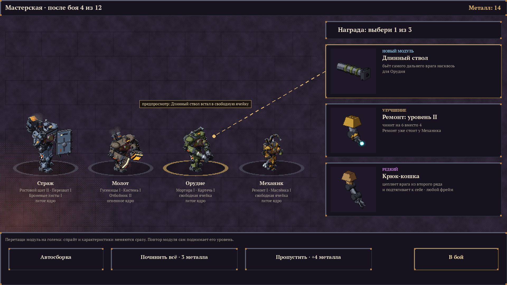

# gam2

Автобатлер-рогалик для ПК (Steam): армия из карт существ с подробными особенностями, бой идёт сам,
решения — до и между боями. Первая версия — два класса: **Литейщик** (мало, но каждый голем силён
и собран под себя) и **Рой** (масса и селекция).

- [Концепт](docs/CONCEPT.md) — поход, бой, размер существ, классы, модули големов, мастерская,
  артефакты.
- [Техническая часть](docs/TECH.md) — свой движок на Rust, логика боя отдельно от картинки.
- [Графика](docs/ART.md) — стиль и инструмент `tools/sprites`, который рисует спрайты.
- [Баланс](docs/BALANCE.md) — мерка, шкалы по размеру, кривая стоимости.
- [Steam](docs/STEAM.md) — что выпуск в Steam требует от графики и интерфейса: экраны и Steam Deck,
  геймпад, перевод, лицензии, раскрытие ИИ, картинки для страницы магазина.
- [Симуляция боя](docs/SIM.md) — крейт `sim`: бой по правилам концепта без графики, прогоны
  тысяч боёв для баланса.

