# Графика

## Выбранный стиль

«Стиль 1» — как в самом первом примере: металл, тёмный контур, светящиеся ядра, ночная палитра.
Верхний ряд на картинке (с тех пор металл стал темнее и взрослее, см. правила ниже):

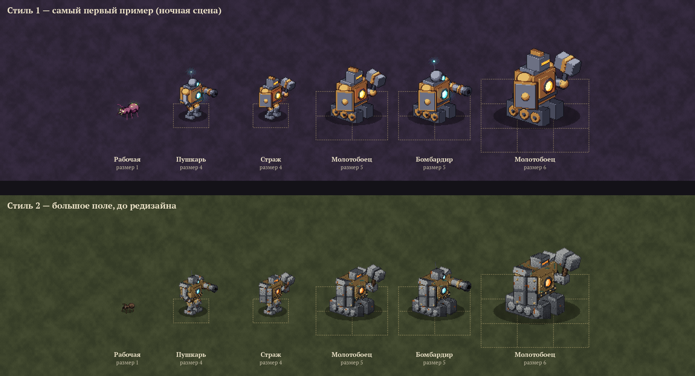

Правила:

- **Вид в пол-оборота**, как в Conquest of Elysium. Существа противника — отражение
  по горизонтали.
- **Атака — отдельный спрайт** у каждого существа (покой и атака). Как в Conquest of Elysium, кадр
  атаки показывается в момент нанесения удара, поэтому это **момент контакта, а не стойка**:
  оружие у цели и на её высоте (враги обычно ниже голема — удар низкий), вес на передней ноге,
  оружие прошло большой путь от позы покоя, дуга следа и вспышка в точке контакта, свободная
  рука уходит назад для противовеса.
- **Ничего не проходит сквозь другое.** Каждая поза и каждый кадр анимации проходят проверку
  пересечений (`clipcheck.py`); допустимы только задуманные стыки (кулак на рукояти, поршень
  на креплении, плечо в гнезде).
- **Размер виден**: существа размера 1 мелкие, големы и матка — огромные (см. концепт).
- **Модульные спрайты**: голем собирается из модулей автоматически, поэтому любая комбинация
  модулей и уровней выглядит правильно и не требует ручной отрисовки.
- Особенность и уровень модуля видны на спрайте.
- **Литейщик взрослый и технический**: тёмное рабочее железо и потемневшая латунь вместо
  яркой бронзы; торс-клин с широкой грудью, маленькая низко посаженная голова с тяжёлым
  забралом и решётками на челюсти вместо рожек; заклёпки рядами, швы панелей, потёки ржавчины,
  табличка с номером, манометр, поршни на плечах, топливный шланг, выхлопные трубы; суставы —
  цилиндры и наплечники, а не шары. Холодный блик по верхнему краю отделяет тёмный металл
  от тёмной земли.
- **Фрейм видно по цвету и силуэту**: у каждого свой окрас — Страж воронёная сталь, Мудрец
  старая медь с белым фарфором, Горн кирпично-красный, Орудие оливковое, Механик охра мастерской —
  и своё тело: Страж — рыцарь с паровым молотом и башенным щитом; Мудрец — маг в капюшоне с одной
  голубой линзой, электростанция на ногах: окно топки в груди, маховик и медные рога с бегущим
  разрядом на спине, медные полы-фалды, посох-электрод с медным шаром; Горн — коренастая печь-бочка с высокой трубой, головой кочегара в очках,
  огнемётом на шланге от топливных баков и клещами; Орудие — стрелок с пушками вместо кистей,
  дальномером поперёк головы и барабаном на спине; Механик — ходячая мастерская: ящик
  с инструментом, два манипулятора над плечами (горелка и захват), голова-фонарь, ключ и маслёнка.
  Отец колосса — машина для убийства: широкий корпус тёмного оружейного металла с красными
  полосами, низкая голова с тремя красными глазами, электробулава и миниган. Маньяк — безумец в кабине-клетке экзоскелета из хлама: пила, бур,
  искрящая катушка.
- **Люди-лидеры** собраны тем же набором, что и големы, но с человеческим: рукава, кисти
  в перчатках, лица, волосы, очки. Изобретатель — старик в синем сюртуке на латунных ногах-протезах
  (лёгкие стойки, открытое колено с шестернёй и пружиной, поршень, когтистая стопа), левая рука —
  механическая с клешнёй, в правой шокер (латунный корпус, лампа, медная катушка-ствол, два зубца);
  за спиной ранец с катушкой Тесла выше головы. Зодчий — архитектор в зелёном сюртуке, фуражке
  и с бородой, стоит на палубе шагающего крана охристого цвета: две ноги-опоры, решётчатая мачта,
  стрела с тросом и крюком, противовес из камня, лебёдка и котёл за спиной архитектора; в руке
  свёрток чертежей, другой рукой он указывает цель.
- Текст: цифры и значки — пиксельные, описания — чётким шрифтом (PT Serif).

## Литейщик: человекоподобные машины

Каждый голем — человекоподобная машина: ступни, колени, таз-редуктор, открытый позвоночник
из колец со светом топки, грудь-топка, наплечники, руки с локтями и кулаками, голова на шее.
Всё — механизмы: шестерни на осях, гидроцилиндры на проушинах, светящиеся тепловые трубки, рёбра
охлаждения, трубы с дымом, окуляры. Големы массивные, голова небольшая и низко. Кулак
по-настоящему держит инструмент: рукоять проходит сквозь хват под углом 70–118° к предплечью.
Атака каждого — момент удара: Страж бьёт молотом сверху, Мудрец поднимает посох и бьёт молнией
из шара туда, куда указывает открытая рука, Горн бьёт длинной струёй из огнемёта, Орудие даёт залп по цели, Механик чинит (манипуляторы варят,
ключ крутит, фонарь светит на работу), Каменщик бьёт молотком, Отец колосса обрушивает электробулаву
с молнией и бьёт очередью из минигана, Маньяк вгрызается пилой, Изобретатель бьёт дугой из шокера,
кран Зодчего взмахом стрелы швыряет кирпичи на две клетки. Следа замаха нет — только
вспышка, искры и пыль в точке удара. В бою враги стоят вплотную, и удар приходится прямо по ним.

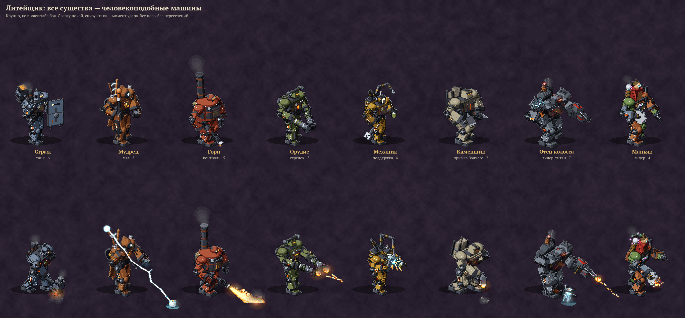

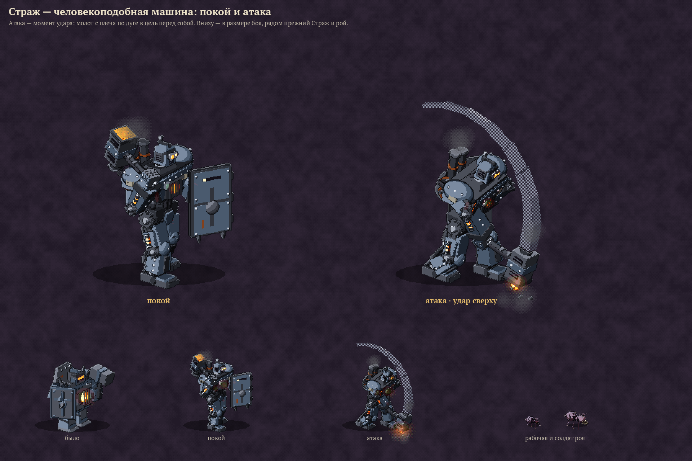

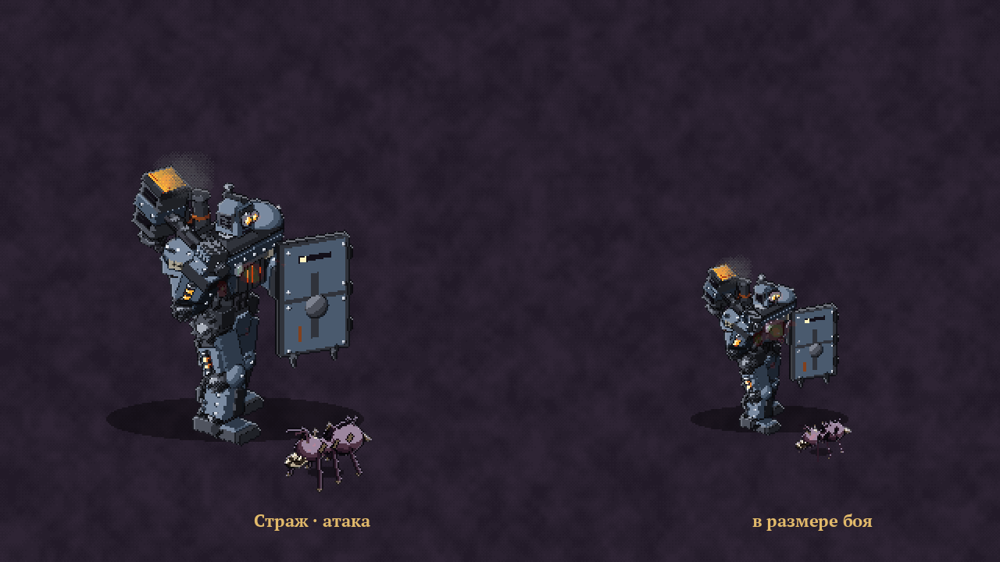

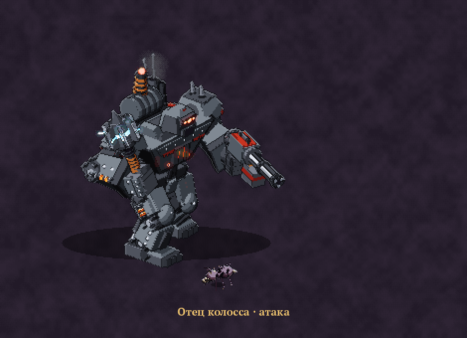

Отец колосса заносит электробулаву высоко за спину, проводит её над головой и обрушивает сверху
вниз, как молот, чуть наискосок поперёк тела, делая шаг вперёд; головка ложится на цель, бьёт молния.
Хват всё время один, как в покое (большой палец сверху): кисть только ровно сгибается, булава
в руке не проворачивается. Миниган всё это время раскручен и стреляет. Потом булава снова
поднимается над плечом.

### Атака по росту цели

Куда приходится удар, зависит от того, насколько враг выше или ниже атакующего — от отношения их
роста на поле. Размер для этого не годится: от 6 к 7 рост почти удваивается (Страж 100 пикселей,
Отец колосса 191), и Страж бил бы титана «вровень».

| Размер | 1 | 2 | 3 | 4 | 5 | 6 | 7 |
|---|---|---|---|---|---|---|---|
| Рост на поле, px | 15 | 22–28 | 28–38 | 50–62 | 60–83 | 69–100 | 191 |

| Полоса | Когда (рост цели / рост атакующего) | Удар |
|---|---|---|
| сверху вниз | меньше 0,5 | в землю, с ударной волной — заодно видно растаптывание по всей клетке |
| вровень | от 0,5 до 1,6 | в тело, примерно на высоте своей груди |
| снизу вверх | 1,6 и больше | вверх, в брюхо и бёдра великана, оружие выше своей головы |

У каждой полосы свой кадр удара и свой замах (в землю — из-за головы, вровень — от плеча, вверх —
от бедра); промежуточные кадры строятся сами и проверяются на пересечения. Кадр выбирается
в момент удара по паре «атакующий — цель». Что нужно каждому против роя:

- **Страж и Маньяк** — все три: по жукам сверху, по матке вровень, по титану снизу вверх.
- **Мудрец** — наводит открытую руку, молния из посоха бьёт туда: в землю по жукам, в голову
  матки, вверх в брюхо великана.
- **Горн и Орудие** — наводят ствол: огонь в землю по жукам, в корпус матки, вверх в великана;
  Орудие бьёт во 2–3 ряд (около 100 единиц), поэтому его наклон меняется немного: −11°, −4°, +8,5°.
- **Каменщик** — меньше вдвое ему никто не попадается: по жукам вровень, по матке снизу вверх.
- **Отец колосса** — сверху вниз по рою, матке и големам до размера 5, вровень по Стражу и титанам;
  миниган тоже наводится вниз, в рой, а не поверх голов.
- **Изобретатель** мал (38 пикселей), поэтому солдат роя ему уже вровень: дуга шокера уходит
  в землю по рабочим, в грудь солдату и вверх в матку.
- **Зодчий** швыряет кирпичи на две клетки по навесной; полоса решает, куда кран выбрасывает трос
  и куда ложится кирпич: в землю к жукам, в корпус матки, вверх в Стража.

Если атакующий перекрывает другое существо, вокруг него тёмный ореол в 2 пикселя — так тёмный голем
читается на фоне тёмного великана. Цель в примерах стоит по силуэту тела (без рук и оружия): её
передний край на высоте удара там, куда приходится удар.

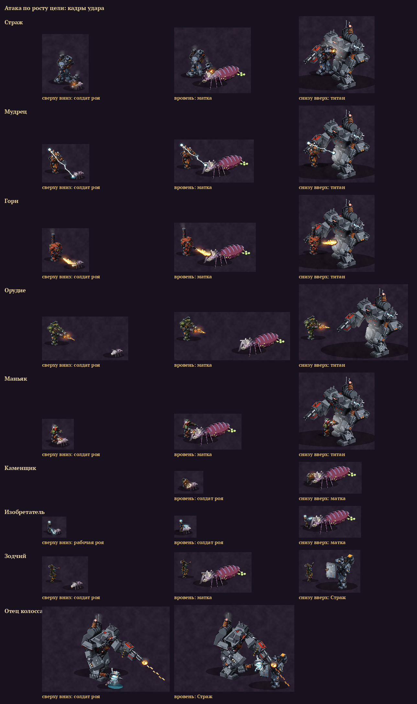

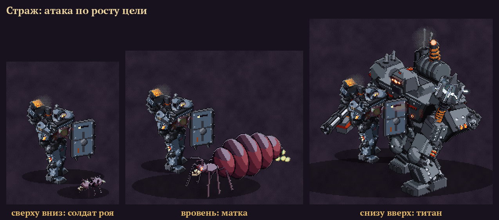

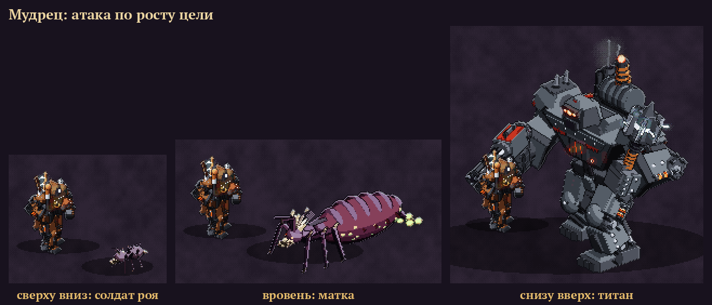

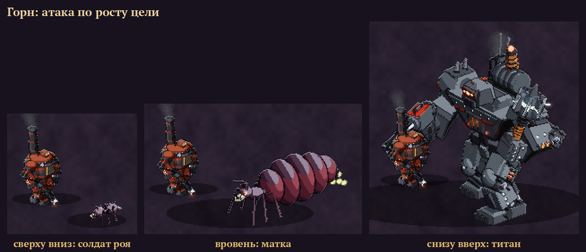

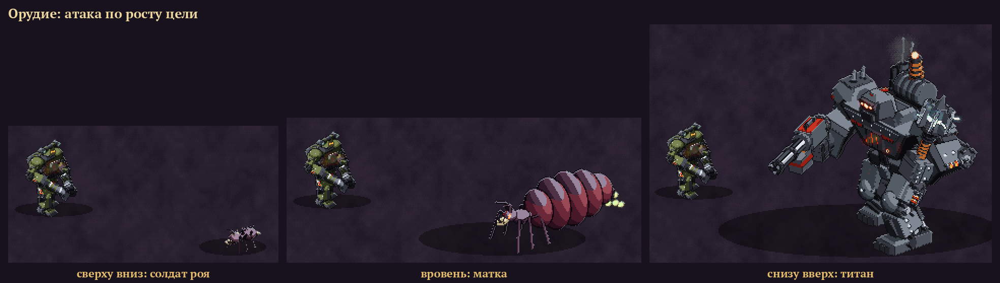

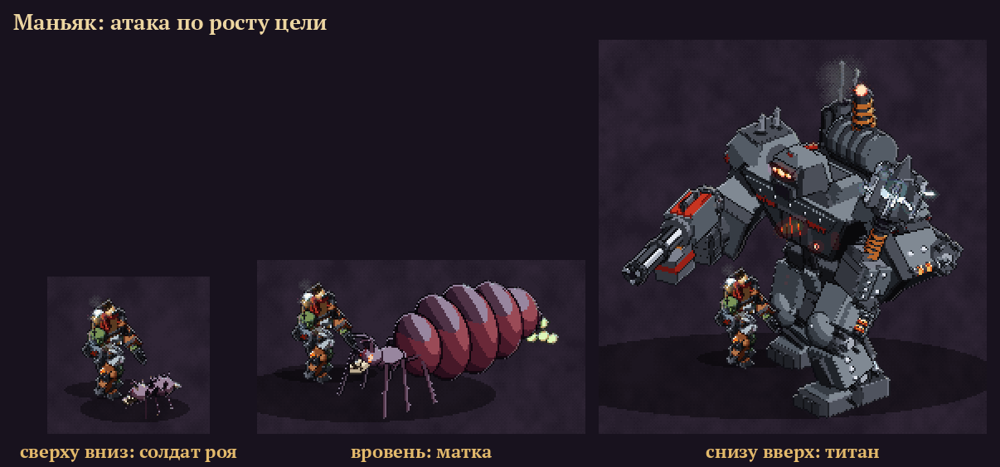

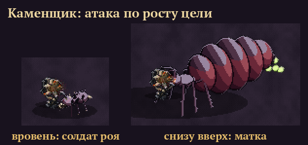

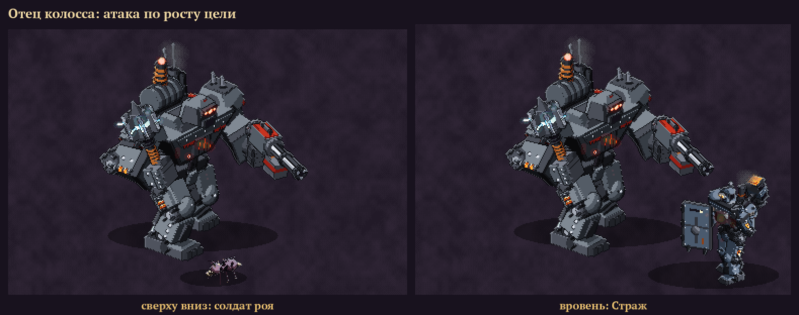

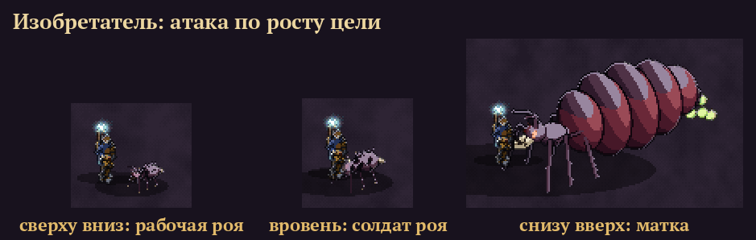

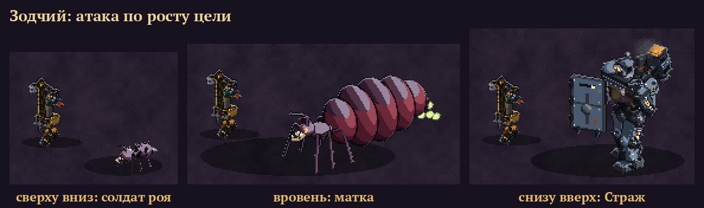

Механик не атакует — его действие ремонт: он подходит к повреждённому соседу, манипуляторы варят пробоину
(сварочная горелка, искры, фонарь светит на работу, ключ крутит), дым из пробоины уходит, починенное место
вспыхивает зелёным, и сосед стоит целым.

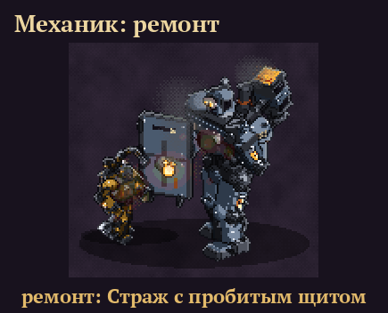

Позы заданы числами (наклон и разворот корпуса, стойка, куда тянутся руки, направление
инструмента), колени и локти ставятся по длинам костей, поэтому промежуточные кадры анимации
получаются сами. У каждого есть и поза «сломан»: осел на колени, дымит.

### Строительные формы Зодчего

В походе строительный модуль сложен на раме за спиной голема и торчит над плечами — по этому
и видно, что он несёт: плиты стены, камни башни, котёл, мачту, стрелу, наковальню. Развернувшись,
голем не исчезает в постройке, а врастает в неё и становится её сердцевиной: Орудие стоит на своей
башне за зубцами и стреляет поверх них; Страж ставит щит на шипы, и он становится серединой стены,
от него в обе стороны раскладываются звенья; за воротами Страж стоит привратником; для пресса он
вкапывается по колени, а перед ним в раме висит штамп на двух гидроцилиндрах; Горн бьёт огнемётом
в топку, над которой на ложе висит котёл, и опрокидывает его на клетки впереди; Мудрец стоит
у подножия решётчатой вышки с медным шаром, кабель идёт от его рогов; Механик ставит выносные опоры
и поднимает над спиной мачту со стрелой или работает у горна и наковальни.

Уровень постройки — материал: I — брёвна, частокол, верёвка, ржавое железо; II — тёсаный камень
рядами и бронзовые пояса; III — клёпаное железо, шипы и светящаяся руническая полоса.

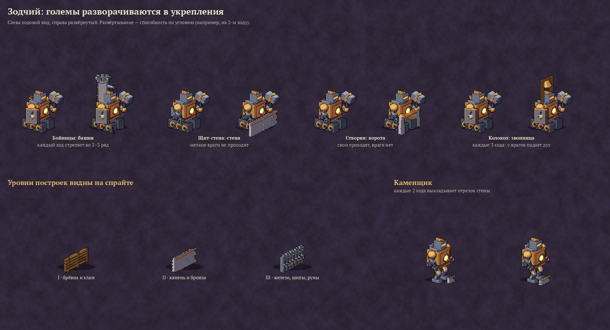

### Цитадель

Развитие Зодчего — голем размера титана (как Отец колосса), который сам становится крепостью.
В походе это ходячий донжон: тёсаная кладка с бойницами и решёткой ворот в груди, голова —
дозорная башня со светящейся щелью и знаменем, плечи — круглые башенки, из-под которых висят руки
с кулаками-таранами, ноги — столпы с железными стопами, а за спиной на петлях сложены стены.
Развёртываясь, он садится на колени и упирает кулаки в землю, половины стены расходятся на петлях,
как створки; развёрнутый — сидит на фундаменте, плечевые башни уходят в землю и встают по бокам
донжона, дозорная башня поднимается выше, руки становятся контрфорсами перед воротами, а стены
расходятся в обе стороны к угловым башням. На крыше и башнях стоят големы — в настоящем масштабе:
Орудие на донжоне, Мудрец на угловой башне. Уровни как у построек: брёвна, камень, железо;
у руки и ног материал уровня, на III уровне — шипы на кулаках.

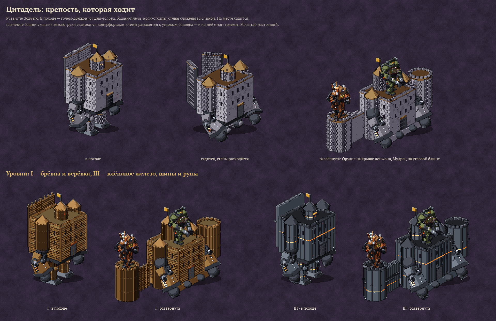

### Аугменты Изобретателя

Аугмент встаёт на любой фрейм: место находится по силуэту самого голема. Грозовая катушка — на
плече, а если там тесно (у Механика плечи заняты манипуляторами), то дальше на спине и поменьше;
Отражатель — круглый полированный щиток снаружи предплечья, повёрнутый к врагу; Пружинный рывок —
латунные пружины по внешней стороне голеней, от проушины под коленом до пяточной пластины. У каждого
аугмента латунный корпус и синяя лампа: они держатся на Изобретателе, погибнет он — лампы погаснут.
Срабатывание: молния из катушки в соседнего врага; вспышка и лучи, отброшенные вперёд, из зеркала;
голем, брошенный вперёд с пружин, и пыль там, где он стоял.

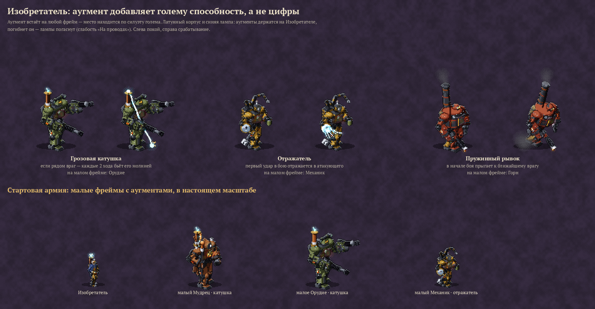

### Конструкты Маньяка

Конструкт — обычный фрейм, собранный «незаконно»: безумный модуль стоит там, где модулей не бывает,
и на каждой такой детали знак Маньяка — фиолетово-зелёные искры. Мудрец едет на двух циркулярных
пилах вместо ног; у Орудия вместо головы катапульта с ломом; у Механика вместо ключа — пружина
с боксёрской перчаткой, которая бьёт через клетку; Орудию прикручены ещё две руки — с кувалдой
и клешнёй (молот, клешня и пушка по очереди); перевёрнутый Мудрец ходит на руках-колёсах,
а на ступнях у него кувалды; Горн носит на трубе катапульту с горящим жуком; у Горна за спиной
батарея ракет, и при поломке над полем рвётся фейерверк. Импровизация показана на Страже: молот
на ход изрыгает пламя, щит раскрывается в пилу, над модулем значок нового эффекта.

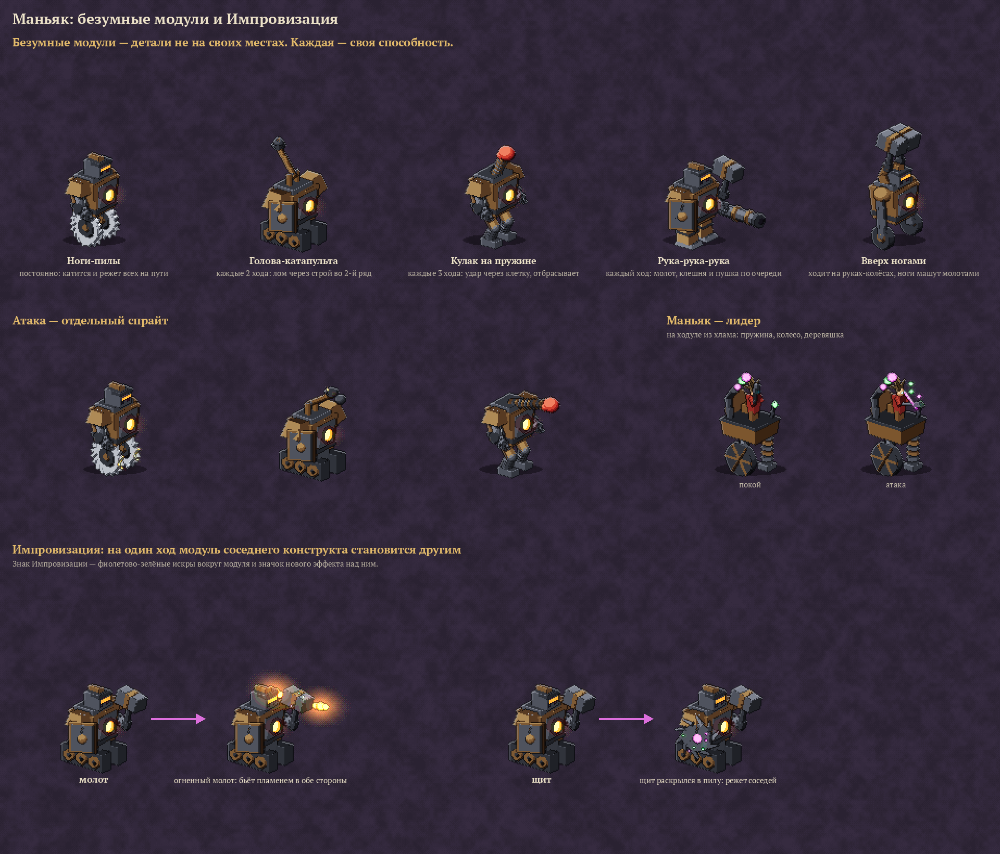

### Модули по уровням

Модуль виден на големе и растёт с уровнем; на III уровне у него новая грань — и новый вид. Модули
ставятся на видимую сторону голема (ближний наплечник, рука, бедро, перед корпуса, верх спины над
плечами, земля у ног), иначе в пол-оборота их не видно; цвет модуля не должен сливаться с окрасом
фрейма (магнит Горна синий, маслёнка Механика жестяная). Редкие модули меняют и само тело: Гусеницы,
Паучьи лапы и Колёса-жернова встают вместо ног, Кистень, Искрящий молот и Кочерга — вместо того, что
в руке. Модули складываются в сборку, каждый улучшается отдельно. Ядро — окно в груди: литая заглушка,
огонь за решёткой или голубой разряд.

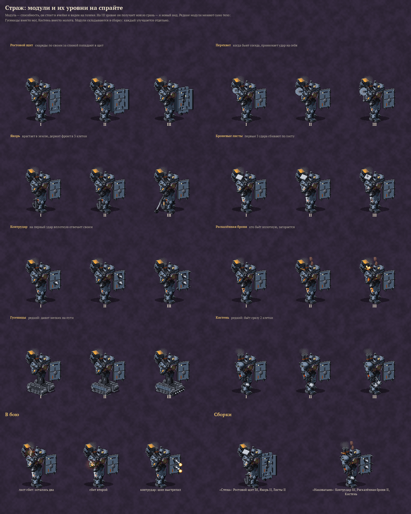

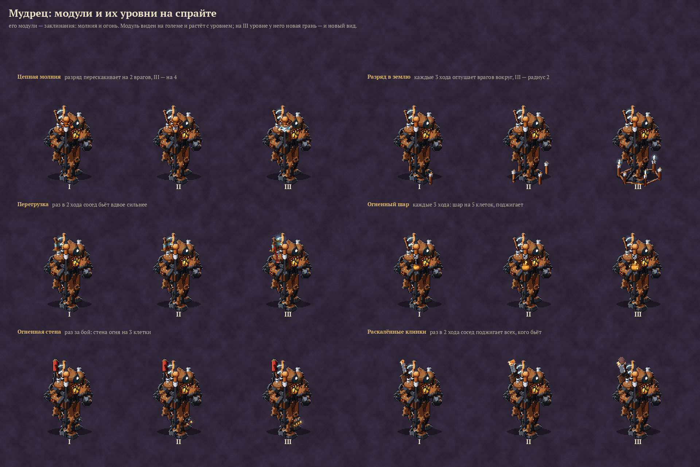

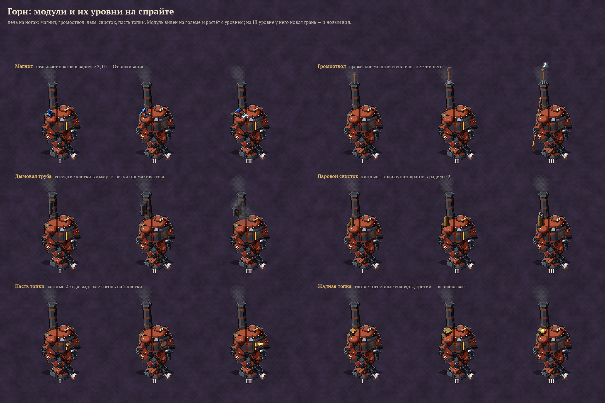

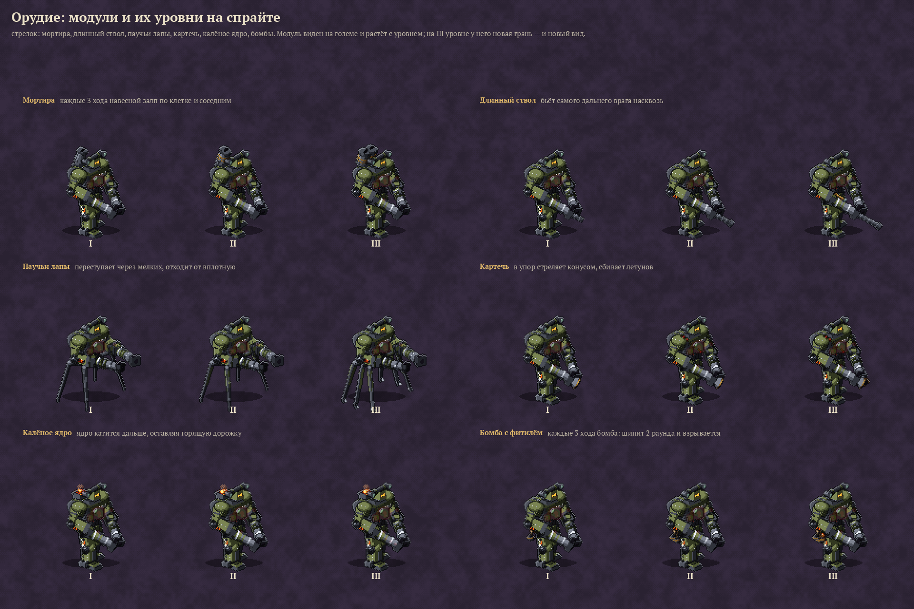

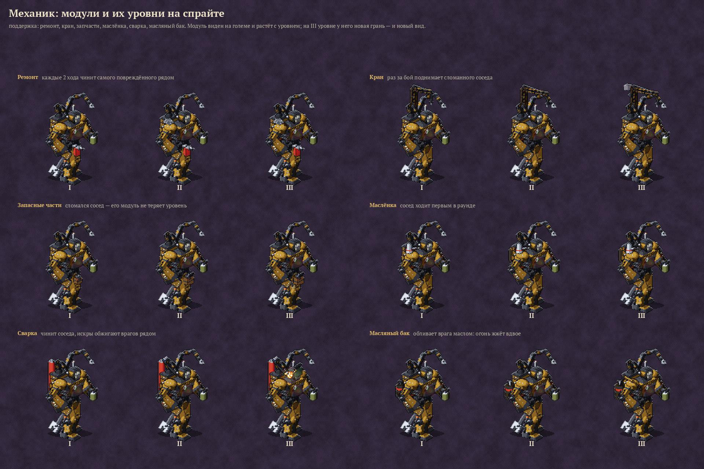

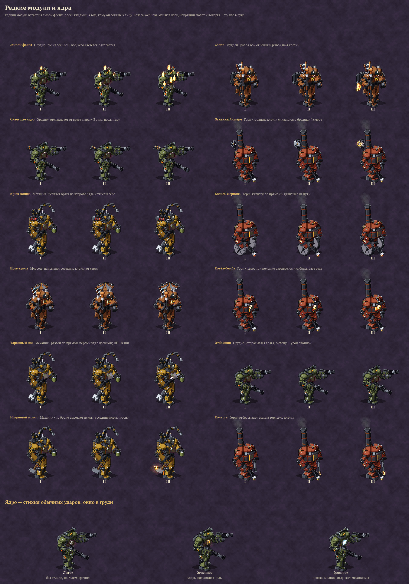

В прежнем, коробочном виде ничего из Литейщика не осталось; старые скрипты и листы убраны.

### Модули в бою

Срабатывание модулей показано на сетке поля (клетка 50 × 34 пикселя): голем в своём модуле, враги — солдаты
роя в своих клетках. Эффект строится в пространстве голема, на мировых точках над клетками, и рисуется
тем же отрисовщиком: Цепная молния перескакивает с жука на жука, Огненный шар летит пять клеток и рвётся
на клетке и соседних, Огненная стена встаёт на три клетки, Разряд в землю оглушает всех вокруг, Перегрузка
заряжает соседнего Стража; Горн выдыхает огонь на две клетки, Магнит тянет врагов, свисток пугает, трубы
затягивают соседние клетки дымом; Мортира кладёт снаряд навесом, Картечь бьёт в упор конусом, Длинный
ствол прошивает ряд, бомба шипит два раунда и рвётся; Механик обливает врага маслом; Страж врастает
Якорем; редкие — огненный смерч, скачущее ядро, крюк-кошка. Задетые враги вспыхивают, горят, синеют
от разряда или чернеют от масла.

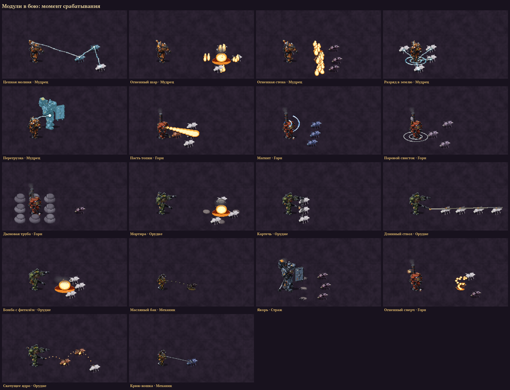

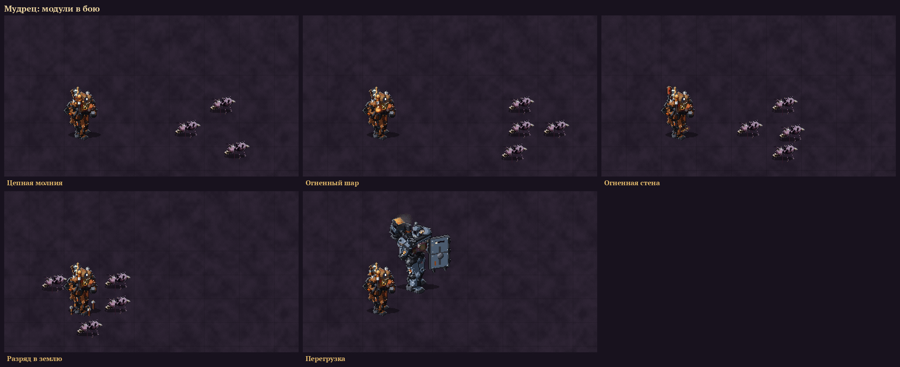

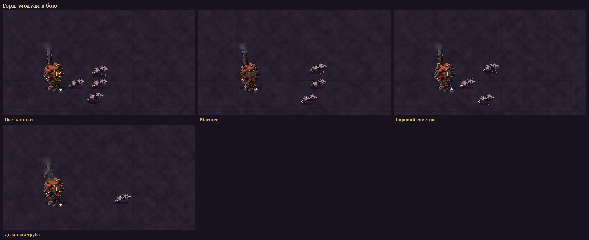

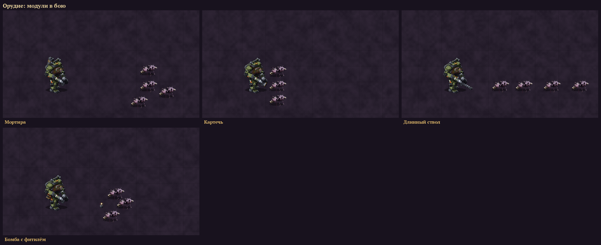

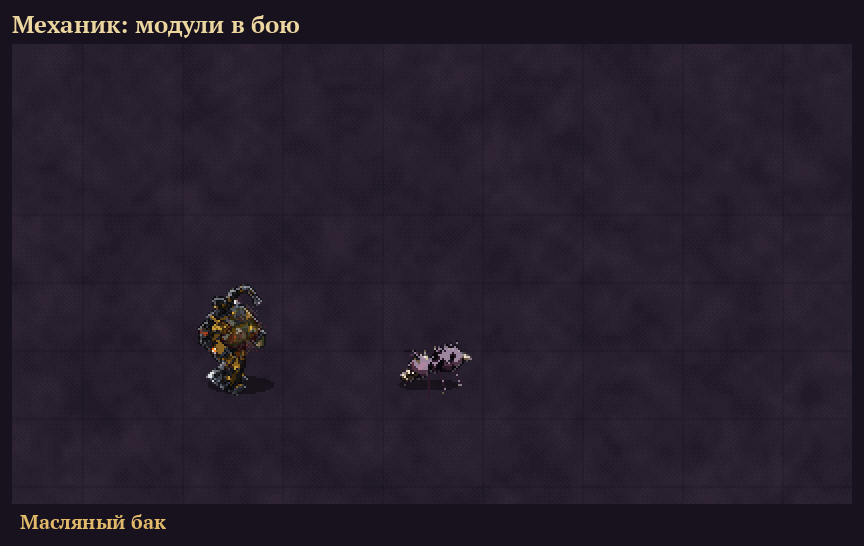 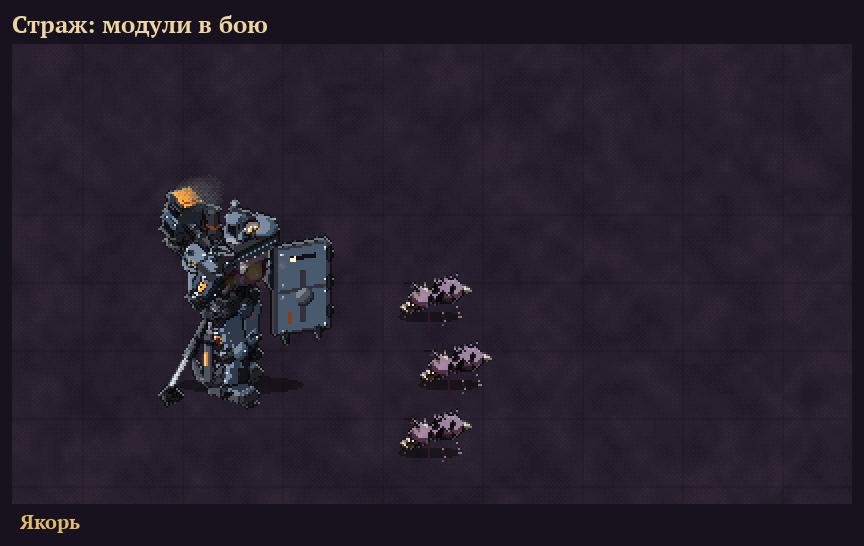

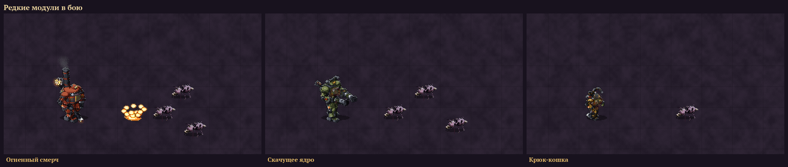

### Иконки модулей

Иконки модулей для мастерской — 16×16. Они сделаны из спрайтов открытого датасета
[Pixel Art Atlas](https://huggingface.co/datasets/Angais/pixel-art-atlas-1.4m) (Angais, CC0 1.0 —
общественное достояние) и переработаны под игру: перекрашены в палитры Литейщика (железо, латунь, медь,
огонь, голубой разряд, окрас фрейма; у безумных модулей Маньяка — его фиолетовый и зелёный), развёрнуты
вправо, как стоят наши существа, получили наш тёмный контур и блик по верхнему краю. В репозитории лежат
только переработанные иконки (`tools/sprites/assets/module_icons.png`), сам датасет — нет.

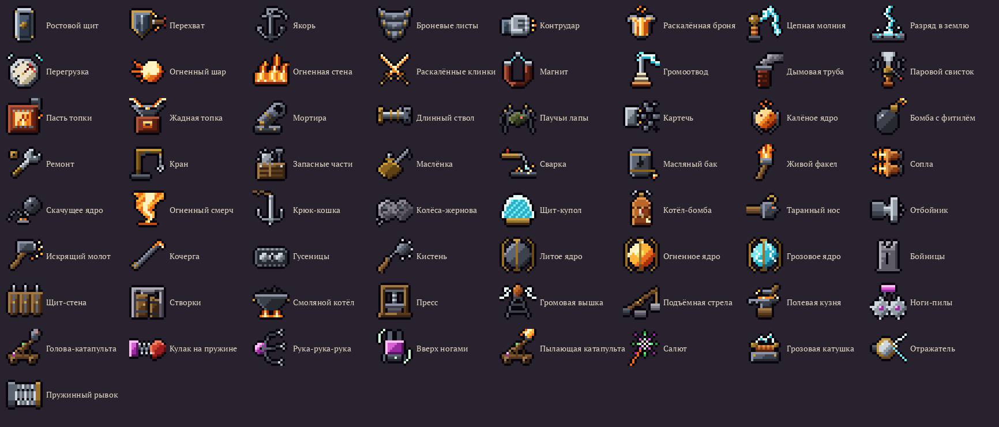

В мастерской големы стоят в своих модулях, а на карточках наград — эти иконки:

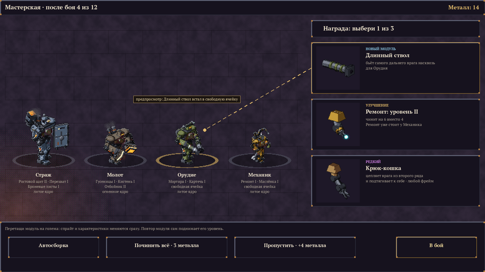

## Рой: живая масса

Рой — противоположность машин: тёмный маслянистый хитин с холодным бликом, гроздья красных глаз,
костяные клыки и шипы, капли ихора, хищная стойка. Форму тела задаёт главная черта, остальные
черты — детали; касты, гигантизм и химеры видны на спрайте (листы — в концепте).

### Лидеры роя

Лидеры роя — крупные особи со своим силуэтом, в том же хитине. **Матка** (размер 6) — вздутое
брюшко-мешок из тёмной перепонки, на нём раздвинутые пластины, сквозь бока светятся яйца, сзади
яйцеклад и кладка на земле; маленькая бронированная голова с короной костяных шипов, обломки
сброшенных крыльев. **Разум улья** (размер 4) — огромный морщинистый мозг-мешок с бороздой между
долями и узлами, светящимися феромонным фиолетовым, на мягком бледном теле-личинке; под мозгом
маленькое лицо с гроздью глаз и перистые усики со светящимися кончиками. **Пожиратель** (размер 5,
растёт до 7) — низкий тяжёлый зверь, который почти весь пасть: четыре костяные челюсти с зубами
и кровавое горло, панцирь из пластин, шипы по хребту; с каждой ступенью роста пластин и шипов
больше, а на последней в трещинах светится ихор. **Кукушка** (размер 3) — оса-наездник: тонкая
талия, брюшко-серп в ржавых полосах, мешочек с яйцами и яйцеклад длиннее тела, который в атаке
она заносит вперёд под себя. Их способности рождают **личинок** — бледных червей с тёмной
головой и жвалами.

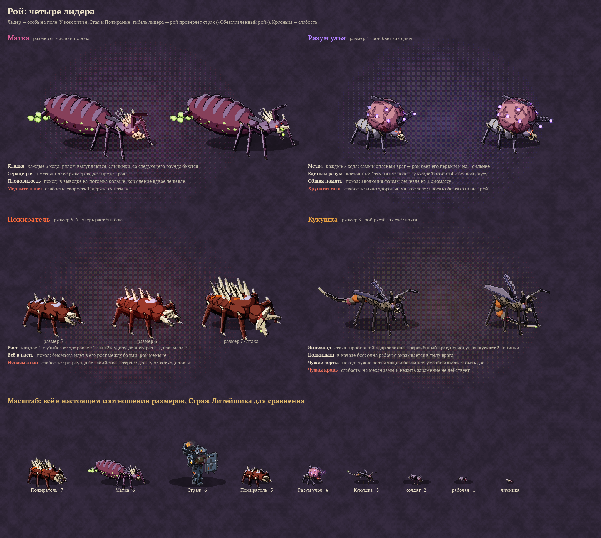

### Развитие лидеров роя

Развитие лидера тоже видно на спрайте. Матка: «кладка чаще» — яйца светятся сквозь всё брюшко
и кладка за ней больше; «+1 личинка» — личинки цепляются за неё и ползают рядом; «+1 к размеру» —
она вырастает до размера 7, корона выше. Разум улья: вторая пара перистых усов (две метки), мозг
весь в светящихся узлах (метка каждый ход) или шипы по борозде и крупные жвалы (+1 к удару).
Пожиратель: сразу размера 6, раздутое брюхо в светящихся трещинах (растёт с каждого убийства) или
второй желудок-мешок на спине (лечится вдвое). Кукушка: мешочек с тремя крупными яйцами, ядовитая
железа и капли яда на яйцекладе или рабочая, которую она несёт под брюхом (подкидышей двое).

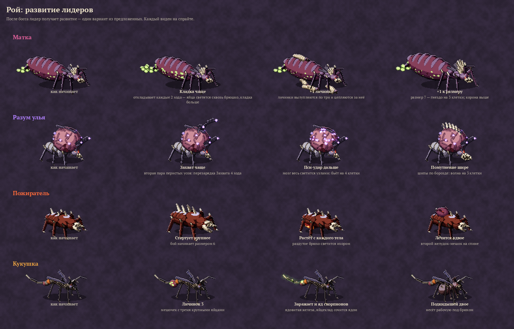

### Способности лидеров роя на поле

Способности видны прямо на поле. Матка откладывает кладку — светлые яйца в слизи; через ход они
лопаются, и из скорлупы вылезают личинки; своя особь, погибшая рядом с Маткой, роняет яйцо
(Сердце роя). Разум улья бьёт мыслью: фиолетовые кольца пси-удара идут от мозга волной к цели,
мимо брони; от погибших особей к их убийце бьют фиолетовые молнии предсмертного крика; Помутнение —
кольца пси-волны над группой врагов: живые бьют своих, у машин сбоит ядро и сыплются искры;
захваченный враг, подсвеченный фиолетовым, с знаком над головой сражается за рой. Пожиратель
растёт на глазах: 5 → 6 → 7, и ест он и погибших своих. Кукушка бьёт длинным яйцекладом через
клетку, из-за своих: на заражённом проступают зелёные пятна, погибнув, он выпускает двух
личинок с его рукой; машина становится гнездом, и личинки в стальных кольцах лезут из её
решёток. Подкидыш — рабочая, вылезшая из-под земли в тылу врага.

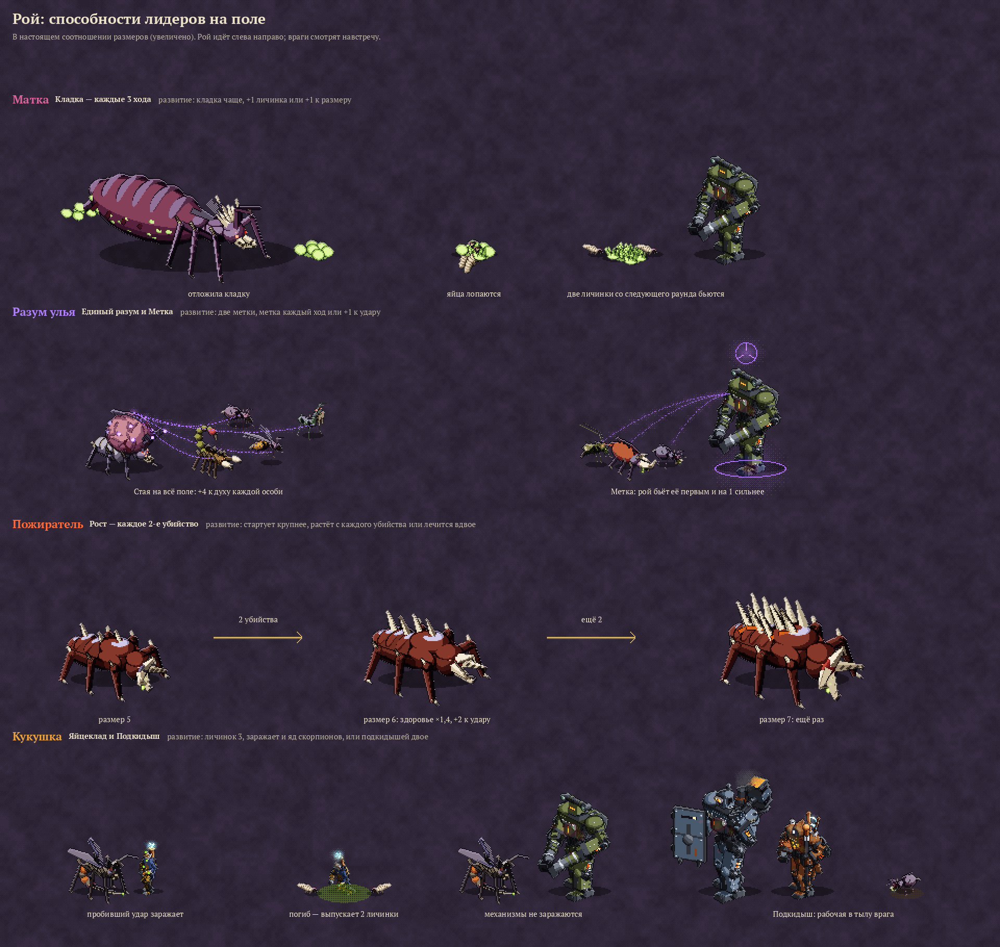

### Способности форм в бою

Каждая форма срабатывает по-своему, и гигант раздувает её приём. Строй — золотые нити к трём
соседям и «+1» (у гиганта — кольцо радиусом 2 и «+1» всем своим). Оса перелетает строй к стрелку
по пунктирной дуге (гигантская уносит мелкого врага). Скорпион жалит, и над целью поднимаются
пузыри яда (гигант жалит цель и соседа). Бочонок плюёт кислотой на 3 клетки и, погибнув,
лопается на соседей — своих тоже (гигант заливает клетку и всех вокруг). Жук разгоняется с
полосами скорости и отбрасывает (гигант проходит насквозь и давит). Мокрица отвечает шипами
и сворачивается в шар (гигант катится шаром). Кузнечик прыгает через строй (гигант оглушает
приземлением). Богомол бьёт серпами дважды (гигант — по всей клетке). Светляк ослепляет
вспышкой (гигант — в радиусе 2). Пожирание — убийца съедает тело и лечится. Заражение и яд
показаны на людях-лидерах Литейщика: на машины они не действуют.

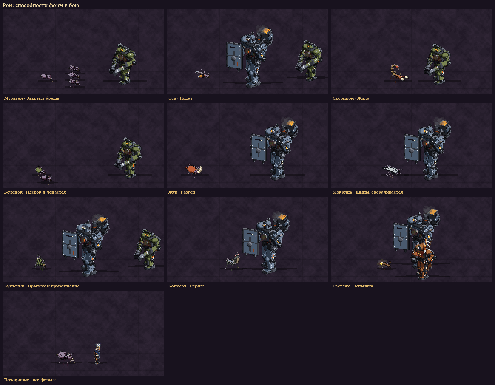

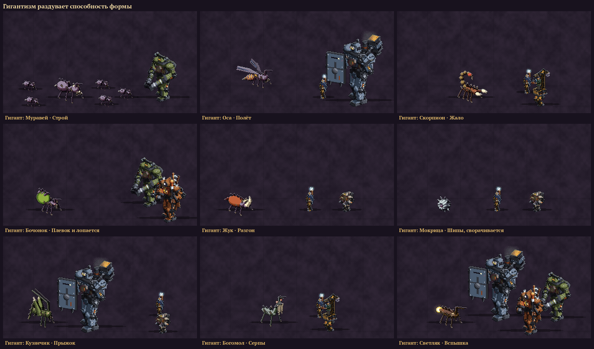

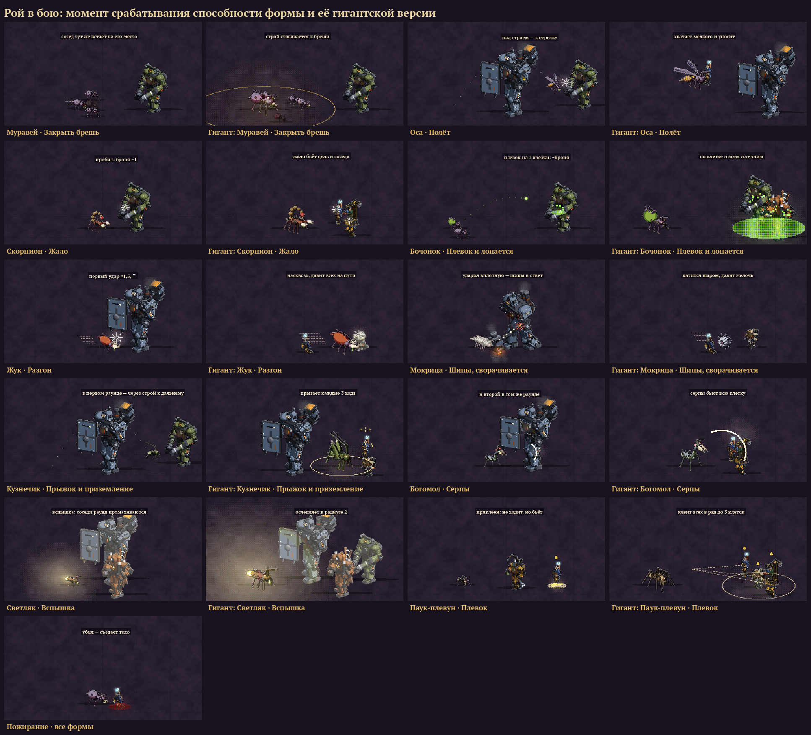

### Мутации роя

Мутация занимает место детали и видна на теле, как деталь. На каждом листе пула — рабочий муравей
и вторая форма с мутацией, а ниже — что она делает в бою, в масштабе поля: враг — Механик или
Изобретатель, для крупного — Страж. Общий пул собран из биологии насекомых: паутинные бородавки
(Прядильные железы), брюшко в жёлтых железах (Взрывной муравей), липкий шарик на нити (Болас),
мохнатая янтарная грудь и полосы пчелы (Пчелиный шар), шёлковый чехол на брюшке (Куколка), крапины
и облачко мошек над спиной (Мошкара), раздутое медовое брюшко (Медовая бочка), красно-чёрные
предупреждающие полосы и капли крови на лапах (Нарывник), стальные жвалы с зубьями (Кусачки),
щит-диск на голове (Стража лидера), бледная заживающая плоть и отрастающая лапа (Живучая).

Пулы лидеров — в цветах своих лидеров. У Матки — яйца, личинки и золото породы: яйца на спине,
личинка в жвалах, королевский гребень, длинные перламутровые крылья брачного полёта, сшитый
из двух форм гибрид, раздутое брюшко наследницы. У Разума улья — фиолетовое пси: светящиеся
жвалы, усы-резонаторы, маска, череп на брюшке (Последняя воля), щупальца поводка и мачта
ретранслятора с маленьким мозгом. У Пожирателя — мясо и голод: розовое сытое брюшко, кровавые
железы приманки, складки жира, бешеные глаза и слюна, кусок мяса в жвалах, рёбра голодной,
багровые пластины его крови, светящийся мешок питательной сути. У Кукушки — заражение: длинный
тонкий яйцеклад, яйца сквозь хитин, кордицепс на спине, полосатый щуп-приманка из головы, коконы
паразитов, личинки под кожей, пёстрый мутагенный мешок, слезающая шкура нестабильной
и королевский яйцеклад с яйцом.

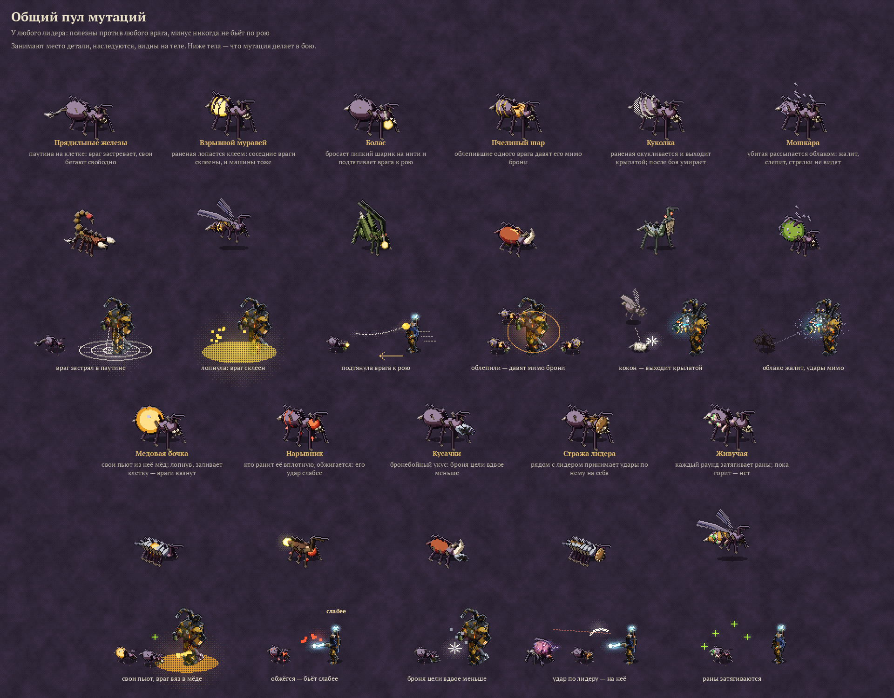

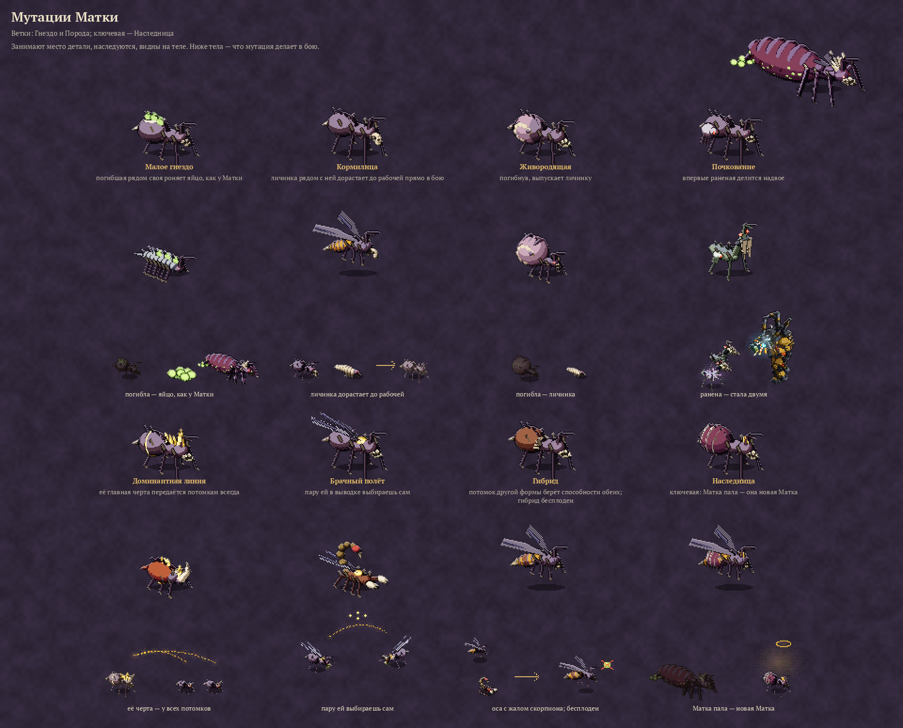

**Надлом** — то, что делает пси, когда копится: над врагом заполняется ряд фиолетовых ромбов,
потом над головой — фиолетовая трещина и звёзды; у голема гаснет искра в ядре и идёт дымок.

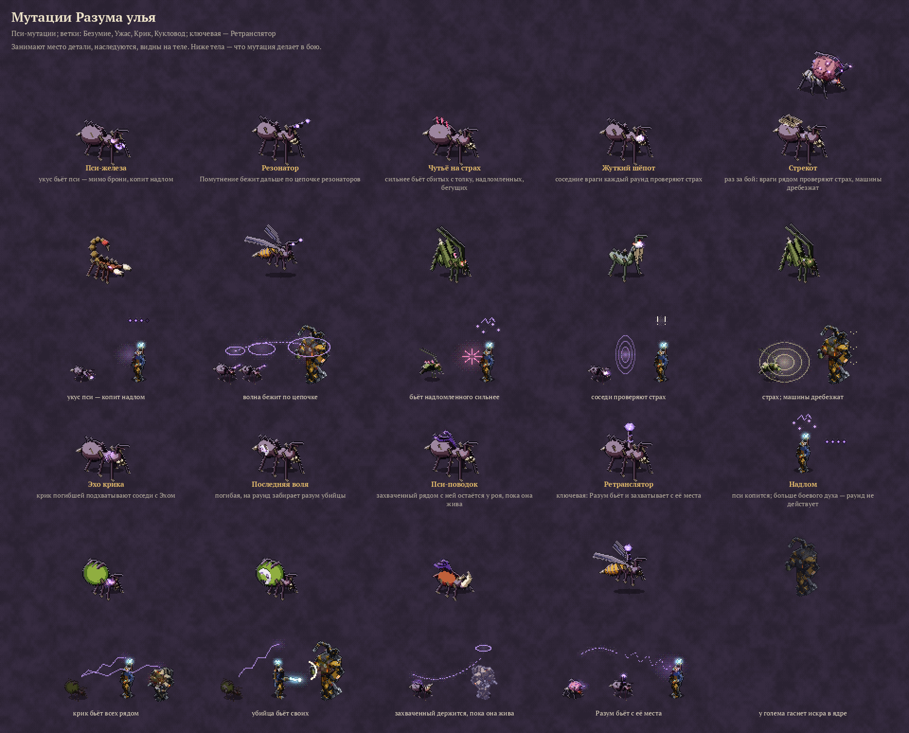

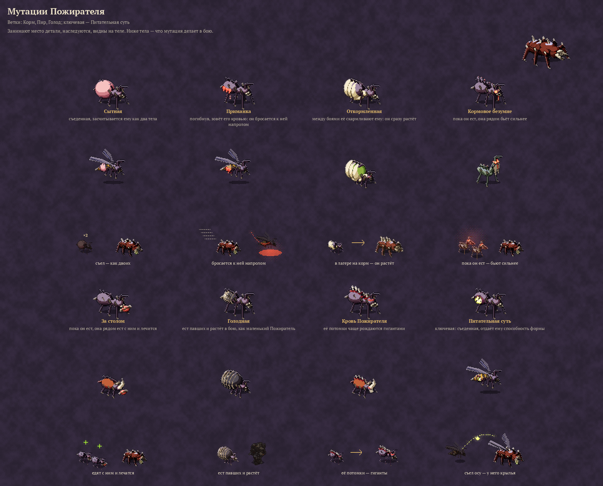

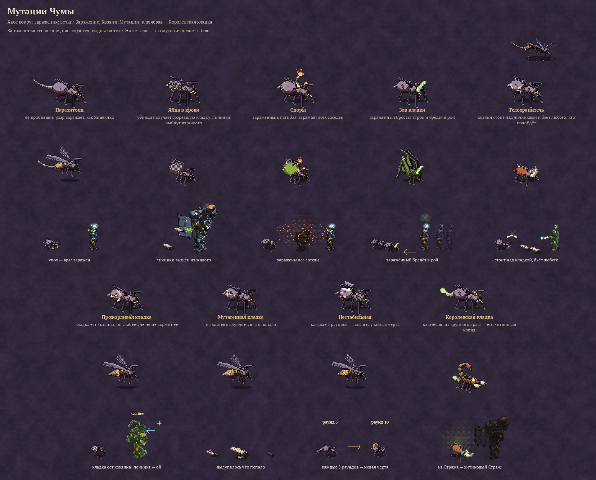

### Мутации в бою — анимация

Самые заметные мутации в движении, в масштабе поля (как способности форм): паутина, клей
Взрывного муравья, Болас, облако Мошкары, кокон Куколки, Надлом, Споры и личинки из живого
хозяина (Яйца в крови).

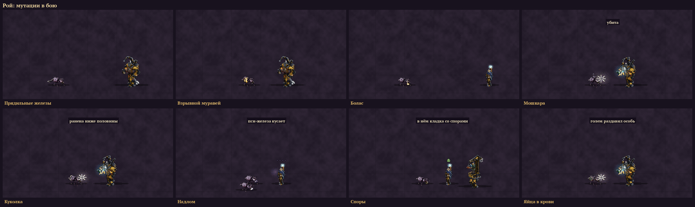

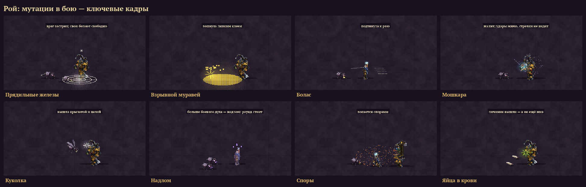

### Состояния на поле

Всё, что рой делает с врагом (и пара состояний своих), показано одним набором: маленький
пиксельный значок над головой в масштабе поля, кое-где ещё след у ног (клей, паутина, мёд) или на
теле (пятна заражения, фиолетовый отлив захваченного, потускневшая машина в сбое). Значки встают
в ряд; над ними — ряд из четырёх ромбов пси: они заполняются с каждым попаданием пси, полный ряд —
надлом, фиолетовая трещина и звёзды. Те же значки стоят на листах способностей и в бою.

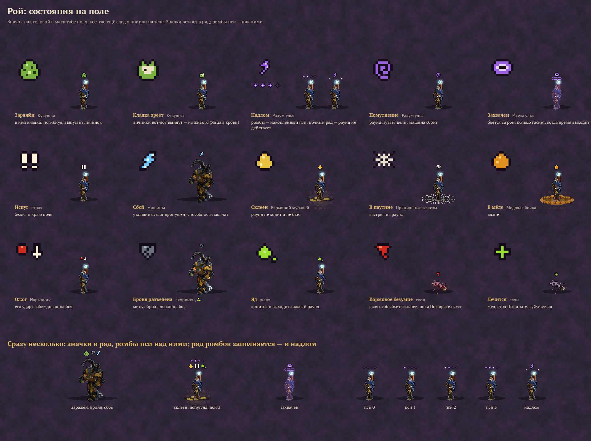

### Паника

Испугавшаяся особь разворачивается и бежит к краю поля, над ней значок страха; толпа
рассыпается в стороны, а плотная середина держится — Стая даёт смелость за каждого соседа.

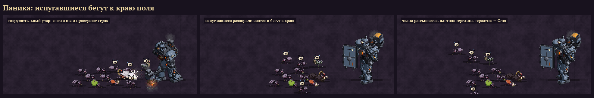


### Огонь против роя

Общие правила огня сильнее всего бьют по рою. Огнемёт Горна поджигает передних, горящие особи
в панике разворачиваются и бегут назад сквозь своих, оставляя горящие клетки и поджигая всех,
мимо кого бегут; горящая оса падает и поджигает клетку; огнеупорный голем стоит в пожаре, а
от роя остаются обугленные тела.


### Бой с каждым лидером роя

Та же битва с каждым лидером роя: Матка в тылу; Разум улья бьёт пси-волной в Стража, и над его
строем расходятся кольца Помутнения; выросший до размера 7 Пожиратель вцепился в Стража на
передней линии; Кукушка держится в тылу, а её подкидыш грызёт Зодчего со спины. У выведенного
к середине похода роя видны эволюции: щитки муравьёв, жала-шприцы ос, пилы богомолов, кислотные
брюшки, вторые рога жуков, клешни-тиски.


### Эволюция форм

Эволюция формы видна на каждой её особи: деталь добавляется к телу из той же черты, поэтому
выведенная порода узнаётся с поля. У муравьёв светится кислотой брюшко, появляются щитки и
костяные крючья на лапах; у осы — длинное жало, янтарные крылья, лапы-крючья; у скорпиона —
огромные клешни, светящийся мешок жала, высокие лапы; у бочонка — сопло, предупреждающие полосы,
поры с пузырями; у жука — второй рог, бугры на надкрыльях, раскрытые крылья; у мокрицы — длинные
шипы, каменная корка, широкие края; кузнечик становится жёлто-чёрной саранчой, у него шипы
на голенях и длинные ноги; у богомола — зубья на серпах, лепестки орхидеи, крылья с глазками;
у светляка — большой фонарь, капюшон над ним или оранжевые кольца.


### Иконки роя

Иконки черт, химер, лидеров и действий выводка сделаны так же, как иконки модулей: из того же
CC0-датасета Pixel Art Atlas, перекрашены в цвета роя — маслянистый хитин, янтарь, ржавчина,
кислотно-зелёный, ихор, феромонный фиолетовый, бледная плоть личинок, — развёрнуты вправо, с нашим
контуром и бликом (`tools/sprites/assets/swarm_icons.png`). Иконка черты — силуэт формы, которую черта
даёт главной. На экране выводка они стоят на кнопках трат, у отметок «химера» и «новая форма»
и в полосах естественного отбора.

Есть и иконки 27 эволюций, 45 мутаций (общий пул и пулы лидеров) и страха — для экранов эволюции,
лагеря и значка над испуганной особью.


### Интерфейс роя — в материалах насекомых

У роя свой набор интерфейса (`swarm_ui.py`), всё из того, из чего строят насекомые:
- **фон** — тёмный восковой сот с прогрызенными ходами и старыми потёками смолы;
- **панели** — хитиновые пластины: сегменты, как у брюшка, маслянистый блик по верху, дыхальца
  по бокам, костяные шипики; у больших панелей — усики сверху и жвалы-крючки снизу;
- **карточки** — ячейки сот: длинный шестиугольник со скошенными углами и восковым ободком, внутри
  тонкий узор сот; цвет ободка — состояние: выбрано — янтарь с ореолом, новые — кислотно-зелёный,
  к съедению — кровь, мутация — золото, закрыто — тёмный;
- **кнопки** — капля смолы в форме шестиугольника: янтарь с пузырьками — главное действие,
  хитин — второстепенное, кровь — «съесть», зелень — траты биомассы, тусклая — недоступно;
- **полоса заголовка** — тёмная перепонка крыла с жилками;
- **предел роя** — брюшко: по сегменту на очко предела, лишние — красные, отмеченные к съедению —
  в янтарную штриховку, костяная метка на пределе.

Шрифты пиксельные: заголовки и главные кнопки — Press Start 2P (OFL, `tools/sprites/fonts`),
текст — GNU Unifont (берётся из системного пакета `fonts-unifont`; если его нет — PT Serif).
Для игры шрифт текста ещё выберем: у Unifont лицензия GPL с исключением для шрифтов.


Экраны роя между боями и перед боем: выбор эволюции формы (карточки трёх эволюций с иконкой,
ценой и видом на спрайте), лагерь (кто получает мутацию, какую черту, как будет выглядеть)
и расстановка стаями (стая — один вид особей; ставится целиком, очертание задаёт игрок).


Экран выводка — отбор: вылупились все, рой собран в группы по формам и чертам, новые отмечены
зелёным, отмеченные к съедению — красным; полоса сверху показывает предел, лишних и отмеченных.
У группы с мутацией — её иконка и отметка в цвет пула: золото Матки, фиолет Разума, багрянец
Пожирателя, зелень Кукушки, серебро общего пула; у гибрида — «бесплоден».


Находки выводка — карточки того же экрана: чистая линия, кокон (рабочая окукливается в солдата),
приблудная стая, яйцо гиганта в прожилках, химерная кладка (`brood.py finds`).


Что добавляют пулы лидеров (`brood.py pools`): Брачный полёт — пару ей выбирают из выживших
карточкой, а не стыком стай; Гибрид — родители двух форм и потомок с перечёркнутым яйцом;
Откормленная — полоска жира по пережитым боям и кнопка «Скормить Пожирателю»; отметки мутаций
по пулам.


## Инструмент для спрайтов — `tools/sprites`

Спрайты рисуются кодом: модули описаны простыми объёмными формами (коробки, сужающиеся блоки,
цилиндры, овалы), маленький отрисовщик переводит их в пиксель-арт в пол-оборота с полосатой
светотенью, контуром и свечением.

| Файл | Что внутри |
|---|---|
| `kit.py` | палитры, спрайт, сцена, свечение, дым |
| `r3d.py` | отрисовщик объёмных форм в пиксель-арт |
| `golem6.py`, `golem7.py` | первые коробочные големы; теперь из них берутся общие материалы (железо, латунь, дым, свечение) и мелкие формы |
| `frames.py` | пять фреймов Литейщика: окрас, масштаб на поле, роль; `build` рисует фрейм; лист `foundry_frames.png` |
| `leaders.py` | материалы человека (кожа, ткань, волосы) и фигурка пилота Маньяка |
| `leaders_h.py` | Изобретатель и Зодчий в новом виде на наборе `golems_h`: рукав, перчатка, голова человека, латунные ноги-протезы, шокер; шагающий кран, где стрела и трос — «рука» с обратной кинематикой |
| `guard_modules.py`, `frame_modules.py`, `modules_sheet.py` | модули на трёх уровнях: Стража (на `humanoid.py`), Мудреца, Горна, Орудия, Механика (на `golems_h.py`), редкие модули и ядра; листы `*_modules.png` |
| `effects.py` | срабатывание модулей в бою на сетке поля: заклинания, огонь, залпы, масло, якорь, редкие; GIF на фрейм и лист ключевых кадров |
| `icons.py` | иконки модулей и роя из датасета Pixel Art Atlas (CC0), переработанные под игру; `assets/module_icons.png`, `assets/swarm_icons.png` и `.json` |
| `augments.py` | аугменты на человекоподобных големах: место по силуэту, покой и срабатывание, проверка пересечений |
| `constructs.py` | конструкты Маньяка на человекоподобных големах: семь безумных модулей, покой и срабатывание, Импровизация на Страже, проверка пересечений |
| `buildings.py` | строительные модули на человекоподобных големах: груз за спиной в походе, развёрнутая постройка вокруг голема, уровни I–III, проверка пересечений |
| `citadel.py` | Цитадель Зодчего: ходячий донжон, развёртывание и крепость с големами на стенах, уровни I–III, проверка пересечений |
| `swarm1.py` | рой: девять форм тела по главной черте, остальные черты — детали, касты (у солдата тоже своя форма), гигантизм, чужие черты-химеры, наследуемые окрас и пропорции, атаки |
| `swarm_sheets.py` | листы роя: все сочетания формы и детали, касты и гиганты, химеры |
| `swarm_leaders.py` | лидеры роя: Матка, Разум улья, Пожиратель (три ступени роста), Кукушка и личинка; покой и атака, развитие на спрайте; листы `swarm_leaders.png`, `swarm_development.png` |
| `swarm_abilities.py` | способности лидеров роя на поле: кладка, Сердце роя, пси Разума улья, Рост, заражение и Подкидыш; лист `swarm_abilities.png` |
| `swarm_effects.py` | способности форм роя в бою и их гигантские версии: панели-анимации на поле, GIF и лист ключевых кадров |
| `swarm_evo.py` | эволюция форм роя: по три на форму, детали на теле (`swarm1.build(..., evo=...)`), лист `swarm_evolution.png` |
| `swarm_fire.py` | бегущие горящие факелы: огонь Горна по рою, горящие бегут сквозь своих и поджигают их; GIF и ключевые кадры |
| `swarm_mut.py` | мутации роя — общий пул и пулы четырёх лидеров — на теле (`swarm1.build(..., rare=...)`) и в бою, Надлом; листы `swarm_mut_*.png`, `check` — все тела крупно |
| `swarm_mut_fx.py` | анимация заметных мутаций в бою; `swarm_mut_fx.gif` и ключевые кадры `swarm_mut_fx.png` |
| `swarm_ui.py` | интерфейс роя в материалах насекомых: `nest`, `plate`, `cell`, `button`, `wing`, `segbar`, `meter`, шрифты `f`/`fnt`; лист `swarm_ui_kit.png`; на нём экраны `brood.py` и `swarm_screens.py` |
| `swarm_status.py` | состояния на поле: значки над головой, следы у ног и на теле, ряд ромбов пси (`unit`, `glyph`, `pips`); лист `swarm_status.png` |
| `swarm_panic.py` | паника роя: испугавшиеся разворачиваются и бегут к краю со значком страха; GIF и ключевые кадры |
| `swarm_screens.py` | макеты экранов роя: выбор эволюции, лагерь с мутацией по выбору, расстановка стаями |
| `sim_shot.py` | кадр настоящего боя из симуляции (`sim`, утилита `snapshot`) |
| `humanoid.py` | человекоподобный Страж: части по группам, позы-числа, обратная кинематика рук и ног, эффекты удара |
| `clipcheck.py` | проверка пересечений: детали заполняются точками сетки, считается общий объём групп |
| `golems_h.py` | Мудрец, Горн, Орудие, Механик, Каменщик, Отец колосса и Маньяк: общее ядро тела, своё у каждого — голова, спина, руки, оружие, позы, эффекты удара, точка удара |
| `animate.py` | анимация атаки Стража: покой — замах — удар — контакт — возврат, цель; GIF |
| `animate_colossus.py` | анимация атаки Отца колосса: замах булавой, удар сверху наискосок, очередь минигана; GIF |
| `animate_duel.py` | атака по росту цели: поединки в масштабе боя для каждого существа и полосы, цель по силуэту тела; GIF на существо и лист кадров удара |
| `workshop.py`, `sheet_swarm.py`, `brood.py` (выводок: отбор, находки, `pools` — что добавляют пулы лидеров), `leaders_sheet.py`, `maniac_sheet.py`, `battle.py` (бой с каждым лидером роя: `battle.py all`) | листы-примеры, макеты экранов и бой из `docs/images` |

Для мелких существ черты нарочно преувеличены: рог, жало, серпы и крылья крупнее «природных»,
иначе на размере 1 их не разглядеть.

Нужны Python 3 с `numpy` и `Pillow`. Запуск из корня репозитория:

```bash
python3 tools/sprites/modules_sheet.py
```

Результат пишется в `tools/sprites/out/` (папка не попадает в git).

Шрифт PT Serif лежит в `tools/sprites/fonts` вместе с лицензией OFL.

Важно для Steam: спрайты нарисованы ИИ, это нужно указать на странице игры в разделе о контенте,
созданном ИИ. Позже спрайты можно доработать вручную или у художника — основа задаёт силуэт,
пропорции, размеры и материалы.
