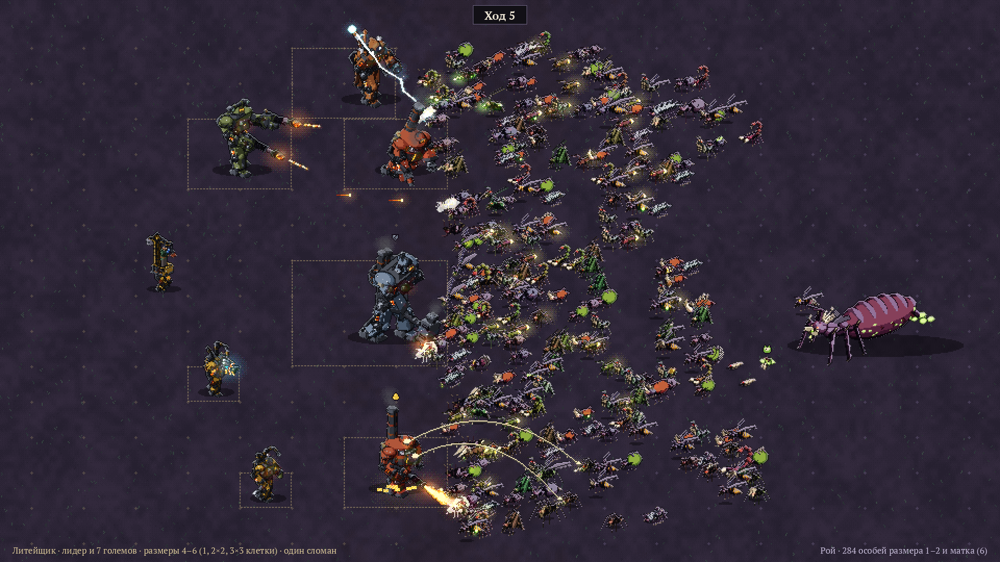
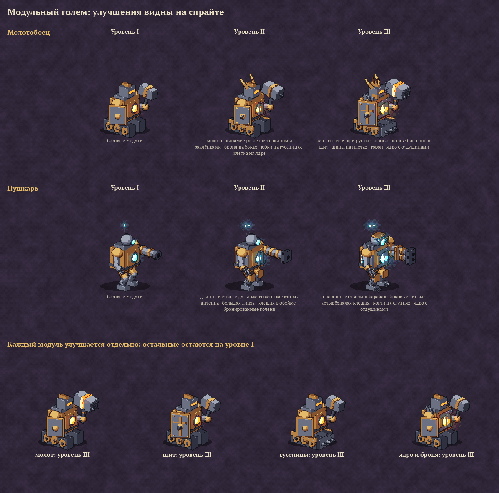
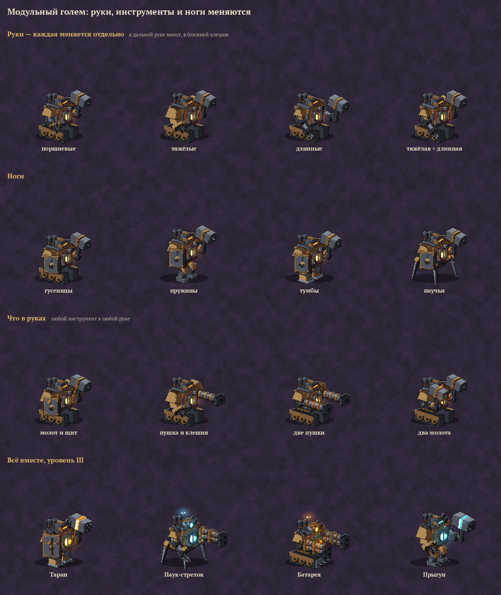
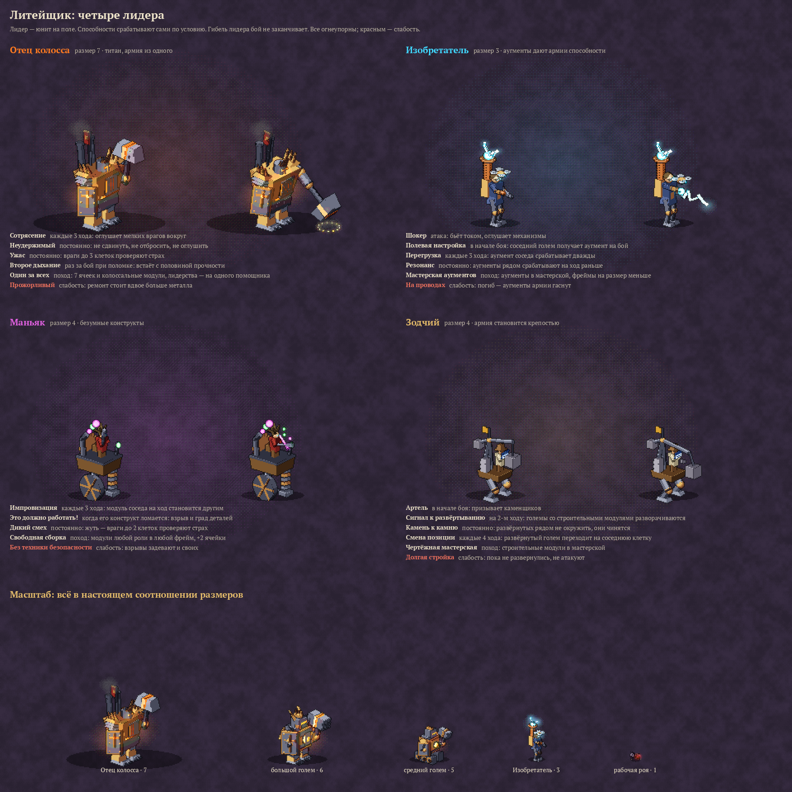
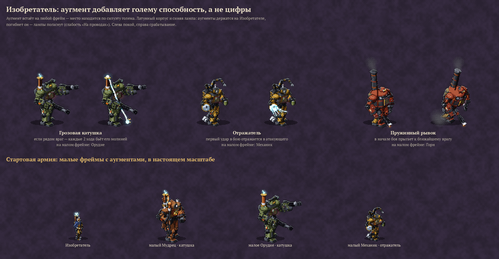
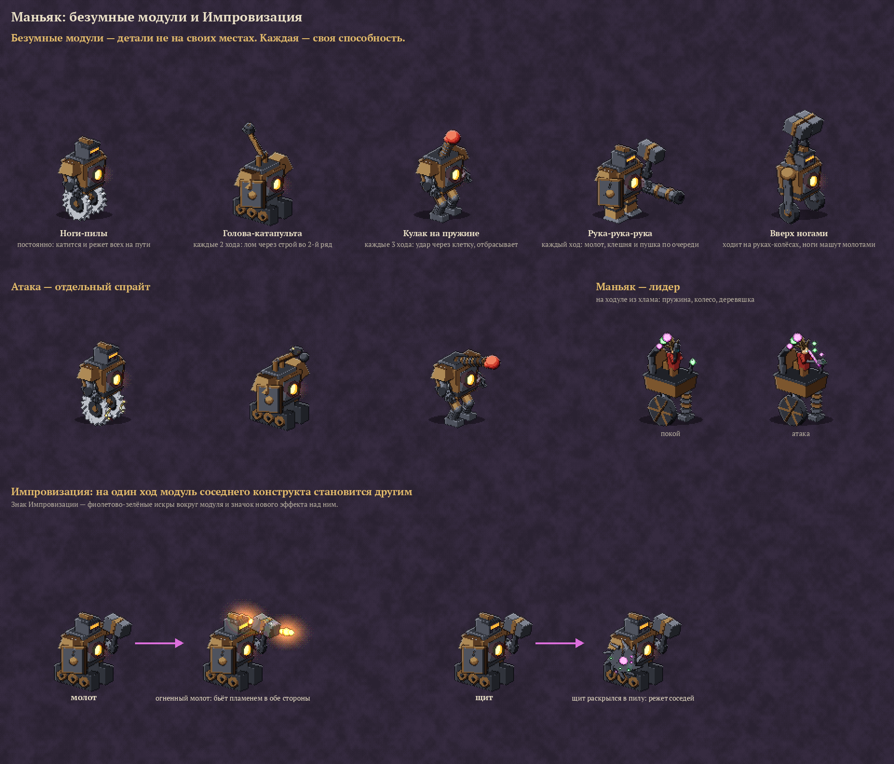
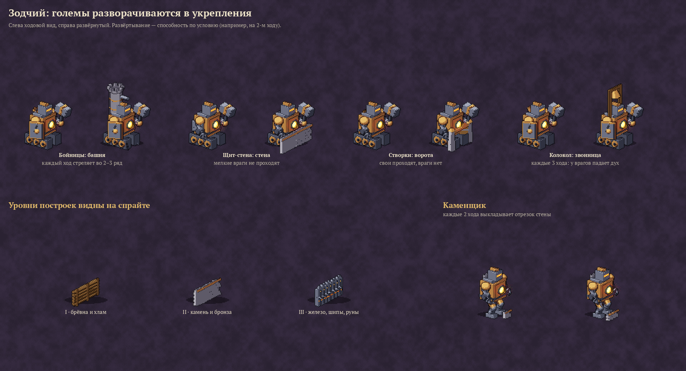
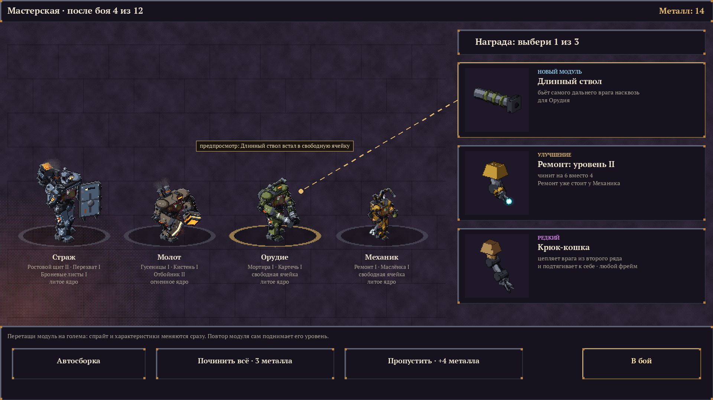
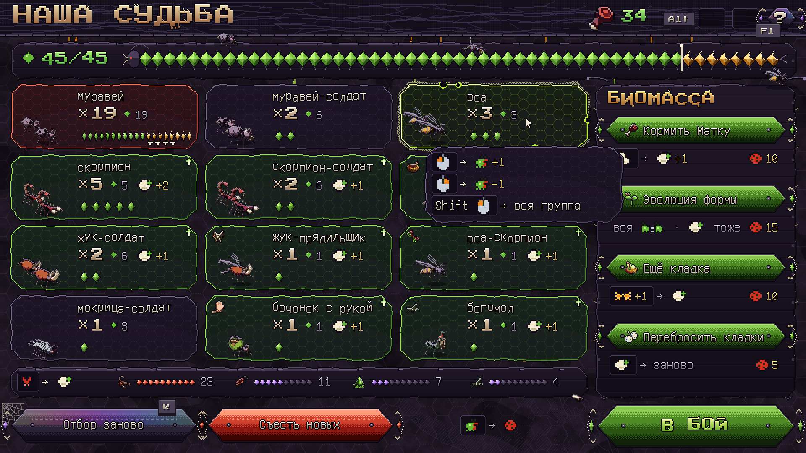
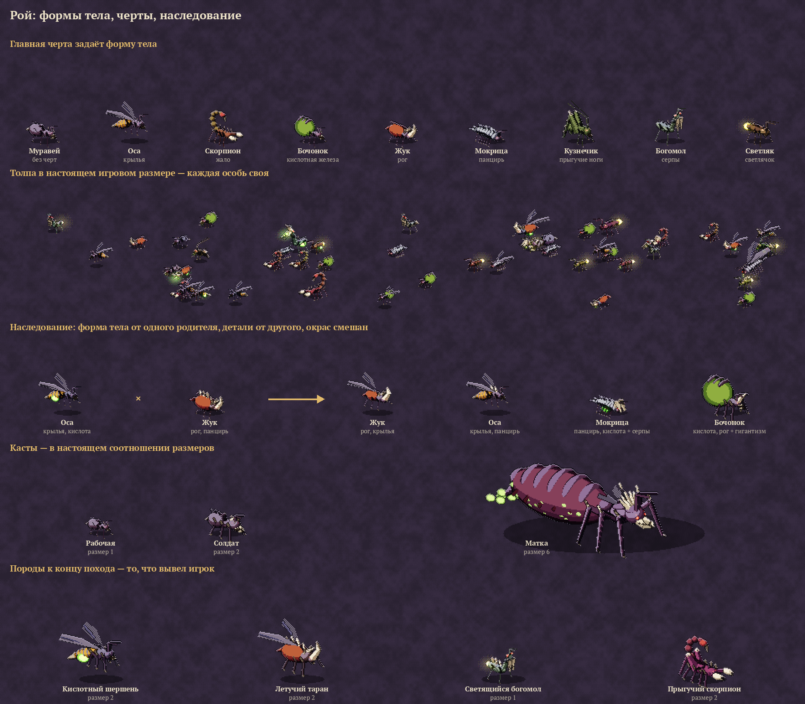

# Концепт игры

Рабочее название — позже, вместе с миром.

## В двух словах

Автобатлер-рогалик для ПК (Steam). Игрок ведёт армию одного из классов через поход из боёв.
Бой идёт сам — игрок в нём ничего не делает. Все решения принимаются **до** боя (кого взять
и куда поставить) и **между** боями (чем усилить армию). Армия — это карты существ с подробным
описанием и особенностями, как в Conquest of Elysium; артефакты — постоянные пассивные бонусы,
как в Slay the Spire, но тактические.

Главное требование: **очень весело, и хочется играть снова и снова**, при этом решения между
боями быстрые и не превращаются в рутину.

## Поход

- Выбор класса и лидера → поход из 12–15 боёв, каждый пятый — с боссом, партия на 20–30 минут.
- Перед каждым боем — выбор из 2–3 противников: видна вся армия врага, её расстановка и награда.
  Это заменяет карту мира.
- Между боями: награды, лагерь, торговец, случайные события с рискованным выбором
  («отдать существо за редкий артефакт»).

## Бой

- **Поле большое**, как в Conquest of Elysium: сетка клеток (в примерах 18×14), у каждой стороны
  своя зона расстановки.
- **Расстановка** — главная тактика: какие существа выйти в бой и в какие клетки.
- **Лидерство**: у лидера есть очки лидерства, у существа — стоимость. В бой идут не все,
  а лучший набор против этого врага. Лидерство растёт по ходу похода.
- **Автобой**: существа действуют сами по своим характеристикам и особенностям.
- **Атака — отдельный спрайт**: существо шагает к цели и меняет спрайт на атакующий.
- **Боевой дух**: отряды не только гибнут, но и бегут. Бой можно выиграть, сломав фланг.
- Победа — вся армия врага разбита или бежала. Гибель лидера бой не заканчивает.
- Противовесы читаются просто: броня против стрел, копья против конницы, летающие через строй,
  магия против брони.

### Ходы

- Бой идёт **раундами**; «ход» в описаниях способностей — это раунд.
- **Фазы раунда**, как в CoE:
  1. Движение: все делают первый шаг, затем второй шаг делают те, у кого скорость 2 и больше,
     затем третий — у кого 3.
  2. Страх: юниты рядом с постоянно пугающими проверяют боевой дух (см. «Удар и числа»).
  3. Удары в порядке **инициативы оружия**: у кого выше, бьёт раньше; при равной — одновременно.
     Инициатива не зависит от скорости: кинжал и жвалы быстрые, тяжёлый молот медленный.
     Способность-атака («каждые N ходов», «в начале боя», «на N-м ходу») срабатывает здесь же,
     с инициативой своего юнита, и в этот раунд заменяет его обычный удар.
  4. Длящиеся эффекты: горение, яд, починка.
  5. Проверка: не кончился ли бой.
- Если способность срабатывает «каждые N ходов», над юнитом идёт обратный отсчёт.
- **Пассивки** действуют всегда. **Способности по событию** (убийство, поломка, ранен ниже
  половины…) срабатывают сразу, как только событие случилось.
- **Оглушение**: юнит пропускает своё следующее действие, над ним значок. По оглушённому каждый
  удар наносит на 1 больше — поэтому оглушение особенно ценно против толпы.
- **Изнеможение**: с 50-го раунда каждый юнит в начале раунда получает урон мимо брони, и он
  растёт: 1, 2, 3… Обычный бой длится 10–15 раундов, это лишь страховка от бесконечных боёв.
- На экране раунд проигрывается почти разом, волнами по скорости, — иначе бой против 150 особей
  роя тянулся бы.

### Огонь

Огонь — тип урона, который живёт на поле своей жизнью. Правила общие для всех, включая врагов:

- **Горение**: урон в начале каждого раунда, 3 раунда. Не складывается — повторный поджог только
  обновляет срок.
- **Горящая клетка**: горит 3 раунда, все в ней горят.
- **Бегущие факелы**: подожжённое мелкое существо (размер 1–2) в панике бежит прочь и поджигает
  всех, мимо кого пробегает.
- **Падающий факел**: подожжённый летун падает и поджигает клетку, на которую рухнул.
- **Местность** видна перед боем: по сухой траве огонь бежит сам, лес горит долго, камень
  не горит, болото тушит.
- **Порох**: бомбардиры, алхимики и пороховые бочки взрываются, если загорятся.
- **Пар**: если огонь тушат водой, поднимается пар, и все внутри облака промахиваются.

### Удар и числа

Баланс примерный, ориентир — Conquest of Elysium 5: классы и юниты несимметричны, некоторые
встречи заведомо тяжёлые, и это нормально — перед боем игрок выбирает противника из 2–3.
Все числа ниже — черновик, их подберут прогоны симуляции.

- **Удар**: урон — разброс плюс прибавка, как в CoE (например, «1–10 +10»). Броня вычитается
  из каждого удара. Если выпал максимум разброса, бросок повторяется и прибавляется — поэтому
  даже мелочь иногда царапает тяжёлую броню.
- **Разброс у большинства узкий**, исход читается заранее. Широкий разброс — только там, где
  непредсказуемость и есть смысл юнита (безумные конструкты Маньяка).
- **Лишний урон пропадает**: удар на 15 по рабочей с 5 здоровья тратит остальное впустую. Поэтому
  против толпы ценны растаптывание и удары по клетке.
- **Сокрушительный удар**: если один удар снёс больше половины полного здоровья цели, цель
  отлетает на клетку (если она не крупнее бьющего), а её соседи проверяют страх 1–7.
  Тяжёлые бойцы делают это часто, мелочь почти никогда.
- **Огонь и горение не замечают броню.** Кислота разъедает броню до конца боя: каждое попадание
  снимает 1 брони.
- **Типы урона**: колющий, рубящий, дробящий, огонь, холод, молния, яд, кислота. У каждого оружия
  и каждой способности, которая ранит, свой тип. Сопротивление режет урон вдвое, уязвимость
  удваивает. Стихийные сопротивления — в процентах (огнеупорность — 75%).
- **Типы брони**: у каждого юнита и каждой постройки свой тип брони — из чего сделана защита.
  Он задаёт, что держит удар, а что его ломает:

  | Тип брони | Кто носит | Держит (урон вдвое меньше) | Слабость (урон вдвое больше) |
  |---|---|---|---|
  | Без брони | ополченцы, звери | — | — |
  | Мягкое тело | «бочонки» роя, личинки | — | колющий |
  | Кожа и стёганка | лёгкая пехота, люди-лидеры Литейщика | дробящий | рубящий |
  | Кольчуга | средняя пехота | рубящий | колющий |
  | Латы | рыцари | рубящий, колющий | дробящий |
  | Литой металл | големы | колющий | кислота снимает 2 брони вместо 1 |
  | Хитин | большинство форм роя | рубящий | дробящий |
  | Тяжёлый хитин | жук-носорог, мокрица | рубящий, колющий | дробящий |
  | Кость | скелеты | колющий | дробящий |
  | Дерево | постройки I уровня, ворота, телеги | колющий | огонь, рубящий |
  | Камень | постройки II уровня, каменные стражи | колющий, рубящий | дробящий |
  | Железо | постройки III уровня | колющий, рубящий | кислота снимает 2 брони вместо 1 |
  | Пламя | огненные духи, саламандры | огонь не действует вовсе | холод |

  **Металл проводит**: латы, кольчуга, литой металл и железо получают от молнии на 50% больше.
  Щит — отдельная защита поверх брони, своего типа у него нет.
- **Порядок расчёта**: бросок → уязвимость ×2 → +1 по оглушённому → минус броня и щит →
  сопротивление ×½ → стихийное сопротивление в процентах. Дроби вниз.
- **Яд копится**: весь урон ядом выходит по 10% за раунд (с округлением вверх), новые отравления
  складываются. Огонь не складывается — стихии ощущаются по-разному.
- **Щиты**: щит снимает 0–1 с каждого удара, большой щит — 0–2, против стрел и снарядов вдвое
  больше.
- **Стрелки**: у оружия своя перезарядка (лук стреляет каждый раунд, тяжёлое — раз в 2–3);
  на дальней половине дистанции урон вдвое меньше; вплотную стрелок бьёт запасным оружием.
- **Стены**: юнит на стене или в башне получает к броне +1, +2 или +3 по уровню постройки
  и стреляет на клетку дальше.
- **Страх** — бросок против боевого духа: выпало больше — юнит бежит к краю поля. Три силы:
  *страх* (вплотную, 1–7), *жуть* (до 2 клеток, 1–8), *ужас* (до 3 клеток, 1–9). Сокрушительный
  удар пугает соседей цели на 1–7. У безмозглых, в том числе големов, боевой дух 99 — их
  не напугать. Свои сбежавшие после победы возвращаются. Всё, что «роняет боевой дух»,
  работает через эти проверки страха, отдельного счётчика нет.
- **Бой длится 10–15 раундов**, на обычной скорости — около 30 секунд, есть ускорение ×2 и ×4.
- **Случайность только в разбросе урона**: промахов нет, кроме тех, что дают способности
  (дым, пар). Бой можно пересмотреть — он воспроизводится по зерну.
- **Проверка баланса грубая**: нет сборки, которая выигрывает всё, и нет фрейма или формы,
  которые никогда не нужны.

Для масштаба:

| Существо | Размер | Здоровье | Удар | Инициатива | Броня | Боевой дух | Скорость |
|---|---|---|---|---|---|---|---|
| Рабочая роя | 1 | 5 | 1–4 колющий | 8 | 0, хитин | 6 | 3 |
| Солдат роя | 2 | 14 | 1–8 рубящий | 6 | 2, хитин | 9 | 2 |
| Воин-человек | 3 | 12 | 1–6 +1 колющий (копьё) | 6 | 2, кольчуга | 10 | 2 |

## Существа

Каждое существо — карта с подробным описанием (видно главное, полное — по наведению):

- здоровье, удар (разброс и прибавка), инициатива оружия, броня, боевой дух, скорость, дальность,
  стоимость лидерства;
- тип атаки (ближняя, дальняя, магическая) и тип урона (колющий, рубящий, дробящий, огонь,
  холод, яд…);
- **размер** (1–7);
- **способности** — столько, сколько нужно по смыслу существа (см. ниже).

Способность по возможности видна на спрайте: по полю понятно, кто есть кто, ещё до чтения карты.

### Способности — общий язык всех юнитов

Игрок во время боя ничего не нажимает, поэтому у всех юнитов — существ роя, големов, лидеров,
врагов — способности **срабатывают сами по понятному условию**. Перед боем видно, что и когда
сработает, и под это расставляется армия.

- **Формат**: условие → цель → эффект. «Каждые 3 хода → соседние враги → бьют только его».
- **Условия**: постоянно; в начале боя; каждые N ходов; на N-м ходу; раз за бой; при событии
  (удар, убийство, получил урон, ранен ниже половины, гибель соседа, поломка, бегство врага…).
- **Цели**: себя, соседей, клетку, ряд, линию, всех своих или всех врагов.
- **Число и вид способностей ничем не ограничены** — только балансом и смыслом существа.
  Скорпион жалит, жук таранит, мокрица держит удар, Зодчий разворачивает стены. Так у каждого
  появляется своё лицо.
- **Призыв**: юнит, которого создаёт способность (каменщики Зодчего, личинки роя). Лидерства не
  стоит, после боя исчезает и в следующем бою призывается заново. В раунд появления не действует.
  Способности, пассивка и слабость у него такие же, как у всех.
- **Пассивки**: у каждого юнита и лидера есть хотя бы одна постоянная способность. Она работает
  в любом бою и сразу говорит, кто это. Часть пассивок общая для класса (у Литейщика —
  огнеупорность).
- **Слабости** — негативные пассивки, они тоже есть у каждого юнита и лидера. Как и сила,
  слабость вытекает из смысла юнита и видна на карте. Это не «−10% ко всему», а понятное правило,
  которым враг может воспользоваться, а игрок — прикрыть расстановкой, модулем или соседом.
- Откуда берутся: у роя — из черт, у големов — из модулей, у лидеров — свой набор, у врагов —
  от вида. Артефакты работают по тому же языку, но всегда постоянно.
- **На поле**: у лидеров и крупных юнитов над головой значки способностей с отсчётом ходов;
  у мелочи значки видны при наведении. В момент срабатывания значок вспыхивает — понятно,
  почему случилось то, что случилось.

### Размер

| Размер | В клетке | Примеры |
|---|---|---|
| 1 | до 4 | рабочая особь роя (с любыми чертами) |
| 2 | до 2 | солдат роя |
| 3–4 | 1 | Механик, лидеры, наёмники Ростовщика |
| 5 | занимает 2×2 | Молот, Горн, Орудие |
| 6 | занимает 3×3 | Страж, матка, боссы |
| 7 | занимает 4×4 | титаны: Отец колосса, боссы-титаны |

Правила размера:

- **Окружение** — крупное существо одновременно атакуют все, кто помещается вокруг него.
- **Растаптывание** — существо, большее цели на 2 и более, бьёт по всей клетке сразу.

### Гибель

Существо может погибнуть один раз: к следующему бою оно живо, но с **увечьем** — одним из короткого
списка, как боевые раны в CoE. Погибло второй раз — пропадает навсегда. Големы Литейщика
не гибнут, а ломаются (см. ниже).

| Увечье | Что даёт |
|---|---|
| Рана | −20% здоровья |
| Рана в грудь | −20% здоровья и −1 к прибавке удара |
| Потерянный глаз | 10% ударов мимо |
| Испуг | −2 боевого духа |

## Классы

У каждого класса: 2–3 лидера на выбор, своя экономика, своё правило, ломающее общее, свой набор
артефактов, своя манера расстановки и свой ритм боя. **Классы должны играться и ощущаться
по-разному.**

Первая версия — **Литейщик и Рой**. Остальные три — позже.

### Литейщик — мало, но каждый голем силён и собран под себя

Мастер, который куёт армию живых машин. Каждый голем — шедевр, собранный игроком, и терять его
жалко. Ощущение — «мало, но каждый на счету».

- Поход начинается с 2 големов, к концу их 5–7. Голем дорогой по лидерству.

#### Айдентика — где сильнее, где слабее

| Сторона | Уровень | Почему |
|---|---|---|
| Прочность | очень сильно | металл и броня |
| Удар | очень сильно | тяжёлые инструменты, растаптывание |
| Бесстрашие | очень сильно | машины не боятся, яд и болезни на них не действуют |
| Огонь | сильно | огнеупорность и огненные модули |
| Дальний бой | средне | артиллерия: мощно, но медленно |
| Скорость | слабо | ходят последними |
| Подвижность | очень слабо | роли «прорыв» нет вовсе |
| Числа | очень слабо | их легко окружить |

- Способности — механика и физика: удар, давка, отбрасывание, пар, огонь, магнит, отдача.
  Никакой магии.
- Слабости не закрываются полностью. Подвижность дают только редкие модули и лидеры, и за неё
  приходится платить. Ответ на быстрых врагов — не догнать, а притянуть или сбить: Магнит,
  Картечь, Орудие.
- **Огнеупорность** — пассивка всего класса, включая лидеров (големы из металла, люди кузни
  в огнеупорных фартуках): огонь наносит на 75% меньше урона, горение гаснет через раунд.
  Правило одно для своего и чужого огня: големы стоят в пожаре, а враги рядом горят.
- **Литой металл** — тип брони всех големов, включая Каменщика и Отца колосса: колющий урон вдвое
  меньше (стрелы и жала отскакивают), дробящий бьёт в полную силу, кислота разъедает вдвое
  быстрее. Яд на големов не действует, страх тоже (боевой дух 99).
- **Проводник** — слабость всех големов: как вся металлическая броня, литой металл получает
  от молнии на 50% больше. Огнеупорность и проводник — две стороны металла.
- Люди-лидеры (Изобретатель, Маньяк, Зодчий) носят **кожу и стёганку**: держат дробящий,
  уязвимы к рубящему.

#### Фреймы и модули

- **Фрейм** — корпус под роль. Он задаёт силуэт, размер, число ячеек и свою пассивку. Роль видна
  по силуэту издалека.
- **Модуль** — способность. Стоит в ячейке, виден на спрайте, имеет уровни I–III. На III уровне
  модуль получает новую грань способности, а не только большие цифры.
- **Пул**: у каждого фрейма 6 модулей своей роли, плюс ядро и редкие модули. В мастерской
  выпадают только модули для фреймов, которые есть в армии.
- **Руки, ноги и голова** — не отдельный выбор: их вид задают модули (Гусеницы и Паучьи лапы —
  ноги, Кистень — рука), голова показывает уровень голема. Спрайт собирается сам.
- Ролей пять, а големов от 2 до 5–7: закрыть всё нельзя, выбор ролей — главное решение похода.
  Можно взять два одинаковых фрейма с разными сборками.

| Фрейм | Роль | Размер | Клетки | Ячейки | Пассивка |
|---|---|---|---|---|---|
| Страж | танк | 6 | 3×3 | 5 | **Заслон**: соседние враги бьют сначала его |
| Молот | разрушитель | 5 | 2×2 | 4 | **Пробивной**: удары не замечают половину брони цели |
| Горн | контроль | 5 | 2×2 | 4 | **Жар горна**: каждый раунд поджигает одного соседнего врага; единственный фрейм с огнём в образе |
| Орудие | стрелок | 5 | 2×2 | 4 | **Наводка**: стреляет во 2–3 ряд и не теряет урон на дальней половине дистанции |
| Механик | поддержка | 4 | 1 | 3 | **Наладка**: соседние големы в начале каждого раунда чинятся на 1 |

У всех фреймов есть ещё огнеупорность и проводник. И у каждого своя слабость:

| Фрейм | Слабость | Как прикрыть |
|---|---|---|
| Страж | **Открытая спина**: удары сзади двойные | спиной к краю поля или к своим |
| Молот | **Без тормозов**: после убийства шагает на место жертвы, даже если там окружат | Страж рядом, Магнит стягивает врагов к своим |
| Горн | **Гаснет**: вода и холод гасят топку — Жар горна и огненные модули молчат 2 раунда | брать его против тех, кто не тушит |
| Орудие | **Слепая зона**: по соседним клеткам не стреляет, бьёт прикладом вполсилы | Картечь, Страж впереди |
| Механик | **Не боец**: сам не атакует | второй ряд, Перехват Стража |

Огненные модули помечены *(огонь)*: в каждом пуле их не больше двух из шести.

**Страж** — сборки «Стена» (бережёт своих) и «Наковальня» (наказывает тех, кто бьёт).

| Модуль | Способность |
|---|---|
| Ростовой щит | снаряды, летящие в своих за его спиной, попадают в щит |
| Перехват | когда бьют соседнего голема, принимает удар на себя (раз за раунд) |
| Якорь | в начале боя врастает в землю: его не сдвинуть, враги не проходят по соседним клеткам — держит фронт в 3 клетки; сам он больше не двигается |
| Броневые листы | первые 3 удара в бою сбивают по листу вместо урона; листы отлетают прямо на спрайте |
| Контрудар | в каждом раунде на первый удар вплотную отвечает своим |
| Раскалённая броня *(огонь)* | кто бьёт его вплотную, загорается |

**Молот**

| Модуль | Способность |
|---|---|
| Таранный нос | в начале боя разгоняется по прямой и давит мелочь, первый удар двойной. III: **Клин** — врагов на пути разгона отбрасывает в стороны |
| Гусеницы | проезжает сквозь клетки с врагами меньше себя на 2 размера и давит каждого; крупный враг его останавливает |
| Кистень | бьёт сразу 2 клетки |
| Отбойник | отбрасывает врага; если сзади стена или другой враг — урон двойной |
| Искрящий молот *(огонь)* | удар по бронированному врагу высекает искры, соседние клетки загораются |
| Кочерга *(огонь)* | отбрасывает врага в ближайшую горящую клетку, и тот вспыхивает |

**Горн**

| Модуль | Способность |
|---|---|
| Магнит | каждые 3 хода стягивает к себе врагов в радиусе 3, летунов сдёргивает на землю. III: **Отталкивание** — когда окружён, отбрасывает всех соседей |
| Громоотвод | вражеские молнии и снаряды летят в него |
| Дымовая труба | соседние клетки в дыму: стрелки по ним и из них промахиваются |
| Паровой свисток | каждые 4 хода пугает врагов в радиусе 2: страх 1–7 |
| Пасть топки *(огонь)* | каждые 2 хода выдыхает огонь на 2 клетки вперёд |
| Жадная топка *(огонь)* | вражеские огненные снаряды в радиусе 2 летят в топку; проглотив третий, выплёвывает огненный шар |

**Орудие**

| Модуль | Способность |
|---|---|
| Мортира | каждые 3 хода вместо выстрела — навесной залп по клетке и соседним (дробящий 1–6 +7); отдача откатывает назад |
| Длинный ствол | бьёт самого дальнего врага насквозь |
| Паучьи лапы | переступает через мелких; если враг подошёл вплотную — отходит |
| Картечь | по врагу вплотную стреляет конусом в упор; летунов сбивает на землю |
| Калёное ядро *(огонь)* | после попадания ядро катится дальше по прямой и оставляет горящую дорожку |
| Бомба с фитилём *(огонь)* | каждые 3 хода: бомба лежит 2 раунда (фитиль шипит), потом взрывается огнём по клетке и соседним |

**Механик**

| Модуль | Способность |
|---|---|
| Ремонт | каждые 2 хода чинит самого повреждённого голема рядом на 4 |
| Кран | раз за бой поднимает сломанного соседа с четвертью прочности |
| Запасные части | если соседний голем сломался, его модуль не теряет уровень |
| Маслёнка | каждые 2 хода смазывает соседнего голема — тот ходит первым в раунде |
| Сварка *(огонь)* | чинит соседнего голема, искры обжигают врагов рядом с ним |
| Масляный бак *(огонь)* | обливает ближайшего врага маслом: от любого огня он горит вдвое сильнее |

**Ядро** — часть тела, есть у каждого голема и меняется. Оно задаёт стихию обычных ударов:

| Ядро | Обычные удары |
|---|---|
| Литое | без стихии, но голем прочнее |
| Огненное | поджигают цель |
| Грозовое | бьют цепной молнией и оглушают механизмы |

Новое ядро выпадает в мастерской как обычное предложение и заменяет старое; в лагере ядра можно
переставлять между големами.

- **Уровни I–III видны на спрайте**: молот обрастает шипами и руной, щит становится башенным,
  на гусеницах появляются юбки и таран, на голове — рога и корона шипов, ядро — в решётке
  и с отдушинами.

#### Числа — черновик

Подобраны по мерке из [BALANCE.md](BALANCE.md): **1 очко лидерства ≈ 1 эталонный боец**, и фрейм
сильнее эталона ровно настолько, сколько стоит. Здоровье — у верхней границы шкалы своего
размера: големы — элита, но не вдвое сильнее её. Отец колосса на старте равен обычной стартовой
армии и растёт модулями.

| Юнит | Размер | Прочность | Удар | Инициатива | Броня | Скорость | Лидерство |
|---|---|---|---|---|---|---|---|
| Страж | 6 | 100 | 1–6 +3 дробящий | 3 | 4 | 1 | 7 |
| Молот | 5 | 60 | 1–8 +3 дробящий | 2 | 3 | 1 | 5 |
| Горн | 5 | 50 | 1–6 +1 дробящий | 3 | 2 | 1 | 5 |
| Орудие | 5 | 55 | 1–10 +3 дробящий, дальность 3 | 4 | 2 | 1 | 5 |
| Механик | 4 | 35 | — | — | 2 | 2 | 3 |
| Каменщик | 2 | 14 | 1–4 дробящий | 4 | 2 | 2 | призыв |
| Отец колосса | 7 | 160 | 1–8 +2 дробящий | 1 | 3 | 1 | лидер |
| Изобретатель | 3 | 20 | 1–6 молния | 7 | 1 | 2 | лидер |
| Маньяк | 4 | 30 | 1–8 +2 рубящий | 5 | 1 | 2 | лидер |
| Зодчий | 4 | 25 | 1–4 +1 дробящий, дальность 2 | 5 | 1 | 1 | лидер |

Големы бьют поздно (инициатива 1–4), зато сильно: мелочь роя с инициативой 8 успевает ударить
первой. Орудие стреляет каждый раунд, кирпичи Зодчего летят каждый раунд. Боевой дух: у големов
99, у Изобретателя 10, у Маньяка 12 (безумцу почти не страшно), у Зодчего 9.

**Типы урона модулей.** Литейщик в основном дробит и жжёт, колющего мало, рубящего нет вовсе
(его даёт только Маньяк). Поэтому латы, хитин и камень ему по зубам, а кожа и стёганка держат его
удары лучше всего.

| Тип | Модули и способности |
|---|---|
| Дробящий | Контрудар, Гусеницы, Кистень, Отбойник, Искрящий молот, Кочерга, Мортира, Калёное ядро, Скачущее ядро, Колёса-жернова, Пресс, Сотрясение |
| Колющий | Таранный нос (клин), Длинный ствол (бронебойный), Картечь, Крюк-кошка, Бойницы |
| Огонь | Жар горна, Раскалённая броня, Пасть топки, Жадная топка, Бомба с фитилём, Сварка, Живой факел, Сопла, Огненный смерч, Котёл-бомба, Смоляной котёл; поджог у Искрящего молота, Кочерги, Калёного и Скачущего ядра, огненного ядра |
| Молния | грозовое ядро, Грозовая катушка, Шокер |

- Масляный бак делает облитого врага уязвимым к огню (урон огнём вдвое больше).
- Ростовой щит считается большим щитом: 0–2 с каждого удара, против снарядов 0–4.
- Броневые листы — тот же литой металл.

- **Броня решает**: укус рабочей (1–4, колющий) ранит Стража (броня 4, литой металл держит
  колющий) примерно раз из пяти, Молота (броня 3) — раз из четырёх. Поэтому Страж держит
  толпу, а рою против Литейщика нужны кислота, солдаты (рубящий металл не держит) и жуки-носороги
  (дробящий). Молоту место рядом со Стражем.
- **Горение**: 3 урона в раунд, 3 раунда. Рабочую убивает за 2 раунда, солдату не хватает,
  Стражу почти не вредит. С огнеупорностью — 1 в раунд.
- **Молния** грозового ядра перескакивает ещё на 2 соседних врагов с половиной урона;
  проводник получает от молнии в полтора раза больше.
- **Уровни модулей**: I — база, II — в полтора раза сильнее, III — вдвое и новая грань
  (Мортира: 10 / 15 / 20). Если модуль измеряется не уроном, растёт количество (Броневые листы:
  3 / 4 / 5).
- **Лидерство**: в начале похода 10 (Страж и Механик или два средних фрейма), +1 за бой,
  +3 за босса — к концу около 28, это 5–7 големов.
- **Металл**: 10 за бой, 20 за элиту, 30 за босса, «Пропустить» в мастерской — 8. Ремонт
  сломанного — 3 × лидерство (Механик 9, Страж 21, у Отца колосса вдвое дороже). Новый голем —
  5 × лидерство (15–35). Переплавка — 10. Голем, который не сломался, чинится между боями сам.

#### Сборки — огонь лишь одна из пяти

| Сборка | На чём держится | Сильна против |
|---|---|---|
| Давка | Таранный нос, Гусеницы, Отбойник, Магнит | строя и толпы |
| Крепость | Якорь, Перехват, Ростовой щит, Ремонт, Кран | затяжного боя и элиты |
| Артиллерия | Мортира, Длинный ствол, Картечь за спинами Стражей | медленных врагов и летунов |
| Огонь | Жар горна, Пасть топки, Калёное ядро, Масляный бак | роя и толпы |
| Гроза | грозовые ядра, Громоотвод | брони и механизмов |

Враги в походе меняются, поэтому одной сборкой его не пройти: обычно армия смешивает две.
Чтобы огонь не стал единственной сборкой:

1. В каждом пуле не больше двух огненных модулей из шести.
2. Горение не складывается: десять источников огня по одной цели дают столько же, сколько один.
3. Урон горения фиксированный: против толпы огонь силён, против боссов и титанов слаб.
4. Огнеупорные враги — саламандры, огненные духи, вражеские големы. В каждом походе хотя бы один
   босс огнеупорен.
5. Местность: камень не горит, болото тушит.

#### Металл, новые големы, поломка

- **Металл** — валюта Литейщика. Откуда: награда за бой, разбор трофеев с побеждённых механизмов,
  «Пропустить» в мастерской. Куда: ремонт, новый голем, переплавка (разобрать модуль ради
  уровня другому).
- **Новые големы**: «новый голем» иногда выпадает среди трёх предложений мастерской — выбор
  1 из 2 фреймов, то есть «какой роли армии не хватает». Стоит металла и лидерства; Страж
  занимает почти весь лимит.
- **Поломка вместо смерти**: сломанный голем выбывает до ремонта, а один случайный модуль теряет
  уровень. Не починил — голем пропускает бои. Это правило заменяет общее «погибает один раз».
  На поле видно: ядро гаснет, голем оседает, оторванная деталь лежит рядом.

#### Старт похода

Каждый голем начинает с модулями I уровня и литым ядром, металла — 20. Четыре старта — четыре
разных первых боя: один титан, три малых голема с аугментами, два безумных гибрида, крепость.

| Лидер | Лидерство | Армия | Модули |
|---|---|---|---|
| Отец колосса | 3 весь поход | сам и Механик | Колосс: Броневые листы, Кистень, Магнит; Механик: Ремонт |
| Изобретатель | 10 | малые Молот (4), Орудие (4) и Механик (2) | Молот: Гусеницы и аугмент Пружинный рывок; Орудие: Мортира и Грозовая катушка; Механик: Ремонт и Отражатель |
| Маньяк | 10 | Молот (5) и Орудие (5) | Молот: Ноги-пилы и Отбойник; Орудие: Голова-катапульта и Картечь |
| Зодчий | 10 | Страж (7), Механик (3) и 2 каменщика | Страж: Щит-стена и Перехват; Механик: Ремонт |

- **Малые фреймы Изобретателя** — на размер меньше: на 1 ячейку меньше, прочность ×0,7, прибавка
  удара −2, лидерство на 1 дешевле.
- **Отец колосса**: лидерство не растёт, развитие идёт в ячейки и модули.

#### Редкие модули — меняют поведение, а не цифры

Выпадают нечасто и ставятся в любой фрейм, кроме отмеченных. Самые сильные несут свой минус.

| Модуль | Что делает |
|---|---|
| Живой факел *(огонь)* | в начале боя голем поджигает сам себя и горит весь бой (огнеупорность бережёт): всё, чего он касается, загорается, мелкие враги обходят его клетку. Пока горит, его нельзя чинить |
| Сопла *(огонь)* | раз за бой огненный рывок на 4 клетки вперёд, клетки позади горят; после рывка голем ход стоит |
| Скачущее ядро *(огонь, Орудие)* | ядро отскакивает от врага к врагу 3 раза и поджигает каждого |
| Огненный смерч *(огонь)* | раз за бой, когда рядом горят 3 клетки и больше, они сливаются в смерч, который 3 раунда бродит в сторону врага |
| Крюк-кошка | цепляет врага из второго ряда и подтягивает к себе |
| Колёса-жернова | голем катится по прямой и давит всё на пути, но не может остановиться до препятствия |
| Щит-купол | накрывает соседние клетки от стрел |
| Котёл-бомба (ядро) | при поломке взрывается и отбрасывает всех вокруг |

#### Лидеры

Лидер — такой же юнит на поле со своей ролью и **набором способностей**: способности в бою
срабатывают сами по условию, плюс одно **правило похода**. Четыре лидера — четыре разных способа
играть Литейщиком.

- **Пассивки**: у каждого лидера огнеупорность класса, своя пассивка («постоянно» в таблице)
  и своя слабость.
- **Гибель лидера бой не заканчивает**: его способности отключаются до конца боя, к следующему
  бою он возвращается.
- **Развитие**: после каждого босса — выбор 1 из 2: усилить одну из способностей или получить
  новую.

| Лидер | Где сила |
|---|---|
| Отец колосса | в самом лидере: один сверхголем |
| Изобретатель | в способностях, которые он добавляет армии |
| Маньяк | в безумных конструктах, собранных против правил |
| Зодчий | в армии, которая разворачивается в укрепления |

##### Отец колосса — армия из одного

Сам лидер — титан размера 7 (4×4 клетки): почти вдвое выше большого голема, со своей фигурой —
топка в груди, шипастые наплечники, две трубы и знамя за спиной, башенный щит и молот-наковальня.
Лидерства у него почти нет (хватает на одного малого помощника), поэтому он почти всегда один —
и всё, что даёт мастерская, идёт ему.

| Способность | Когда | Что делает |
|---|---|---|
| Сотрясение | каждые 3 хода | бьёт по земле (дробящий), оглушает всех мелких врагов вокруг |
| Неудержимый | постоянно | его нельзя сдвинуть, отбросить или оглушить |
| Ужас | постоянно | враги до 3 клеток каждый раунд проверяют страх 1–9 |
| Прожорливый | слабость | ремонт стоит вдвое больше металла — а чинить приходится только его |
| Второе дыхание | раз за бой, при поломке | встаёт с половиной прочности |
| Один за всех | правило похода | свой фрейм Колосс: 7 ячеек, модули из пула любого фрейма и **колоссальные модули**, которые не встают ни на кого другого: плечевая батарея, реактор с трубами |

Развитие: +1 ячейка или новый колоссальный модуль.

##### Изобретатель — аугменты дают армии способности

Аугментированный человек (размер 3) с механическими ногами и рукой, катушкой за спиной и шокером.
Его армия — много малых големов, на которых он вешает **аугменты**. Аугмент даёт не прибавку
к цифрам, а новую способность:

| Аугмент | Способность |
|---|---|
| Грозовая катушка | если рядом враг — каждые 2 хода бьёт его молнией |
| Отражатель | первый удар в бою отражается в атакующего тем же типом урона |
| Пружинный рывок | в начале боя прыгает к ближайшему врагу |

| Способность | Когда | Что делает |
|---|---|---|
| Шокер | атака | бьёт током, оглушает механизмы |
| Полевая настройка | в начале боя | соседний голем получает случайный аугмент на этот бой |
| Перегрузка | каждые 3 хода | аугмент соседа срабатывает сразу дважды |
| Резонанс | постоянно | аугменты големов в радиусе 2 срабатывают на ход раньше |
| На проводах | слабость | если он погиб, все аугменты армии гаснут до конца боя |
| Мастерская аугментов | правило похода | аугменты в мастерской; фреймы отливаются на размер меньше — ячеек меньше, но лидерство дешевле, поэтому големов больше; у каждого фрейма ячейка аугмента |

Развитие: новый вид аугментов или +1 аугмент на голема.

##### Маньяк — безумные конструкты

Безумец на тележке из хлама (размер 4). Игнорирует правила сборки: детали ставятся не на свои
места, каждая «незаконная» деталь даёт причуду — полезную или опасную.

| Безумный модуль | Способность |
|---|---|
| Ноги-пилы | постоянно: катится и режет всех на пути |
| Голова-катапульта | каждые 2 хода: бросает лом через строй во второй ряд |
| Кулак на пружине | каждые 3 хода: удар через клетку, отбрасывает |
| Рука-рука-рука | каждый ход: молот, клешня и пушка по очереди |
| Вверх ногами | ходит на руках-колёсах, ноги машут молотами |
| Пылающая катапульта | каждые 3 хода: швыряет горящего врага обратно в его же строй |
| Салют | при поломке: фейерверк по 5 случайным клеткам (огонь), враги в них проверяют страх 1–7 |

Типы урона: Ноги-пилы — рубящий; Голова-катапульта, Кулак на пружине и Вверх ногами — дробящий;
Рука-рука-рука бьёт по очереди дробящим, рубящим и колющим; Пылающая катапульта — дробящий
и огонь; Салют — огонь; град деталей «Это должно работать!» — колющий. Импровизация меняет и тип:
молот, изрыгающий пламя, бьёт огнём.

| Способность | Когда | Что делает |
|---|---|---|
| Импровизация | каждые 3 хода | модуль соседнего конструкта на ход становится другим (молот изрыгает пламя, щит раскрывается в пилу); знак — фиолетово-зелёные искры и значок нового эффекта |
| Это должно работать! | когда его конструкт ломается | тот разлетается взрывом и осыпает врагов деталями |
| Дикий смех | постоянно | жуть: враги до 2 клеток каждый раунд проверяют страх 1–8 |
| Без техники безопасности | слабость | взрывы его конструктов задевают и своих |
| Свободная сборка | правило похода | модули любой роли в любой фрейм (Молот с Пастью топки, Страж с Мортирой), +2 ячейки, в мастерской появляются безумные модули |

Развитие: новый безумный модуль или причуды чаще полезны.

##### Зодчий — армия становится крепостью

Архитектор на шагающем кране (размер 4), сам слаб — бросает кирпичи. Его сила в армии:
у големов два режима, **ходовой и развёрнутый**. Развёртывание — способность по условию
(«на 2-м ходу», «когда враг ближе 3 клеток»…); развёрнутый голем неподвижен, но становится
постройкой. Строительные модули встают в пулы фреймов по роли.

| Строительный модуль | Фрейм | Развёрнутый вид | Что делает |
|---|---|---|---|
| Бойницы | Орудие | башня | каждый ход стреляет во 2–3 ряд |
| Щит-стена | Страж | стена на 3 клетки | мелкие враги не проходят, крупные проламывают |
| Створки | Страж | ворота | свои проходят, враги нет |
| Смоляной котёл | Горн | котёл над топкой | каждые 3 хода льёт кипящую смолу на клетки перед собой: враги в них вязнут и ходят на клетку меньше; смола загорается от огня |
| Пресс | Молот | вкапывается | первый враг рядом расплющен |
| Подъёмная стрела | Механик | подъёмный кран | раз в 3 хода переставляет соседнего голема |
| Полевая кузня | Механик | ремонтная кузница | раз в 2 хода чинит голема рядом |

Уровни построек видны на спрайте: I — брёвна и хлам, II — камень и бронза, III — железо, шипы,
руны. Тип брони постройки — по уровню: дерево (горит и рубится), камень, железо.

**Каменщик** — призыв Зодчего: малый голем размера 2 (двое в клетке). Как все големы,
огнеупорен и проводник.

| Способность | Когда | Что делает |
|---|---|---|
| Свой на стройке | постоянно | проходит сквозь свои стены и развёрнутых големов |
| Кладка | каждые 2 хода | кладёт отрезок стены I уровня на соседнюю клетку со стороны врага |
| Заделать пролом | когда рядом разрушена своя стена | за ход восстанавливает её |
| Без хозяина | слабость | если Зодчий погиб, каменщики бросают работу и только стоят |

| Способность | Когда | Что делает |
|---|---|---|
| Артель | в начале боя | призывает каменщиков: 2, и ещё по одному за каждого побеждённого босса (до 5) |
| Сигнал к развёртыванию | на 2-м ходу | големы со строительными модулями разворачиваются разом |
| Камень к камню | постоянно | развёрнутых големов рядом не окружить, они понемногу чинятся |
| Долгая стройка | слабость | пока не развернулись, строительные големы не атакуют |
| Смена позиции | каждые 4 хода | развёрнутый голем сворачивается, шагает и разворачивается снова |
| Чертёжная мастерская | правило похода | строительные модули в мастерской |

Развитие: развёртывание на ход раньше, +1 способность развёрнутым, или **Цитадель** — большой
голем, который разворачивается в крепость, где могут стоять другие големы.

Как играется: сильна против роя (стены режут толпу на коридоры), слабее против гигантов
(проламывают стены) и летающих (перелетают), простаивает, если враг обходит укрепления.

Другие идеи лидеров на потом: Кукловод (големы на нитях), Металлург (материалы), Маршал (строй).

- **Слабости**: медленные, их окружают, подвижной роли нет, каждая потеря — заметная доля армии,
  у врагов есть ответы (кислота разъедает броню, молнии и магниты бьют по механизмам,
  огнеупорные враги не боятся огня).

#### Мастерская — 15–30 секунд между боями

1. После боя — **выбор 1 из 3** модулей.
2. Модуль сам встаёт на подходящего голема (изменение сразу видно на спрайте); можно перетащить
   на другого.
3. «В бой».

- **Повтор = улучшение**: взял модуль, который уже стоит, — он поднимается на уровень. Без крафта.
- Кнопки «Автосборка», «Починить всё», «Пропустить» (даёт металл).
- Полная пересборка — только в лагере.
- Против монотонности: виды предложений (новый модуль, улучшение, редкий, новый голем,
  переплавка, трофей с побеждённого механизма); редкие модули меняют поведение, а не цифры
  (живой факел, сопла, крюк-кошка); ячеек мало — приходится выбирать.

### Рой — масса и селекция

Противоположность Литейщика: много дешёвых существ, отдельная особь ничего не стоит, сила —
в числе, окружении и в породе, которую игрок выводит за поход.

- **Касты**: рабочая (размер 1), солдат (размер 2, большая голова и жвалы), матка (размер 6,
  лидер). Начало похода — 20–30 особей, к концу — 150 и больше.
- **Черты** — каждая видна на теле и меняет поведение в бою. **Первая (главная) черта задаёт
  форму тела**, остальные добавляются деталями — поэтому даже мелкие особи легко различимы:

  | Черта | Форма тела, если главная | Как деталь | В бою |
  |---|---|---|---|
  | — | муравей | — | — |
  | Крылья | оса: тонкая талия, полосатое брюшко | крылья | летит через строй |
  | Жало | скорпион: хвост дугой, клешни | жало на брюшке | яд |
  | Кислотная железа | «бочонок»: огромное светящееся брюшко | светящийся мешок | плевок кислотой, разъедает броню |
  | Рог | жук-носорог: надкрылья куполом | рог на голове | таран, отбрасывает |
  | Панцирь | мокрица: сегменты-пластины | шипы на спине | защита, урон тем, кто бьёт |
  | Прыгучие ноги | кузнечик: длинное тело | мощные задние ноги | прыжок в тыл |
  | Серпы | богомол: вертикальная грудь | передние лапы-серпы | быстрые рубящие удары |
  | Светлячок | светляк: щиток и фонарь | фонарь на брюшке | ослепляет врагов, освещает соседей |

  Типы урона: укус рабочей — колющий, жвалы солдата и Серпы — рубящий, Жало — колющий с ядом,
  Кислотная железа — кислота, Рог — дробящий, шипы Панциря — колющий. Тип брони — по форме тела:
  хитин у большинства, тяжёлый хитин у жука-носорога и мокрицы, мягкое тело у «бочонка».

  Окрас и пропорции (брюшко, голова, длина ног) тоже наследуются, поэтому в толпе нет двух
  одинаковых особей.

- **Размножение**: соседи по полю, пережившие бой, откладывают яйца. Потомок берёт по черте
  от каждого родителя (форму тела — от одного из них), окрас смешивается. Расстановка решает
  две задачи: как выиграть бой и кого с кем скрестить.
- **Мутации** иногда дают черту, которой не было у родителей. Среди них **гигантизм**: +1
  к размеру — рабочая становится крупной тварью.
- **Матка** — лидер: её размер задаёт предел численности. Гибель матки обрушивает боевой дух роя.
- К концу похода — своя порода, которой ни у кого не было («Кислотный шершень», «Летучий
  таран»…).

#### Уникальные механики роя

Рой — живой организм: растёт, пожирает, приспосабливается. Литейщик собирает каждого голема
вручную, рой управляется целыми формами и поколениями.

- **Пожирание и биомасса.** Убив врага, особь съедает труп: лечится и даёт биомассу. Биомасса —
  единая валюта роя: кормить матку (растёт предел численности), лишнее яйцо в выводке,
  эволюция формы.
- **Эволюция формы.** Улучшение сразу для всех особей одной формы («Осы: жало пробивает
  броню»). Одно решение действует на десятки особей — никакого поштучного микроменеджмента.
- **Естественный отбор.** Черты, которые чаще убивали в бою, чаще наследуются; статистика
  видна на экране выводка.
- Позже — как редкие черты, способность матки и артефакт роя:
  - *Яйцеклад* (паразиты): заражённый враг гибнет, из него вылупляются личинки роя;
    на механизмы вроде големов не действует.
  - *Роющие лапы* (подкоп): начинают бой под землёй и выныривают в тылу на 2–3-м ходу.
  - *Тревога* (матка): гибель особи злит соседей, +атака до конца боя.
  - *Феромонный след* (артефакт): где строй прорван, остальные идут туда быстрее.

#### Выводок — 15–30 секунд между боями

1. Матка показывает до трёх потомков от соседей, переживших бой: форма, черты, окрас, размер.
2. Игрок выбирает, кого вывести; остальных съедает матка. За биомассу можно получить ещё
   одно яйцо.
3. По желанию — одна эволюция формы или кормление матки.
4. «В бой». Есть «Автовыбор» и «Пропустить» (даёт биомассу).

- **Слабости**: отдельная особь хрупкая, растаптывание и удары по площади выкашивают толпу,
  без матки рой разбегается.

### Позже

- **Ростовщик** — контракты наёмников (срок, условие), ставки на исход боя, долг: при неуплате
  наёмники переходят к врагу посреди боя.
- **Садовница** — растения растут от боя к бою (семя → росток → куст → древо), времена года
  меняются каждые 3 боя, корни захватывают поле.
- **Ловец душ** — выбор боя как выбор добычи, сосуды для душ, призыв призрачных копий врагов,
  слияние душ.

## Артефакты

- **Всегда пассивные**, без кнопок.
- Проверка для каждого: срабатывает почти в каждом бою **и** меняет хотя бы одно решение игрока.
- Примеры: *Знамя двух ветров* (центр +2 атаки, фланги +2 защиты), *Сапоги преследователя*
  (убийца шагает на клетку жертвы), *Кровавая чаша* (убийство лечит соседей), *Вербовочный
  барабан* (сбежавший враг может перейти к вам), *Тяжёлая наковальня* (+50% урона, ход последним),
  *Колокол тревоги* (гибель союзника усиливает остальных).
- ~85–90% артефактов — широкие; ~10–15% — редкие, меняющие правила. Если артефакт что-то
  отнимает, он обязательно даёт новую игрушку: *Туманный фонарь* (стрелки бьют только по соседнему
  ряду → засады с двойным уроном), *Зеркало одиночества* (без строя → вызов на поединок),
  *Цепь каторжника* (передний ряд не отступает → убийца утаскивается в ваш строй),
  *Песочные часы* (два хода без атак → накопление силы).
- **Артефакты, меняющие сам удар**, задают стиль армии: *Гранёные кости* (разброс −2,
  прибавка +2 — армия надёжнее), *Шальная искра* (разброс вдвое шире, прибавка 0 — лотерея
  против тяжёлой брони).
- **Скрытые пары**: два определённых артефакта вместе включают третий эффект.
- **Пробуждение**: выполнил условие — артефакт становится сильнее.
- Предложение: держать одновременно не больше 4–5 артефактов.

## Враги

Враги не играют картами: у них готовая армия и расстановка, видимые до боя. У элиты и боссов —
свои артефакты и особые правила.

## Чтобы было весело и хотелось ещё

- Можно «сломать игру» нелепо сильной связкой; сдерживает рост силы врагов, а не урезание связок.
- Цепные реакции на поле: огонь перекидывается, взрывы отбрасывают, бегство сеет страх.
- Сочные эффекты: заморозка кадра в момент удара, тряска, вспышки, крупные цифры урона.
- Короткие партии, ускорение боя, мгновенный новый поход.
- После поражения видно, сколько не хватило и что открыто.

## Метапрогрессия

Открытие новых существ, модулей, артефактов, лидеров и классов; уровни сложности, каждый
добавляет врагу правило; бестиарий.

## Рамки

- Платформа: только ПК, публикация в Steam.
- Первая версия: два класса — Литейщик и Рой.
- Мир и название — в конце.

## Открытые вопросы

- Точные числа: лидерство, стоимость, размер поля, число ячеек и модулей.
- Лидеры роя: пока только матка — расписать её набор способностей и добавить ещё 1–2.
- Наборы способностей, пассивки и слабости для всех форм роя и для врагов.
- С кем сражаются Литейщик и Рой: друг с другом, с другими классами, с нейтральными армиями.
- Лимит артефактов — подтвердить.
