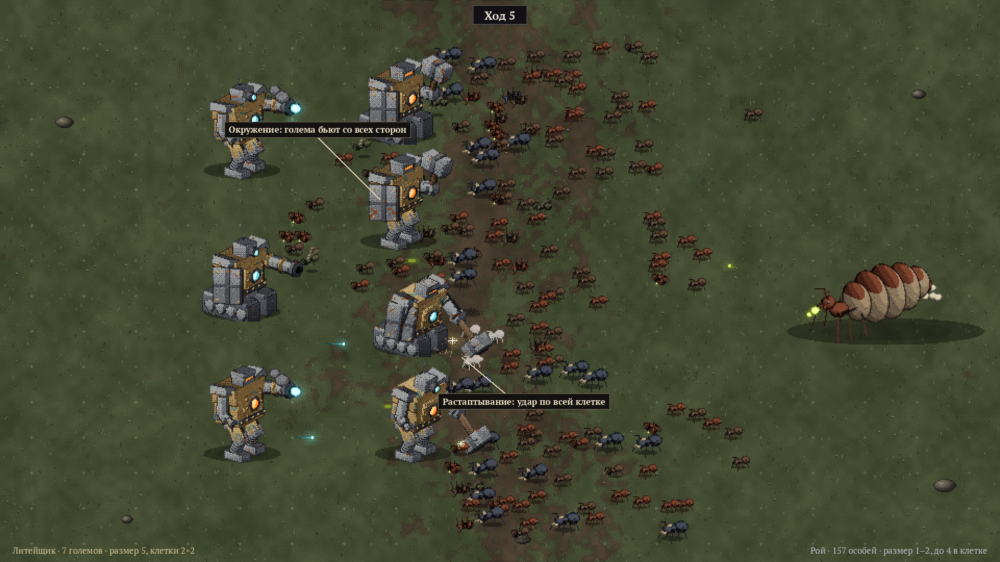

# Концепт игры

Рабочее название — позже, вместе с миром.

## В двух словах

Автобатлер-рогалик для ПК (Steam). Игрок ведёт армию одного из классов через поход из боёв.
Бой идёт сам — игрок в нём ничего не делает. Все решения принимаются **до** боя (кого взять
и куда поставить) и **между** боями (чем усилить армию). Армия — это карты существ с подробным
описанием и особенностями, как в Conquest of Elysium; артефакты — постоянные пассивные бонусы,
как в Slay the Spire, но тактические.

Главное требование: **очень весело, и хочется играть снова и снова**, при этом решения между
боями быстрые и не превращаются в рутину.

## Поход

- Выбор класса и лидера → поход из 12–15 боёв, каждый пятый — с боссом, партия на 20–30 минут.
- Перед каждым боем — выбор из 2–3 противников: видна вся армия врага, её расстановка и награда.
  Это заменяет карту мира.
- Между боями: награды, лагерь, торговец, случайные события с рискованным выбором
  («отдать существо за редкий артефакт»).

## Бой

- **Поле большое**, как в Conquest of Elysium: сетка клеток (в примерах 18×14), у каждой стороны
  своя зона расстановки.
- **Расстановка** — главная тактика: какие существа выйти в бой и в какие клетки.
- **Лидерство**: у лидера есть очки лидерства, у существа — стоимость. В бой идут не все,
  а лучший набор против этого врага. Лидерство растёт по ходу похода.
- **Автобой**: существа действуют сами по своим характеристикам и особенностям.
- **Атака — отдельный спрайт**: существо шагает к цели и меняет спрайт на атакующий.
- **Боевой дух**: отряды не только гибнут, но и бегут. Бой можно выиграть, сломав фланг.
- Победа — враг сломлен или погиб его вожак.
- Противовесы читаются просто: броня против стрел, копья против конницы, летающие через строй,
  магия против брони.

## Существа

Каждое существо — карта с подробным описанием (видно главное, полное — по наведению):

- здоровье, атака, защита, боевой дух, скорость, стоимость лидерства;
- тип атаки (ближняя, дальняя, магическая) и тип урона (колющий, рубящий, дробящий, огонь,
  холод, яд…);
- **размер** (1–6);
- 2–4 **особенности** с подсказками: Летающее, Нежить, Страх, Строй, Длинное оружие,
  Призрачное, Огнестойкое, Регенерация, Растаптывание…

Особенность видна на спрайте: по полю понятно, кто есть кто, ещё до чтения карты.

### Размер

| Размер | В клетке | Примеры |
|---|---|---|
| 1 | до 4 | рабочая особь роя (с любыми чертами) |
| 2 | до 2 | солдат роя |
| 3–4 | 1 | малый голем, наёмники Ростовщика |
| 5 | занимает 2×2 | средний голем |
| 6 | занимает 3×3 | большой голем, матка, боссы |

Правила размера:

- **Окружение** — крупное существо одновременно атакуют все, кто помещается вокруг него.
- **Растаптывание** — существо, большее цели на 2 и более, бьёт по всей клетке сразу.

### Гибель

Существо может погибнуть один раз: к следующему бою оно живо, но с отметкой. Погибло второй раз —
пропадает навсегда. Големы Литейщика не гибнут, а ломаются (см. ниже).

## Классы

У каждого класса: 2–3 лидера на выбор, своя экономика, своё правило, ломающее общее, свой набор
артефактов, своя манера расстановки и свой ритм боя. **Классы должны играться и ощущаться
по-разному.**

Первая версия — **Литейщик и Рой**. Остальные три — позже.

### Литейщик — мало, но каждый голем силён и собран под себя

- Поход начинается с 2 големов, к концу их 5–7. Голем дорогой по лидерству.
- **Корпус** задаёт размер и число ячеек:

  | Корпус | Размер | Клетки | Ячейки |
  |---|---|---|---|
  | малый | 4 | 1 | 3 |
  | средний | 5 | 2×2 | 4 |
  | большой | 6 | 3×3 | 5 |

- **Модули** (каждый со своим видом на спрайте и тремя уровнями):

  | Ячейка | Варианты |
  |---|---|
  | рука ×2 (каждая отдельно) | поршневая (быстрая), тяжёлая (сильная, медленнее), длинная (тройной сустав, достаёт до второго ряда) |
  | инструмент в каждой руке | молот, пушка, щит, клешня |
  | ноги | гусеницы (устойчивость, растаптывание), пружины (прыжок через ряд), тумбы (не сдвинуть), паучьи (быстрые, через препятствия) |
  | голова | забрало, сенсор |
  | ядро | огненное, грозовое |
  | броня | пластины на корпусе |

- **Уровни I–III видны на спрайте**: молот обрастает шипами и руной, щит становится башенным,
  на гусеницах появляются юбки и таран, на голове — рога и корона шипов, ядро — в решётке
  и с отдушинами.
- **Поломка вместо смерти**: сломанный голем выбывает до ремонта, ремонт стоит металла.
- **Слабости**: медленные, их окружают, каждая потеря — заметная доля армии, у врагов есть
  ответы (кислота разъедает броню, молнии и магниты бьют по механизмам).

#### Мастерская — 15–30 секунд между боями

1. После боя — **выбор 1 из 3** модулей.
2. Модуль сам встаёт на подходящего голема (изменение сразу видно на спрайте); можно перетащить
   на другого.
3. «В бой».

- **Повтор = улучшение**: взял модуль, который уже стоит, — он поднимается на уровень. Без крафта.
- Кнопки «Автосборка», «Починить всё», «Пропустить» (даёт металл).
- Полная пересборка — только в лагере.
- Против монотонности: виды предложений (новый модуль, улучшение, редкий, новый корпус,
  переплавка, трофей с побеждённого механизма); редкие модули меняют поведение, а не цифры
  (рука-магнит, котёл-бомба, ноги-буры); связки модулей; ячеек мало — приходится выбирать.

### Рой — масса и селекция

Противоположность Литейщика: много дешёвых существ, отдельная особь ничего не стоит, сила —
в числе, окружении и в породе, которую игрок выводит за поход.

- **Касты**: рабочая (размер 1), солдат (размер 2, большая голова и жвалы), матка (размер 6,
  лидер). Начало похода — 20–30 особей, к концу — 150 и больше.
- **Черты** — каждая видна на теле и меняет поведение в бою:

  | Черта | Вид | В бою |
  |---|---|---|
  | Крылья | перепончатые крылья, парит | летит через строй |
  | Жало | жало на брюшке | яд; в атаке брюшко подгибается |
  | Кислотная железа | светящийся мешок на брюшке | плевок кислотой, разъедает броню |
  | Рог | рог на голове | таран, отбрасывает |
  | Панцирь | пластины и шипы на спине | защита, урон тем, кто бьёт |
  | Прыгучие ноги | мощные задние ноги | прыжок в тыл |
  | Серпы | передние лапы богомола | быстрые рубящие удары |
  | Светлячок | светящийся кончик брюшка | ослепляет врагов, освещает соседей |

- **Размножение**: соседи по полю, пережившие бой, откладывают яйца. Потомок берёт по черте
  от каждого родителя, окрас смешивается. Расстановка решает две задачи: как выиграть бой
  и кого с кем скрестить.
- **Мутации** иногда дают черту, которой не было у родителей. Среди них **гигантизм**: +1
  к размеру — рабочая становится крупной тварью.
- **Выводок после боя — одно быстрое решение**: показываются до трёх потомков с превью (черты,
  окрас, размер). Игрок выбирает, кого вывести; остальных съедает матка.
- **Матка** — лидер: её размер задаёт предел численности; скормленные ей особи растят её.
  Гибель матки обрушивает боевой дух роя.
- К концу похода — своя порода, которой ни у кого не было («Кислотный шершень», «Рогатый
  таран»…).
- **Слабости**: отдельная особь хрупкая, растаптывание и удары по площади выкашивают толпу,
  без матки рой разбегается.

### Позже

- **Ростовщик** — контракты наёмников (срок, условие), ставки на исход боя, долг: при неуплате
  наёмники переходят к врагу посреди боя.
- **Садовница** — растения растут от боя к бою (семя → росток → куст → древо), времена года
  меняются каждые 3 боя, корни захватывают поле.
- **Ловец душ** — выбор боя как выбор добычи, сосуды для душ, призыв призрачных копий врагов,
  слияние душ.

## Артефакты

- **Всегда пассивные**, без кнопок.
- Проверка для каждого: срабатывает почти в каждом бою **и** меняет хотя бы одно решение игрока.
- Примеры: *Знамя двух ветров* (центр +2 атаки, фланги +2 защиты), *Сапоги преследователя*
  (убийца шагает на клетку жертвы), *Кровавая чаша* (убийство лечит соседей), *Вербовочный
  барабан* (сбежавший враг может перейти к вам), *Тяжёлая наковальня* (+50% урона, ход последним),
  *Колокол тревоги* (гибель союзника усиливает остальных).
- ~85–90% артефактов — широкие; ~10–15% — редкие, меняющие правила. Если артефакт что-то
  отнимает, он обязательно даёт новую игрушку: *Туманный фонарь* (стрелки бьют только по соседнему
  ряду → засады с двойным уроном), *Зеркало одиночества* (без строя → вызов на поединок),
  *Цепь каторжника* (передний ряд не отступает → убийца утаскивается в ваш строй),
  *Песочные часы* (два хода без атак → накопление силы).
- **Скрытые пары**: два определённых артефакта вместе включают третий эффект.
- **Пробуждение**: выполнил условие — артефакт становится сильнее.
- Предложение: держать одновременно не больше 4–5 артефактов.

## Враги

Враги не играют картами: у них готовая армия и расстановка, видимые до боя. У элиты и боссов —
свои артефакты и особые правила.

## Чтобы было весело и хотелось ещё

- Можно «сломать игру» нелепо сильной связкой; сдерживает рост силы врагов, а не урезание связок.
- Цепные реакции на поле: огонь перекидывается, взрывы отбрасывают, бегство сеет страх.
- Сочные эффекты: заморозка кадра в момент удара, тряска, вспышки, крупные цифры урона.
- Короткие партии, ускорение боя, мгновенный новый поход.
- После поражения видно, сколько не хватило и что открыто.

## Метапрогрессия

Открытие новых существ, модулей, артефактов, лидеров и классов; уровни сложности, каждый
добавляет врагу правило; бестиарий.

## Рамки

- Платформа: только ПК, публикация в Steam.
- Первая версия: два класса — Литейщик и Рой.
- Мир и название — в конце.

## Открытые вопросы

- Точные числа: лидерство, стоимость, размер поля, число ячеек и модулей.
- Лидеры каждого класса (по 2–3).
- С кем сражаются Литейщик и Рой: друг с другом, с другими классами, с нейтральными армиями.
- Лимит артефактов — подтвердить.
- Экран выводка роя — макет, как у мастерской Литейщика.
- Картинка с размерами на поле пока в раннем стиле — перерисовать в выбранном.
