# Концепт игры

Рабочее название — позже, вместе с миром.

## В двух словах

Автобатлер-рогалик для ПК (Steam). Игрок ведёт армию одного из классов через поход из боёв.
Бой идёт сам — игрок в нём ничего не делает. Все решения принимаются **до** боя (куда поставить
армию — на поле выходит вся) и **между** боями (чем усилить армию). Армия — это карты существ с подробным
описанием и особенностями, как в Conquest of Elysium; артефакты — постоянные пассивные бонусы,
как в Slay the Spire, но тактические.

Главное требование: **очень весело, и хочется играть снова и снова**, при этом решения между
боями быстрые и не превращаются в рутину.

## Поход

- Выбор класса и лидера → поход из 12–15 боёв, каждый пятый — с боссом, партия на 20–30 минут.
- Перед каждым боем — выбор из 2–3 противников: видна вся армия врага, как обе армии встанут и награда.
  Это заменяет карту мира.
- Между боями: награды, лагерь (у роя — Улей), торговец, случайные события с рискованным выбором
  («отдать существо за редкий артефакт»).

## Бой

- **Поле большое**, как в Conquest of Elysium: сетка 36×30 клеток, у каждой стороны своя зона —
  15 столбцов со своего края, между зонами — 6 пустых. В зону стороны влезают сотни бойцов (до 450 клеток,
  по четыре мелких в клетке).
- **Расстановки нет**: армии встают сами, по ролям (см. «Строй сам»). Тактика — в том, из кого
  собрана армия, что каждый умеет и с кем драться: строй меняется вместе с армией.
- **На поле всегда выходит вся армия.** Лидерство ограничивает её размер: у лидера есть очки
  лидерства, у существа — стоимость, и армия не может быть больше лидерства. Лидерство растёт
  по ходу похода. Выбор — не кого взять в этот бой, а кого держать в армии.
- **Автобой**: существа действуют сами по своим характеристикам и особенностям.
- **Атака — отдельный спрайт**: существо шагает к цели и меняет спрайт на атакующий.
- **Боевой дух**: отряды не только гибнут, но и бегут. Бой можно выиграть, сломав фланг.
- Победа — вся армия врага разбита или бежала. Гибель лидера бой не заканчивает.
- Противовесы читаются просто: броня против стрел, копья против конницы, летающие через строй,
  магия против брони.

### Строй сам

Расстановки нет — армии встают сами, по одному правилу для всех классов и врагов. Каждый получает
роль по своим числам и чертам, роль задаёт ряд; ряды считаются от передней кромки своей зоны,
клетки заполняются от середины поля к краям. Армия встаёт в прямоугольник по своему размеру: обычная — в
6×14 клеток посреди поля, бо́льшая — в такой же, но шире и глубже, вплоть до всей зоны; края и задние ряды в
таблице — края и задние ряды этого прямоугольника.

| Роль | Кто | Где встаёт |
|---|---|---|
| Лидер-боец | крупный лидер ближнего боя: размер от 5, скорость от 2 (Пожиратель) | первым, в середине первого ряда |
| Щит | заслон, шипы, сворачивается или броня от 4 (Страж, мокрица) | первый ряд, середина |
| Ударный | весь прочий ближний бой | первый ряд рядом со щитами, дальше — второй |
| Фланг | летает, прыгает или скорость от 4 (оса, кузнечик) | концы первого ряда, верх и низ по очереди |
| Поддержка | не бьёт (Механик) | второй ряд, за фронтом |
| Стрелок | дальность больше 1 или заклинатель (Орудие, Мудрец, бочонок, паук-плевун) | задние ряды |
| Лидер в тылу | все прочие лидеры: стреляют, кладут яйца, медленные или мелкие (Матка, Разум улья, Чума; люди-лидеры Литейщика — Изобретатель, Маньяк, Зодчий) | последний ряд, середина |

- **Лидер в тылу — не танк**: пока его армия стоит, он не выходит вперёд, а бьёт тех, кто до него
  добрался (враг ближе двух клеток); вперёд идёт, только когда своих не осталось. Прежде симуляция
  гнала Изобретателя в ближний бой — он выбегал первым и погибал на втором ходу, не успев ударить.

- Внутри роли первыми встают самые крепкие (броня, потом здоровье); вид встаёт подряд — стая не
  рассыпается.
- Строй читает врага: если у врага есть удары по площади (Мортира), мелкие встают по 2 в клетке,
  а не по 4.
- Строй виден до боя: при выборе противника показаны обе армии, как они встанут. Игрок влияет
  составом — эволюция или черта меняет роль (крылья уводят на край, панцирь ставит в первый ряд), —
  и выбором противника.
- То же правило в симуляции: `sim/src/battle.rs`, `role` и `deploy`.

### Ходы

- Бой идёт **раундами**; в игре раунд называется **ход** — так он записан везде в интерфейсе.
  Время в эффектах — тремя значками: «каждые N ходов» (кольцо стрелок), «через N ходов»
  (песочные часы), «на N ходов» (полоска в скобках; ∞ — до конца боя).
- **Фазы раунда**, как в CoE:
  1. Движение: все делают первый шаг, затем второй шаг делают те, у кого скорость 2 и больше,
     затем третий — у кого 3.
  2. Страх: юниты рядом с постоянно пугающими проверяют боевой дух (см. «Удар и числа»).
  3. Удары в порядке **инициативы оружия**: у кого выше, бьёт раньше; при равной — одновременно.
     Инициатива не зависит от скорости: кинжал и жвалы быстрые, тяжёлый молот медленный.
     Способность-атака («каждые N ходов», «в начале боя», «на N-м ходу») срабатывает здесь же,
     с инициативой своего юнита, и в этот раунд заменяет его обычный удар.
  4. Длящиеся эффекты: горение, яд, починка.
  5. Проверка: не кончился ли бой.
- **Удержание**: боец ближнего боя держит врагов, подошедших к нему на две клетки. Мимо него не пройти — ни вдоль
  строя, ни ему за спину, ни к стрелкам за ним: удержанный может только подойти и драться. Строй, где между
  бойцами не больше четырёх клеток, закрывает тех, кто стоит за ним, — обойти его можно только с конца, широкой
  дугой. Толпа по-прежнему окружает одиночку: свободные места у него сзади и с боков занимают те, кто пришёл туда
  издалека, а не проскользнул мимо. Не держат стрелки, летуны и те, кто не бьёт (Механик); не держатся летающие
  (перелетают строй), неудержимые и бегущие.
- Если способность срабатывает «каждые N ходов», над юнитом идёт обратный отсчёт.
- **Пассивки** действуют всегда. **Способности по событию** (убийство, поломка, ранен ниже
  половины…) срабатывают сразу, как только событие случилось.
- **Оглушение**: юнит пропускает своё следующее действие, над ним значок. По оглушённому каждый
  удар наносит на 1 больше — поэтому оглушение особенно ценно против толпы.
- **Изнеможение**: с 50-го раунда каждый юнит в начале раунда получает урон мимо брони, и он
  растёт: 1, 2, 3… Обычный бой длится 10–15 раундов, это лишь страховка от бесконечных боёв.
- На экране раунд проигрывается почти разом, волнами по скорости, — иначе бой против 150 особей
  роя тянулся бы.

### Огонь

Огонь — тип урона, который живёт на поле своей жизнью. Правила общие для всех, включая врагов:

- **Горение**: урон в начале каждого раунда, 3 раунда. Не складывается — повторный поджог только
  обновляет срок.
- **Горящая клетка**: горит 3 раунда, все в ней горят.
- **Бегущие факелы**: подожжённое мелкое существо (размер 1–2) в панике бежит прочь и поджигает
  всех, мимо кого пробегает.
- **Падающий факел**: подожжённый летун падает и поджигает клетку, на которую рухнул.
- **Местность** видна перед боем: по сухой траве огонь бежит сам, лес горит долго, камень
  не горит, болото тушит.
- **Порох**: бомбардиры, алхимики и пороховые бочки взрываются, если загорятся.
- **Пар**: если огонь тушат водой, поднимается пар, и все внутри облака промахиваются.

### Поле живёт

Поле — не сцена, а участник боя: павшие оставляют на нём следы, следы вступают в реакции, тела валятся друг на друга,
а у некоторых дорог своя погода. Хаос рождается из сочетаний, а не из отдельной способности.

**Металл против плоти.** Классы — два материала. Литейщик — железо, масло, огонь и молния; рой — плоть, слизь,
кислота и яд. Павшие каждой стороны готовят поле для другой: слизь роя проводит молнию Литейщика, масло големов горит
под роем. У каждого боя свой сюжет: первая сшибка рисует местность, вторая половина боя играет на ней.

**Один закон.** Любое действие в бою либо оставляет след на поле (масло, слизь, корка, мёд, паутина, трещина, стена),
либо несёт стихию (огонь, молния, кислота, яд), либо читает поле (кегли, ночь, Удержание). Реакции — одна таблица:

| След \ стихия | Огонь | Молния | Кислота |
|---|---|---|---|
| Масло (машины) | пожар: 3 хода, поджигает стоящих, бежит по соседним пятнам | — | едкая пена: снимает броню всем в луже (2 клетки) |
| Слизь (рой) | сохнет в корку: не горит, не проводит | разряд по луже: 3 клетки, вполовину всем в ней, своим тоже | ядовитый пар: яд 1–4 всем в луже (2 клетки) |
| Мёд | карамель: стоящий в нём склеен на ход | — | — |
| Паутина | сгорает, огонь бежит по сети | — | — |
| Стена | огонь на ней останавливается | разряд на ней останавливается | — |

**У каждого лидера — своё звено.** Своя вещь каждого лидера цепляется за поле:

| Лидер | Крючок в поле |
|---|---|
| Отец колосса | брошенный, упав на масло, поджигает его искрами булавы |
| Изобретатель | заземляет своих: пока он стоит, разряд по слизи не бьёт его армию — молния Мудрецов в рою на слизи становится минным полем |
| Маньяк | стоя в масле, тащит из него лом: броневой лист ближнему голему, до 3 за бой |
| Зодчий | стены останавливают пожар и разряд по слизи |
| Матка | в слизи её личинки окукливаются за 2 хода, а не за 3: слизь павших — её гнездо |
| Разум улья | ночью Подмена — на ход чаще: в темноте умы податливее |
| Пожиратель | стоя в масле, лакает его: 3 здоровья за клетку |
| Чума | зараза бежит по слизи: заражённый заражает своих в 2 клетках, если оба стоят в слизи |

**Находки меняют таблицу.** Модуль Литейщика **Громоотвод** (на любой корпус): молния с неба бьёт в него втрое
охотнее и уходит в землю, разряд по слизи его не берёт — голем-громоотвод уводит грозу от остальных. Мутация роя
**Сухой хитин** (общий пул): павшие оставляют сухую корку, а не слизь — по ней не бежит молния големов; цена — в корке
не зреют личинки Матки и не ходит зараза Чумы.

- **Масло и слизь.** Сломанный голем (и лидер Литейщика в своей машине) разливает масло на свои клетки, павшая особь
  роя оставляет слизь. Пятна копятся весь бой: к концу толпа стоит в море слизи, а строй големов — в масле своих
  сломанных.
- **Пожар по маслу.** Огонь (Жар горна, огненный шар, горящий) поджигает масло под тем, в кого попал; горящее масло
  горит 3 хода, поджигает всех, кто в нём стоит, и каждый ход перекидывается на соседние пятна масла. Выгорев, масло
  исчезает. Слизь огонь сушит в корку — по ней разряд уже не бежит: Горн, прошедшийся по луже, делает её безопасной
  для Мудреца.
- **Разряд по слизи.** Молния (Мудрец, сеть Изобретателя, гроза, перенятый Мимикрией ток), попав в стоящего в
  слизи, бежит по ней на 3 клетки и бьёт вполовину всех, кто в ней стоит, — и чужих, и своих. Мудрец, ударивший в
  толпу на слизи, бьёт по двадцати; голем, вставший в ту же лужу, получает от своего же Мудреца.
- **Кегли.** Отброшенный врезается в своего, стоящего прямо за ним: оба получают 1–3, и тот летит дальше — до трёх
  тел подряд. На масле отброшенный скользит ещё на клетку и падает (оглушён). Брошенный Отцом колосса разбрасывает
  тех, на кого рухнул.
- **Погода.** Со второго боя примерно у каждой третьей дороги своя погода; она видна на карточке дороги, и врага
  подбирают уже под неё — кривая сложности держится:

| Погода | Что делает | Кому на руку |
|---|---|---|
| Гроза | каждый ход две молнии с неба — в крупных и в железо намного чаще, 1–8; по слизи разряд бежит дальше | рою против големов, но слизь под роем — громоотвод |
| Землетрясение | каждые 4 хода (до трёх раз) поле раскалывается поперёк: кто на трещине — падает (1–6, оглушён), шагнувший в трещину выбирается только на следующий ход | тем, кто бьёт с места; толпа вязнет в трещинах |
| Ночь | дальше двух клеток стрелки видят только то, что горит или светится, и бьют его первым | ближнему бою; огонь Горна и светляки становятся маяками |

### Сеты стихий

У каждой находки — стихия: у модулей Литейщика огонь, молния, железо или удар, у мутаций и эволюций роя гнездо, яд,
крыло или панцирь. **Три находки одной стихии** в армии — сет: он меняет, как воюет вся армия, и почти всегда
через поле. Карточка находки пишет её стихию и сколько до сета: «огонь 2/3».

| Сет | Класс | Стихия: находки | Что делает |
|---|---|---|---|
| **Пал** | Литейщик | огонь: Огненный шар, Живой факел, Раскалённая броня | огонь армии оставляет горящее масло там, куда попал (и Жар горна тоже); её големы проходят сквозь пожар невредимыми |
| **Громовая сеть** | Литейщик | молния: Перегрузка, Грозовая катушка, Искрящий молот, Громоотвод | армия заземлена — разряд по слизи её не бьёт; её разряд бежит по слизи на 5 клеток, а не на 3 |
| **Стальная стена** | Литейщик | железо: Перехват, Броневые листы, Ростовой щит, Контрудар, Ремонт | бойцы держат на 3 клетки, а не на 2 (строй с просветами в 6 клеток уже не пройти); их не отбросить и не сбить кеглями |
| **Кегли** | Литейщик | удар: Мортира, Картечь, Длинный ствол, Голова-катапульта, Кистень, Таранный нос | каждый удар вплотную отбрасывает; сбитые катятся до 5 тел подряд |
| **Трясина** | рой | гнездо: Медовые соты, Паутина, Живородящая, Почкование | враг, ступивший в слизь, вязнет и до конца хода больше не идёт |
| **Мор** | рой | яд: Муравьиная кислота, Дальний плевок, Жало-шприц, Паразитоид, Кукловод, Мошкара | яд берёт машины, и сквозь броню, удержавшую удар |
| **Туча** | рой | крыло: Крылатый рой, Летучий жук, Пикирование, Дальний прыжок, Длинные лапы, Стрекот | рой не удержать: он идёт мимо бойцов и перескакивает трещины — ответ на Удержание |
| **Сцепка** | рой | панцирь: Сомкнутый строй, Двойной рог, Бугристые надкрылья, Длинные шипы, Известковый панцирь, Серпы-пилы, Сухой хитин, Мимикрия | особи в одной клетке делят каждый удар поровну; их не отбросить |

Сет — уже не цифры, а лицо похода: «огненный Литейщик», «роевая трясина». Находка значит больше, чем её числа: она
либо ведёт к сету, либо уводит от него.

### Враги с лицом

- **Приставка элиты.** У каждого элитного врага своя приставка, она видна на карточке дороги и в бою:

| Приставка | Что значит | Против кого хороша, кому на руку |
|---|---|---|
| Бронированные | +2 к броне каждому | против мелких ударов; кислота её снимает |
| Огненные | удары поджигают, огонь им вчетверть | опасны для роя; горящие — маяки ночью |
| В масле | бой начинается с масла под ними | подарок сету «Пал» и любому огню |
| В слизи | бой начинается со слизи под ними | подарок молнии и «Громовой сети» |
| Живучие | первый смертельный удар оставляет каждого с 1 | против россыпи слабых ударов |
| Неудержимые | не удержать, не отбросить, не оглушить | против Удержания, кеглей и строя |

  Врага подбирают уже с приставкой: кривая сложности держится, а армия, у которой есть ответ (огонь против «В
  масле»), выигрывает легче. Так дорога с элитой — ещё и вопрос «подходит ли мне этот враг».
- **Вторая фаза босса.** Босс — лидер другого класса; на половине здоровья он входит во вторую фазу, каждый своей:

| Босс | Вторая фаза |
|---|---|
| Отец колосса | сбрасывает броню: скорость +1, Сотрясение каждые 2 хода |
| Изобретатель | перегружает сеть: её молния вдвое сильнее |
| Маньяк | прикручивает каждый ход |
| Зодчий | заново обносит себя стенами |
| Матка | кладёт в панике: три личинки каждый ход |
| Разум улья | кричит: все враги в 3 клетках оглушены |
| Пожиратель | в ярости: сразу ступень роста |
| Чума | лопается спорами: все враги в 4 клетках заражены |

### Повадки вместо цифр

Награда, которая только прибавляет к числу («+1 броня», «+3 к удару»), не меняет ни боя, ни решения игрока: её не
видно на поле и её не с чем сочетать. Поэтому артефакты, находки, развитие лидеров и правила похода дают **повадки**
— новое поведение на поле, которое видно глазом и которое сочетается с другими. Числа остаются у самих бойцов, у
модулей, ядер и мутаций (там их и надо крутить), но то, что выбирают как награду, — повадка.

**Артефакты** (всей армии; Знамя и Колокол — лидеру):

| Артефакт | Было | Стало |
|---|---|---|
| Знамя | мораль +3 | когда падёт половина армии, знамя поднимается — его подхватит любой, кто стоит: уцелевшие лечатся на четверть, бегущие возвращаются; раз за бой |
| Сапоги скорохода | скорость +1 | разбег: первый удар в бою с разгона (×1,5, отбрасывает) |
| Кровавая чаша | здоровье +20 % | убийство лечит своих рядом с убийцей на 2 |
| Тяжёлая наковальня | удар +3, ход последним | каждый удар, прошедший сквозь броню, сминает её ещё на 1; ход последним |
| Колокол тревоги | инициатива +2 | каждый 4-й ход колокол лидера оглушает врагов в 2 клетках от него |
| Гранёные кости | разброс −2, удар +2 | наибольшее на кубике — удар вдвое и оглушает |
| Песочные часы | броня +1 | первый смертельный удар поворачивает время бойца к началу хода; раз за бой |
| Фонарь дальнобоя | дальность стрелков +1 | выстрелы стрелков поджигают, ночь им не мешает |

**Находки:**

| Находка | Было | Стало |
|---|---|---|
| Ростовой щит (Страж) | броня +2, скорость −1 | стрелок не может выстрелить в своих прямо за щитом |
| Длинный ствол (Орудие) | дальность +1 | навылет: враг прямо за целью получает половину |
| Искрящий молот | молния, +1 | молния; искра поджигает врага рядом с целью (и масло под ним) |
| Живой факел | огонь | огонь; горит весь бой без вреда себе, ночью виден |
| Длинные лапы (Скорпион) | скорость +1 | жало достаёт и того, кто стоит за целью |
| Дальний плевок (Бочонок) | дальность +1 | брызги: соседям цели по половине |
| Бугристые надкрылья (Жук) | здоровье +2 | рикошет: удар, погашенный панцирем целиком, отскакивает в другого врага рядом |
| Известковый панцирь (Мокрица) | броня +1 | свернувшись, притягивает удары врагов рядом — живой заслон |
| Стрекот (Разум) | стрекот, скорость +1 | только стрекот |

**Развитие лидеров** (после босса):

| Лидер | Было | Стало |
|---|---|---|
| Отец колосса | Сотрясение каждые 2 хода; +40 прочности, +1 броня | **Ударная волна**: Сотрясение отбрасывает всех, кого задело, — кегли; **Сброс плит**: с каждой потерянной четвертью здоровья с него падает плита на врагов рядом (1–8, мелкие оглушены) |
| Изобретатель | шокер +2 | **Цепной шокер**: удар перескакивает на двух врагов рядом с целью, по половине |
| Маньяк | пила +3 | **Пила-вихрь**: удар рубит каждого врага рядом |
| Зодчий | армии +1 броня; кирпичи +2 и дальше | **Каменный дождь**: его стены, падая, давят врагов рядом (1–6, мелкие оглушены); **Кирпичи навесом**: бросок накрывает всю клетку, мелкие оглушены через раз |
| Матка | три личинки; +25 здоровья, +1 броня | **Засада**: личинки вылупляются рядом с ближайшим врагом; **Свита**: удар по ней принимает самая мелкая её особь рядом |
| Разум улья | стае +1 к удару; +12 здоровья, +2 брони | **Воля роя**: рой не бежит; **Пси-отпор**: кто бьёт его вплотную, пропускает следующий удар |
| Пожиратель | +20 здоровья, +1 к удару; +3 к удару; +2 брони | **Отрыжка**: переварив добычу, плюётся кислотой на врагов в 2 клетках; **Рвущие челюсти**: каждый прокус сминает броню; **Кислотная кровь**: кто бьёт его вплотную, обожжён кислотой |
| Чума | стае +1 здоровья; +12 здоровья, +1 броня | **Чумная кровь**: кто вплотную убьёт особь стаи, заражён; **Кокон**: от смертельного удара окукливается — половина здоровья назад, два хода без движения |

**Правила похода роя:** Память роя — рой бьёт запомненный вид **первым** (а не +2): толпа сама выбирает, на кого
бросаться. Ты — то, что ты ешь — съеденное даёт повадку, а не число: Страж и Каменщик — враги рядом бьют его первым
(Заслон), Орудие — зубы пробивают половину брони, Механик — заживает на 2 в ход, лидер Литейщика — его страх.

**Сет «Сцепка»** (панцирь; был «Хитиновая стена», −1 с удара): особи в одной клетке делят каждый удар поровну — стая
держит удар вместе, мелкие не гибнут по одной; их не отбросить.

### Удар и числа

Баланс примерный, ориентир — Conquest of Elysium 5: классы и юниты несимметричны, некоторые
встречи заведомо тяжёлые, и это нормально — перед боем игрок выбирает противника из 2–3.
Все числа ниже — черновик, их подберут прогоны симуляции.

- **Удар**: урон — разброс плюс прибавка, как в CoE (например, «1–10 +10»). Броня вычитается
  из каждого удара. Если выпал максимум разброса, бросок повторяется и прибавляется — поэтому
  даже мелочь иногда царапает тяжёлую броню.
- **Разброс у большинства узкий**, исход читается заранее. Широкий разброс — только там, где
  непредсказуемость и есть смысл юнита (безумные конструкты Маньяка).
- **Лишний урон пропадает**: удар на 15 по рабочей с 5 здоровья тратит остальное впустую. Поэтому
  против толпы ценны растаптывание и удары по клетке.
- **Сокрушительный удар**: если один удар снёс больше половины полного здоровья цели, цель
  отлетает на клетку (если она не крупнее бьющего), а её соседи проверяют страх 1–7.
  Тяжёлые бойцы делают это часто, мелочь почти никогда.
- **Пси** — удар по разуму: броня от него не спасает. Безмозглые (боевой дух 99 — големы, нежить)
  получают от пси вдвое меньше: страха у них нет, но то, что ими движет, — искра в ядре голема,
  чары нежити — пси сбивает. **Надлом**: пси копится в разуме, как яд в крови; когда накопленное
  превысит боевой дух цели, разум надламывается — раунд она не действует, держась за голову,
  и накопленное обнуляется. Кого трудно напугать, того трудно и надломить: элиту дольше,
  ополченцев быстро. У безмозглых вместо боевого духа свой порог — искра в ядре на раунд гаснет.
  Пси бьёт только Разум улья и его рой.
- **Огонь и горение не замечают броню.** Кислота разъедает броню до конца боя: каждое попадание
  снимает 1 брони.
- **Типы урона**: колющий, рубящий, дробящий, огонь, холод, молния, яд, кислота, пси. У каждого оружия
  и каждой способности, которая ранит, свой тип. Сопротивление режет урон вдвое, уязвимость
  удваивает. Стихийные сопротивления — в процентах (огнеупорность — 75%).
- **Типы брони**: у каждого юнита и каждой постройки свой тип брони — из чего сделана защита.
  Он задаёт, что держит удар, а что его ломает:

  | Тип брони | Кто носит | Держит (урон вдвое меньше) | Слабость (урон вдвое больше) |
  |---|---|---|---|
  | Без брони | ополченцы, звери | — | — |
  | Мягкое тело | «бочонки» роя, личинки | — | колющий |
  | Кожа и стёганка | лёгкая пехота, люди-лидеры Литейщика | дробящий | рубящий |
  | Кольчуга | средняя пехота | рубящий | колющий |
  | Латы | рыцари | рубящий, колющий | дробящий |
  | Литой металл | големы | колющий | кислота снимает 2 брони вместо 1 |
  | Хитин | большинство форм роя | рубящий | дробящий |
  | Тяжёлый хитин | жук-носорог, мокрица | рубящий, колющий | дробящий |
  | Кость | скелеты | колющий | дробящий |
  | Дерево | постройки I уровня, ворота, телеги | колющий | огонь, рубящий |
  | Камень | постройки II уровня, каменные стражи | колющий, рубящий | дробящий |
  | Железо | постройки III уровня | колющий, рубящий | кислота снимает 2 брони вместо 1 |
  | Пламя | огненные духи, саламандры | огонь не действует вовсе | холод |

  **Металл проводит**: латы, кольчуга, литой металл и железо получают от молнии на 50% больше.
  Щит — отдельная защита поверх брони, своего типа у него нет.
- **Порядок расчёта**: бросок → уязвимость ×2 → +1 по оглушённому → минус броня и щит →
  сопротивление ×½ → стихийное сопротивление в процентах. Дроби вниз.
- **Яд копится**: весь урон ядом выходит по 10% за раунд (с округлением вверх), новые отравления
  складываются. Огонь не складывается — стихии ощущаются по-разному.
- **Щиты**: щит снимает 0–1 с каждого удара, большой щит — 0–2, против стрел и снарядов вдвое
  больше.
- **Стрелки**: у оружия своя перезарядка (лук стреляет каждый раунд, тяжёлое — раз в 2–3);
  на дальней половине дистанции урон вдвое меньше; вплотную стрелок бьёт запасным оружием.
- **Стены**: юнит на стене или в башне получает к броне +1, +2 или +3 по уровню постройки
  и стреляет на клетку дальше.
- **Страх** — бросок против боевого духа: выпало больше — юнит бежит к краю поля. Три силы:
  *страх* (вплотную, 1–7), *жуть* (до 2 клеток, 1–8), *ужас* (до 3 клеток, 1–9). Сокрушительный
  удар пугает соседей цели на 1–7. У безмозглых, в том числе големов, боевой дух 99 — их
  не напугать. Свои сбежавшие после победы возвращаются. Всё, что «роняет боевой дух»,
  работает через эти проверки страха, отдельного счётчика нет.
- **Бой длится 10–15 раундов**, на обычной скорости — около 30 секунд, есть ускорение ×2 и ×4.
- **Случайность только в разбросе урона**: промахов нет, кроме тех, что дают способности
  (дым, пар). Бой можно пересмотреть — он воспроизводится по зерну.
- **Проверка баланса грубая**: нет сборки, которая выигрывает всё, и нет фрейма или формы,
  которые никогда не нужны.

### Оружие

Как в Conquest of Elysium 5: у существа не один удар, а список оружия.

- **Ближнее оружие** (дальность 1) работает всё сразу: каждый раунд существо бьёт каждым
  ближним оружием, и каждое может попасть в свою цель. Одно оружие дважды в списке — два удара
  за раунд.
- **Стрелковое** (дальность 2 и больше) стреляет, только если вплотную нет врагов; вплотную
  стрелок бьёт запасным оружием. Отметки после названия меняют это:
  - **«вместо»** (\*) — можно и вплотную, тогда существо бьёт только им;
  - **«вдобавок»** (\*\*) — можно и вплотную, вместе с остальным оружием;
  - **«или»** (#) — либо это оружие, либо следующее в списке, за раунд только одно.
- **Инициатива — у оружия**: каждое оружие бьёт в свою очередь. Лёгкий миниган стреляет рано,
  тяжёлая булава того же существа бьёт поздно.
- **Свойства оружия**: дальность (длинное достаёт через клетку), перезарядка (лук — каждый раунд,
  тяжёлое — раз в 2–3), площадь (клетка, луч, конус, вокруг себя), добавочный эффект при попадании
  (яд, горение, оглушение), бронебойное (не замечает брони), а также:
  - **размах** — если удар убил цель, остаток урона сразу уходит в следующего врага рядом;
  - **полный размах** — удар по всем соседним врагам, на каждом следующем урон на 1 меньше.
- **Способность-атака** («каждые 3 хода», «в начале боя») — это оружие с перезарядкой
  и отметкой «или»: в свой раунд она заменяет обычный удар.
- **Заклинание** — оружие мага: бьёт из второго ряда, за раунд только одно, и тогда других атак
  нет; вплотную с врагом срабатывает раз из четырёх.
- **На экране** кадр атаки показывает всё оружие, что сработало в раунде. Свои кадры — только
  у взаимоисключающего («или», «вместо») и у запасного.

Для масштаба:

| Существо | Размер | Здоровье | Удар | Инициатива | Броня | Боевой дух | Скорость |
|---|---|---|---|---|---|---|---|
| Рабочая роя | 1 | 5 | 1–4 колющий | 8 | 0, хитин | 6 | 3 |
| Солдат роя | 2 | 14 | 1–8 рубящий | 6 | 2, хитин | 9 | 2 |
| Воин-человек | 3 | 12 | 1–6 +1 колющий (копьё) | 6 | 2, кольчуга | 10 | 2 |

## Существа

Каждое существо — карта с подробным описанием (видно главное, полное — по наведению):

- здоровье, удар (разброс и прибавка), инициатива оружия, броня, боевой дух, скорость, дальность,
  стоимость лидерства;
- тип атаки (ближняя, дальняя, магическая) и тип урона (колющий, рубящий, дробящий, огонь,
  холод, яд…);
- **размер** (1–7);
- **способности** — столько, сколько нужно по смыслу существа (см. ниже).

Способность по возможности видна на спрайте: по полю понятно, кто есть кто, ещё до чтения карты.

### Способности — общий язык всех юнитов

Игрок во время боя ничего не нажимает, поэтому у всех юнитов — существ роя, големов, лидеров,
врагов — способности **срабатывают сами по понятному условию**. Перед боем видно, что и когда
сработает, и под это расставляется армия.

- **Формат**: условие → цель → эффект. «Каждые 3 хода → соседние враги → бьют только его».
- **Условия**: постоянно; в начале боя; каждые N ходов; на N-м ходу; раз за бой; при событии
  (удар, убийство, получил урон, ранен ниже половины, гибель соседа, поломка, бегство врага…).
- **Цели**: себя, соседей, клетку, ряд, линию, всех своих или всех врагов.
- **Число и вид способностей ничем не ограничены** — только балансом и смыслом существа.
  Скорпион жалит, жук таранит, мокрица держит удар, Зодчий разворачивает стены. Так у каждого
  появляется своё лицо.
- **Призыв**: юнит, которого создаёт способность (каменщики Зодчего, личинки роя). Лидерства не
  стоит, после боя исчезает и в следующем бою призывается заново. В раунд появления не действует.
  Способности, пассивка и слабость у него такие же, как у всех.
- **Пассивки**: у каждого юнита и лидера есть хотя бы одна постоянная способность. Она работает
  в любом бою и сразу говорит, кто это. Часть пассивок общая для класса (у Литейщика —
  огнеупорность).
- **Слабости** — негативные пассивки, они тоже есть у каждого юнита и лидера. Как и сила,
  слабость вытекает из смысла юнита и видна на карте. Это не «−10% ко всему», а понятное правило,
  которым враг может воспользоваться, а игрок — прикрыть составом армии, модулем или соседом.
- Откуда берутся: у роя — из черт, у големов — из модулей, у лидеров — свой набор, у врагов —
  от вида. Артефакты работают по тому же языку, но всегда постоянно.
- **На поле**: у лидеров и крупных юнитов над головой значки способностей с отсчётом ходов;
  у мелочи значки видны при наведении. В момент срабатывания значок вспыхивает — понятно,
  почему случилось то, что случилось.

### Размер

| Размер | В клетке | Примеры |
|---|---|---|
| 1 | до 4 | рабочая особь роя (с любыми чертами) |
| 2 | до 2 | солдат роя |
| 3–4 | 1 | Механик, лидеры, наёмники Ростовщика |
| 5 | занимает 2×2 | Мудрец, Горн, Орудие |
| 6 | занимает 3×3 | Страж, матка, боссы |
| 7 | занимает 4×4 | титаны: Отец колосса, боссы-титаны |

Правила размера:

- **Окружение** — крупное существо одновременно атакуют все, кто помещается вокруг него.
- **Растаптывание** — существо, большее цели на 2 и более, бьёт по всей клетке сразу.

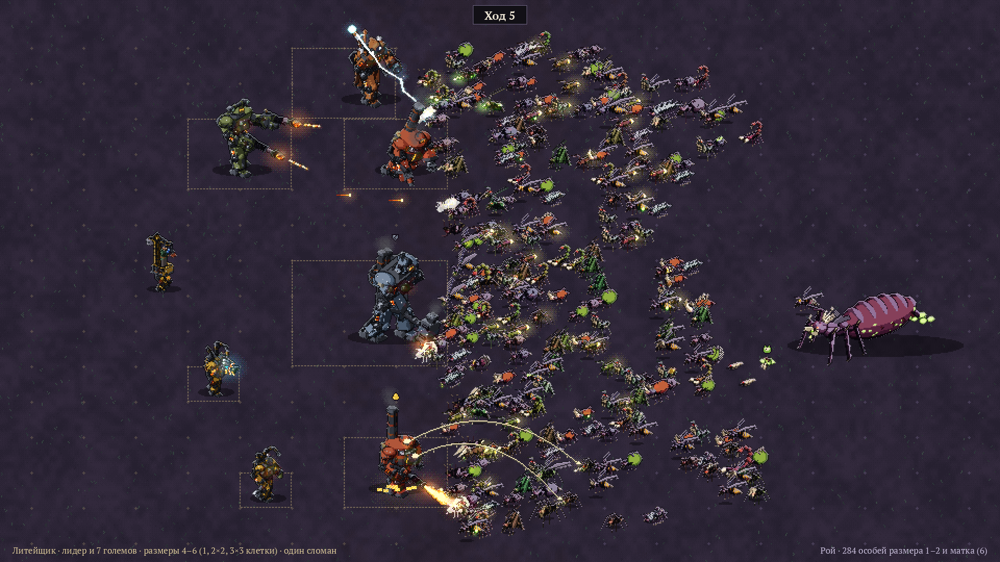

### Гибель

Существо может погибнуть один раз: к следующему бою оно живо, но с **увечьем** — одним из короткого
списка, как боевые раны в CoE. Погибло второй раз — пропадает навсегда. Големы Литейщика
не гибнут, а ломаются, а особи роя гибнут навсегда, и их место занимают новые кладки (см. ниже).

| Увечье | Что даёт |
|---|---|
| Рана | −20% здоровья |
| Рана в грудь | −20% здоровья и −1 к прибавке удара |
| Потерянный глаз | 10% ударов мимо |
| Испуг | −2 боевого духа |

## Классы

У каждого класса: 2–3 лидера на выбор, своя экономика, своё правило, ломающее общее, свой набор
артефактов, свой строй и свой ритм боя. **Классы должны играться и ощущаться
по-разному.**

Первая версия — **Литейщик и Рой**. Остальные три — позже.

### Литейщик — мало, но каждый голем силён и собран под себя

Мастер, который куёт армию живых машин. Каждый голем — шедевр, собранный игроком, и терять его
жалко. Ощущение — «мало, но каждый на счету».

- Поход начинается с 2 големов, к концу их 5–7. Голем дорогой по лидерству.

#### Айдентика — где сильнее, где слабее

| Сторона | Уровень | Почему |
|---|---|---|
| Прочность | очень сильно | металл и броня |
| Удар | очень сильно | тяжёлые инструменты, растаптывание |
| Бесстрашие | очень сильно | машины не боятся, яд и болезни на них не действуют |
| Огонь | сильно | огнеупорность и огненные модули |
| Дальний бой | средне | артиллерия: мощно, но медленно |
| Скорость | слабо | ходят последними |
| Подвижность | очень слабо | роли «прорыв» нет вовсе |
| Числа | очень слабо | их легко окружить |

- Способности — механика и физика: удар, давка, отбрасывание, пар, огонь, магнит, отдача.
  Никакой магии: даже маг Литейщика, Мудрец, «колдует» током и огнём своей электростанции.
- Слабости не закрываются полностью. Подвижность дают только редкие модули и лидеры, и за неё
  приходится платить. Ответ на быстрых врагов — не догнать, а притянуть или сбить: Магнит,
  Картечь, Орудие.
- **Огнеупорность** — пассивка всего класса, включая лидеров (големы из металла, люди кузни
  в огнеупорных фартуках): огонь наносит на 75% меньше урона, горение гаснет через раунд.
  Правило одно для своего и чужого огня: големы стоят в пожаре, а враги рядом горят.
- **Литой металл** — тип брони всех големов, включая Каменщика и Отца колосса: колющий урон вдвое
  меньше (стрелы и жала отскакивают), дробящий бьёт в полную силу. Кислота разъедает броню —
  не больше единицы за ход, сколько бы бочонков ни плевало: толпа точит голема, а не раздевает
  его за раунд. Яд на големов не действует, страх тоже (боевой дух 99).
- **Проводник** — слабость всех големов: как вся металлическая броня, литой металл получает
  от молнии на 50% больше. Огнеупорность и проводник — две стороны металла.
- Люди-лидеры (Изобретатель, Маньяк, Зодчий) носят **кожу и стёганку**: держат дробящий,
  уязвимы к рубящему.

#### Корпус, детали и модули

Голем собирается целиком, деталь за деталью: **корпус**, **ноги**, **две руки**, **голова**, **ядро**
и **модули**. Ощущение — «я собрал эту машину сам».

- **Корпус** (раньше — фрейм) задаёт роль: размер, клетки, прочность, число ячеек модулей, свою
  пассивку и слабость, цвет. Спина — часть корпуса: барабан Орудия, динамо Мудреца, труба Горна,
  ящик Механика, котёл Стража. Роль видна по корпусу издалека.
- **Ноги, руки и голова — общие детали**: любая встаёт на любой корпус. Ноги задают ход
  и устойчивость, руки — удары и умения, голова — чутьё (дальность, обзор, защиту).
- **Ядро** — стихия ударов (ниже).
- **Модуль** — способность роли. Встаёт только на свой корпус, в его ячейку, виден на спрайте, имеет
  уровни I–III; на III уровне получает новую грань, а не только большие цифры. Некоторым модулям
  нужна деталь, на которой они держатся: Длинный ствол, Картечь, Калёное ядро и Отбойник — на Пушке;
  Цепная молния, Разряд в землю и Огненный шар — на Посохе; Ростовой щит и Контрудар — на Щите.
- **Пул**: у каждого корпуса 6 модулей своей роли, плюс ядро, редкие модули и общие детали.
  В мастерской выпадают модули только для корпусов, которые есть в армии; детали — для всех.
- Ролей пять, а големов от 2 до 5–7: закрыть всё нельзя, выбор ролей — главное решение похода.
  Можно взять два одинаковых корпуса с разными сборками — и Стража с тяжёлым ружьём вместо молота.

**Детали без уровней.** Лишняя деталь лежит на **стойке** и ставится на любого голема; переставлять
детали в мастерской бесплатно. Пустых мест на теле нет: снятую руку заменяет Кулак-поршень, ноги —
Шагающие, голову — Шлем (запасные, их сколько угодно).

**Удары.** Каждая рука — своя строка в «Возможностях». За ход голем бьёт одной рукой — той, что
достаёт до цели и бьёт сильнее; умения рук (щит, клещи, ладонь, ключ, лейка) работают всегда.
Пассивки корпусов работают с любым подходящим оружием: Наводка Орудия — с любым дальним.

*Числа деталей — в балансе позже; штатные сборки повторяют нынешние фреймы один в один, так что
их цифры не меняются.*

| Ноги | Что дают |
|---|---|
| Шагающие | обычный шаг; запасные |
| Опоры | броня +1; отброс и притяжение не действуют; ходит последним |
| Паучьи лапы | переступает через мелких; если враг подошёл вплотную — отходит |
| Гусеницы *(редкие)* | проезжает сквозь клетки с врагами меньше себя на 2 размера и давит каждого; крупный враг его останавливает |
| Жернова *(редкие)* | катится по прямой и давит всё на пути, но не может остановиться до препятствия |

| Рука | Что даёт |
|---|---|
| Кулак-поршень | дробящий удар вплотную, слабый; запасная |
| Паровой молот | дробящий удар вплотную, тяжёлый |
| Щит | удары спереди — вполсилы; на нём держатся Ростовой щит и Контрудар |
| Пушка | тяжёлое ружьё в руке: дробящий выстрел на 3 клетки; на ней — модули ствола |
| Посох-электрод | молния на 4 клетки; на нём — заклинания Мудреца |
| Ладонь-разрядник | наводит: молнии и заклинания голема бьют на клетку дальше |
| Огнемёт *(огонь)* | струя огня на 2 клетки |
| Клещи | хватают врага вплотную: пока держат, тот не уходит |
| Ключ | слабый удар вплотную; вместо удара подтягивает болты соседу — ремонт 2 |
| Лейка | смазывает сам себя: ходит раньше в раунде |
| Искрящий молот *(редкая, огонь)* | удар по бронированному врагу высекает искры, соседние клетки загораются |
| Кочерга *(редкая, огонь)* | отбрасывает врага в ближайшую горящую клетку, и тот вспыхивает |
| Кистень *(редкая)* | бьёт сразу 2 клетки |

| Голова | Что даёт |
|---|---|
| Шлем | броня +1; запасная |
| Капюшон с линзой | заклинания (огненные и грозовые модули) бьют на клетку дальше |
| Шлем кочегара | огонь не жжёт вовсе; может стоять в горящей клетке |
| Дальномер | выстрелы — на клетку дальше |
| Фонарь | соседи видят в дыму и темноте: их удары не промахиваются; скрытые враги видны |

**Штатные сборки** — с ними корпус выходит из литейной, так выглядят пять знакомых големов:

| Корпус | Ноги | Правая рука | Левая рука | Голова |
|---|---|---|---|---|
| Страж | Шагающие | Паровой молот | Щит | Шлем |
| Мудрец | Шагающие | Посох-электрод | Ладонь-разрядник | Капюшон с линзой |
| Горн | Шагающие | Огнемёт | Клещи | Шлем кочегара |
| Орудие | Шагающие | Пушка | Пушка | Дальномер |
| Механик | Шагающие | Ключ | Лейка | Фонарь |

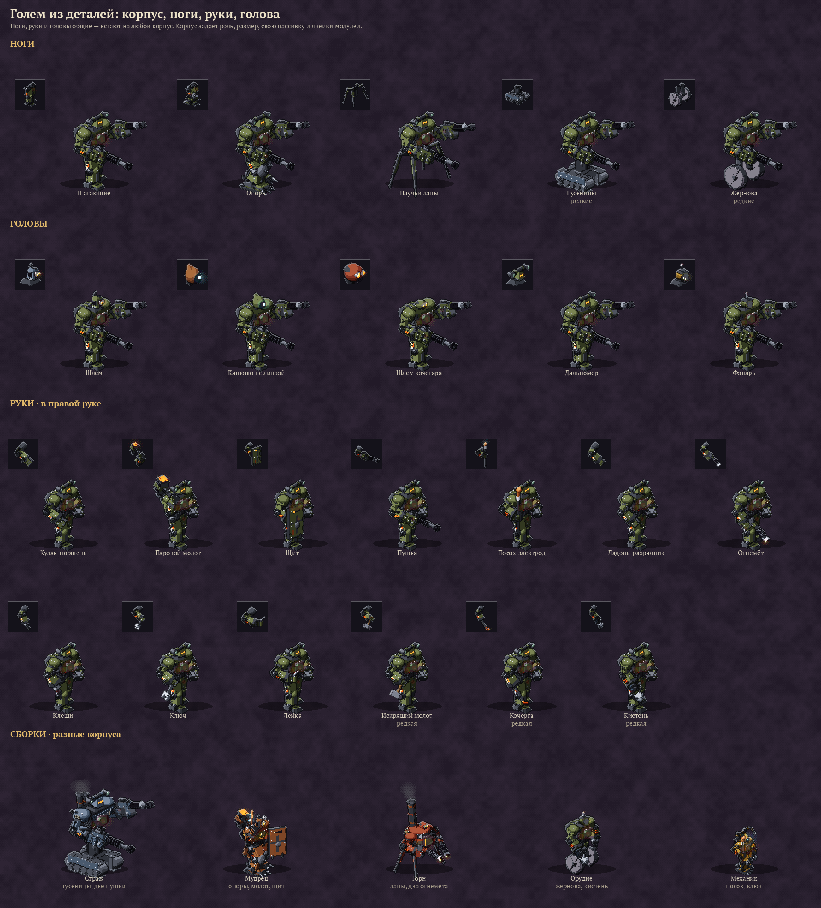

Корпуса:

| Корпус | Роль | Размер | Клетки | Ячейки | Пассивка |
|---|---|---|---|---|---|
| Страж | танк | 6 | 3×3 | 5 | **Заслон**: соседние враги бьют сначала его |
| Мудрец | маг | 5 | 2×2 | 4 | **Питание**: у соседних големов огненные и грозовые модули перезаряжаются на раунд быстрее |
| Горн | контроль | 5 | 2×2 | 4 | **Жар горна**: каждый раунд поджигает одного соседнего врага; огонь в упор |
| Орудие | стрелок | 5 | 2×2 | 4 | **Наводка**: из дальнего оружия стреляет во 2–3 ряд и не теряет урон на дальней половине дистанции |
| Механик | поддержка | 4 | 1 | 3 | **Наладка**: соседние големы в начале каждого раунда чинятся на 1 |

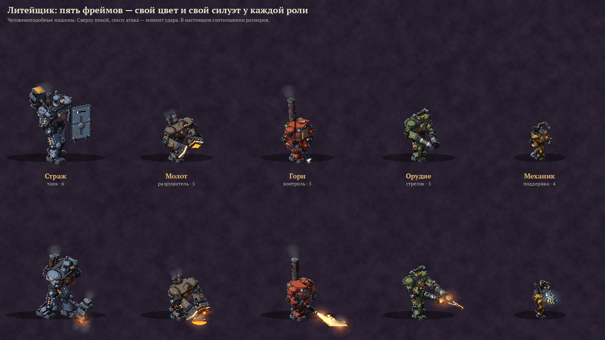

Каждый фрейм — человекоподобная машина и узнаётся по цвету и силуэту: Страж — воронёная сталь,
паровой молот и башенный щит; Мудрец — медь и белый фарфор изоляторов, электростанция на ногах:
топка за решёткой в груди, маховик турбины на спине, разряд бежит вверх между двух медных рогов,
в руке посох-электрод с медным шаром (голубым, когда бьёт молнией, оранжевым — огнём); Горн —
кирпично-красная печь-бочка с высокой трубой, огнемётом на шланге от баков на спине и клещами;
Орудие — оливковый стрелок с двумя тяжёлыми ружьями в руках — одно у бедра, другое у плеча (пистолетная
рукоять, приклад упирается в предплечье, барабанный магазин, длинный ствол в кожухе охлаждения), дальномером и барабаном на спине; Механик — охра,
ходячая мастерская: ящик с инструментом на спине, два манипулятора над плечами (горелка
и захват), голова-фонарь, большой ключ и маслёнка.

У всех фреймов есть ещё огнеупорность и проводник. И у каждого своя слабость:

| Фрейм | Слабость | Как прикрыть |
|---|---|---|
| Страж | — (была «Открытая спина»: удары сзади двойные; удара в спину в игре больше нет — слабость ещё не придумана) | — |
| Мудрец | **Замыкание**: кислота и вода замыкают обмотки — после кислотного плевка или воды 2 раунда молчит | за спинами Стражей; первыми выбивать бочонков |
| Горн | **Гаснет**: вода и холод гасят топку — Жар горна и огненные модули молчат 2 раунда | брать его против тех, кто не тушит |
| Орудие | **Слепая зона**: по соседним клеткам не стреляет, бьёт прикладом вполсилы | Картечь, Страж впереди |
| Механик | **Не боец**: сам не атакует | второй ряд, Перехват Стража |

Огненные модули помечены *(огонь)*: в каждом пуле их не больше двух из шести — кроме Мудреца,
у которого огонь и молния и есть суть: три огненных и три грозовых *(молния)*.

**Страж** — сборки «Стена» (бережёт своих) и «Наковальня» (наказывает тех, кто бьёт).

| Модуль | Способность |
|---|---|
| Ростовой щит | снаряды, летящие в своих за его спиной, попадают в щит |
| Перехват | когда бьют соседнего голема, принимает удар на себя (раз за раунд) |
| Якорь | в начале боя врастает в землю: его не сдвинуть, враги не проходят по соседним клеткам — держит фронт в 3 клетки; сам он больше не двигается |
| Броневые листы | первые 3 удара в бою сбивают по листу вместо урона; листы отлетают прямо на спрайте |
| Контрудар | в каждом раунде на первый удар вплотную отвечает своим |
| Раскалённая броня *(огонь)* | кто бьёт его вплотную, загорается |

**Мудрец** — маг Литейщика: сборки «Буря» (Цепная молния, Огненный шар, Разряд в землю — выжигает
и глушит рой издали) и «Кочегар» (Перегрузка, Раскалённые клинки, Огненная стена — сам бьёт мало,
зато Страж рядом с ним страшнее, а стена огня держит толпу). Его модули — заклинания.

| Модуль | Способность |
|---|---|
| Цепная молния *(молния)* | разряд перескакивает ещё на 2 врагов с половиной урона. III: на 4 |
| Разряд в землю *(молния)* | каждые 3 хода оглушает всех врагов вокруг. III: в радиусе 2 |
| Перегрузка *(молния)* | раз в 2 хода соседний голем в этот раунд бьёт вдвое сильнее |
| Огненный шар *(огонь)* | каждые 3 хода: шар на 5 клеток, взрыв по клетке и соседним, поджигает |
| Огненная стена *(огонь)* | раз за бой: стена огня на 3 клетки перед строем, горит 3 раунда |
| Раскалённые клинки *(огонь)* | раз в 2 хода соседний голем в этот раунд поджигает всех, кого бьёт |

**Горн**

| Модуль | Способность |
|---|---|
| Магнит | каждые 3 хода стягивает к себе врагов в радиусе 3, летунов сдёргивает на землю. III: **Отталкивание** — когда окружён, отбрасывает всех соседей |
| Громоотвод | вражеские молнии и снаряды летят в него |
| Дымовая труба | соседние клетки в дыму: стрелки по ним и из них промахиваются |
| Паровой свисток | каждые 4 хода пугает врагов в радиусе 2: страх 1–7 |
| Пасть топки *(огонь)* | каждые 2 хода выдыхает огонь на 2 клетки вперёд |
| Жадная топка *(огонь)* | вражеские огненные снаряды в радиусе 2 летят в топку; проглотив третий, выплёвывает огненный шар |

**Орудие**

| Модуль | Способность |
|---|---|
| Мортира | каждые 3 хода вместо выстрела — навесной залп по клетке и соседним (дробящий 1–6 +7); отдача откатывает назад |
| Длинный ствол | бьёт самого дальнего врага насквозь |
| Картечь | по врагу вплотную стреляет конусом в упор; летунов сбивает на землю |
| Калёное ядро *(огонь)* | после попадания ядро катится дальше по прямой и оставляет горящую дорожку |
| Бомба с фитилём *(огонь)* | каждые 3 хода: бомба лежит 2 раунда (фитиль шипит), потом взрывается огнём по клетке и соседним |
| Отбойник | отбрасывает врага; если сзади стена или другой враг — урон двойной |

Паучьи лапы стали ногами — общей деталью; их место в пуле Орудия занял Отбойник, бывший редкий.

**Механик**

| Модуль | Способность |
|---|---|
| Ремонт | каждые 2 хода чинит самого повреждённого голема рядом на 4 |
| Кран | раз за бой поднимает сломанного соседа с четвертью прочности |
| Запасные части | если соседний голем сломался, его модуль не теряет уровень |
| Маслёнка | каждые 2 хода смазывает соседнего голема — тот ходит первым в раунде |
| Сварка *(огонь)* | чинит соседнего голема, искры обжигают врагов рядом с ним |
| Масляный бак *(огонь)* | обливает ближайшего врага маслом: от любого огня он горит вдвое сильнее |

**Ядро** — часть тела, есть у каждого голема и меняется. Оно задаёт стихию обычных ударов:

| Ядро | Обычные удары |
|---|---|
| Литое | без стихии, но голем прочнее |
| Огненное | поджигают цель |
| Грозовое | бьют цепной молнией и оглушают механизмы |

Новое ядро выпадает в мастерской как обычное предложение и заменяет старое; в лагере ядра можно
переставлять между големами.

- **Уровни I–III видны на спрайте**. На Страже: Ростовой щит обрастает фартуком до земли, на II —
  боковыми крыльями, на III — зубцами и подпоркой; Якорь висит у бедра, на II — когти на ступнях,
  на III — гидроупоры в землю; Броневые листы — три листа голой стали на наплечнике, наруче
  и бедре, в бою они отлетают по одному; Контрудар — шип на поршне в умбоне щита; Раскалённая
  броня — светящиеся швы, на III раскалённые пластины и пламя на плечах. (Гусеницы и Кистень на этом
  листе теперь детали тела — редкие ноги и редкая рука.)

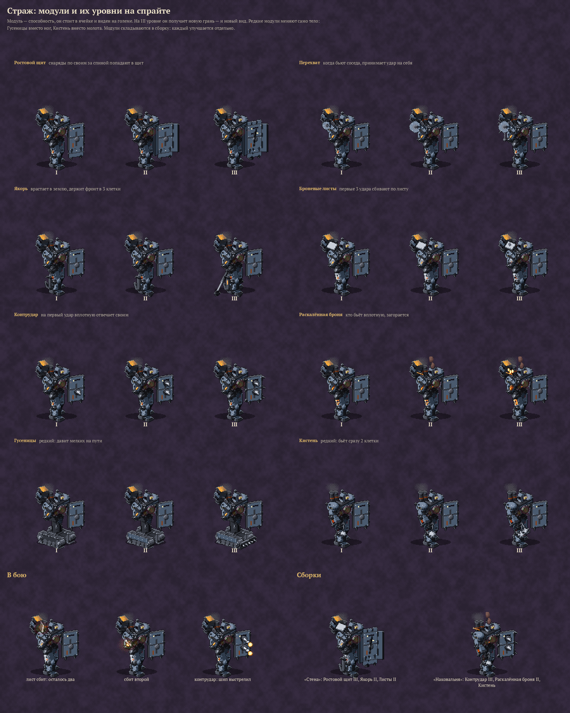

Так же у остальных корпусов: заклинания Мудреца — кольцо с шарами на посохе (по числу перескоков
молнии), колья заземления, лейденские банки, кадило с углями, бак с горелками у подола, колчан
раскалённых клинков; у Горна — магнит, громоотвод на трубе, лишние трубы, свисток, пасть топки,
жадная воронка; у Орудия — мортира на спине, длинный ствол, паучьи лапы (теперь ноги), раструб картечи,
жаровня калёных ядер, бомбы на бедре; у Механика — клепальщик, кран, ящик запчастей, маслёнка,
газовые баллоны сварки, бочка масла. Редкие модули и ядро тоже видны: ядро — окно в груди.

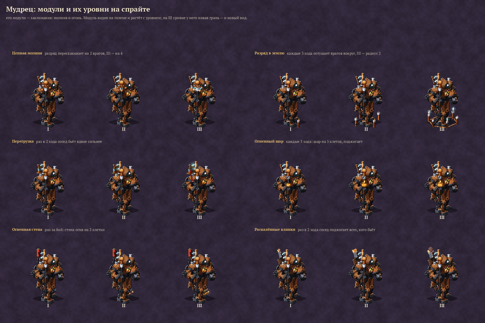

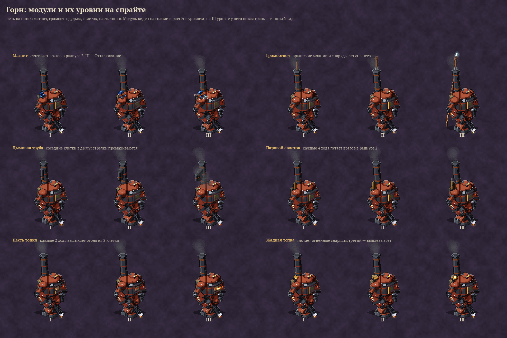

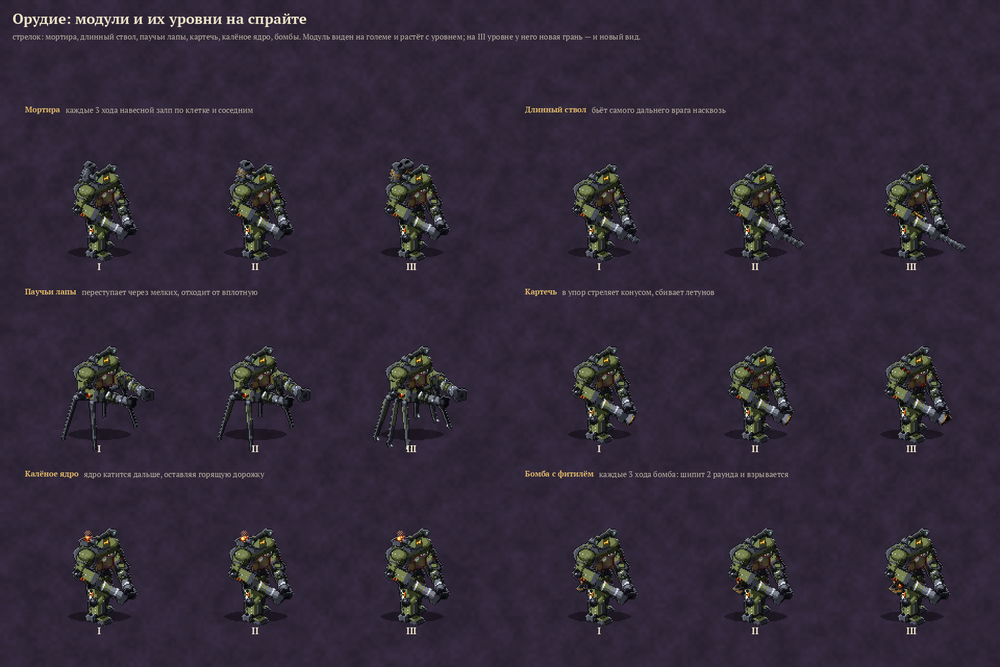

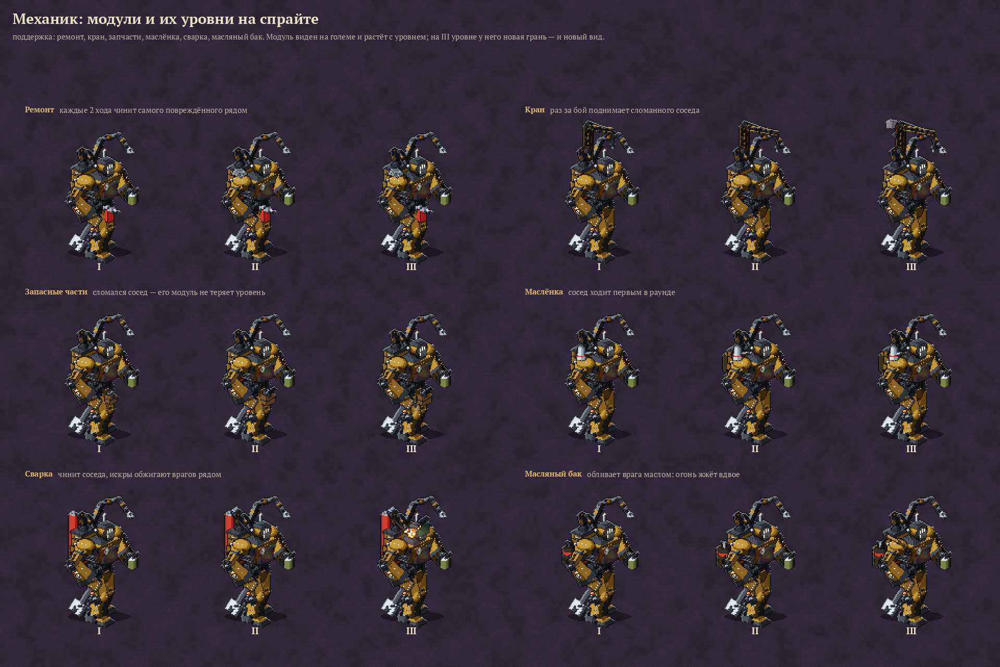

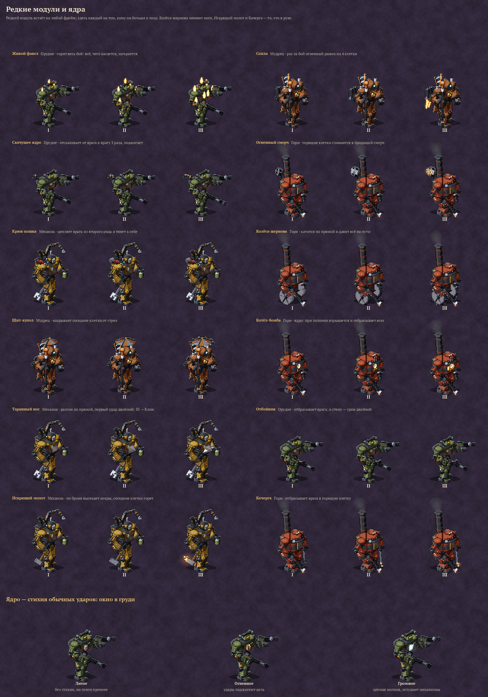

#### Числа — черновик

Подобраны по мерке из [BALANCE.md](BALANCE.md): **1 очко лидерства ≈ 1 эталонный боец**, и фрейм
сильнее эталона ровно настолько, сколько стоит. Здоровье — у верхней границы шкалы своего
размера: големы — элита, но не вдвое сильнее её. Отец колосса на старте равен обычной стартовой
армии и растёт модулями.

| Юнит | Размер | Прочность | Оружие (инициатива) | Броня | Скорость | Лидерство |
|---|---|---|---|---|---|---|
| Страж | 6 | 100 | Паровой молот 1–6 +3 дробящий (3) | 4 | 1 | 7 |
| Мудрец | 5 | 56 | Разряд — заклинание, 1–8 +1 молния, дальность 4 (5), перескакивает ещё на двоих рядом с целью | 2 | 1 | 5 |
| Горн | 5 | 50 | Огнемёт\* 1–6 огонь, конус на 2 клетки (3) | 2 | 1 | 5 |
| Орудие | 5 | 77 | Пушки 1–10 +3 дробящий, дальность 3 (4), ядро накрывает всю клетку мелких; запасное — приклад 1–5 +1 дробящий (2) | 2 | 1 | 5 |
| Механик | 4 | 35 | — | 2 | 2 | 3 |
| Каменщик | 2 | 14 | Молоток 1–4 дробящий (4) | 2 | 2 | призыв |
| Отец колосса | 7 | 120 | Электробулава 1–8 +2 дробящий, размах (1); Миниган\*\* 3 × 1–4 колющий, дальность 4 (4) | 3 | 1 | лидер |
| Изобретатель | 3 | 35 | Шокер 1–6 молния (7) | 1 | 2 | лидер |
| Маньяк | 4 | 50 | Пила 1–8 +2 рубящий (5); Бур 1–4 колющий, бронебойный (3) | 1 | 2 | лидер |
| Зодчий | 4 | 25 | Кирпичи 1–4 +1 дробящий, дальность 2 (5) | 1 | 1 | лидер |

Числа нового оружия (миниган, огнемёт, приклад, бур, Разряд) — черновик до прогонов симуляции.
Големы бьют поздно (инициатива 1–4), зато сильно: мелочь роя с инициативой 8 успевает ударить
первой; только миниган Колосса стреляет раньше его булавы. Орудие стреляет каждый раунд,
кирпичи Зодчего летят каждый раунд. Боевой дух: у големов
99, у Изобретателя 10, у Маньяка 12 (безумцу почти не страшно), у Зодчего 9.

**Типы урона модулей.** Литейщик в основном дробит и жжёт, колющего мало, рубящего нет вовсе
(его даёт только Маньяк). Поэтому латы, хитин и камень ему по зубам, а кожа и стёганка держат его
удары лучше всего.

| Тип | Модули и способности |
|---|---|
| Дробящий | Контрудар, Гусеницы, Кистень, Отбойник, Искрящий молот, Кочерга, Мортира, Калёное ядро, Скачущее ядро, Колёса-жернова, Пресс, Сотрясение |
| Колющий | Таранный нос (клин), Длинный ствол (бронебойный), Картечь, Крюк-кошка, Бойницы |
| Огонь | Жар горна, Огненный шар, Огненная стена, Раскалённые клинки, Раскалённая броня, Пасть топки, Жадная топка, Бомба с фитилём, Сварка, Живой факел, Сопла, Огненный смерч, Котёл-бомба, Смоляной котёл; поджог у Искрящего молота, Кочерги, Калёного и Скачущего ядра, огненного ядра |
| Молния | Разряд, Цепная молния, Разряд в землю, грозовое ядро, Грозовая катушка, Шокер |

- Масляный бак делает облитого врага уязвимым к огню (урон огнём вдвое больше).
- Ростовой щит считается большим щитом: 0–2 с каждого удара, против снарядов 0–4.
- Броневые листы — тот же литой металл.

- **Броня решает**: укус рабочей (1–4, колющий) ранит Стража (броня 4, литой металл держит
  колющий) примерно раз из пяти, Мудреца (броня 2) — заметно чаще. Поэтому Страж держит
  толпу, а рою против Литейщика нужны кислота, солдаты (рубящий металл не держит) и жуки-носороги
  (дробящий). Мудрецу место за спинами Стражей.
- **Горение**: 3 урона в раунд, 3 раунда. Рабочую убивает за 2 раунда, солдату не хватает,
  Стражу почти не вредит. С огнеупорностью — 1 в раунд.
- **Молния** грозового ядра перескакивает ещё на 2 соседних врагов с половиной урона;
  проводник получает от молнии в полтора раза больше.
- **Уровни модулей**: I — база, II — в полтора раза сильнее, III — вдвое и новая грань
  (Мортира: 10 / 15 / 20). Если модуль измеряется не уроном, растёт количество (Броневые листы:
  3 / 4 / 5).
- **Лидерство**: в начале похода 10 (Страж и Механик или два средних фрейма), +1 за бой,
  +3 за босса — к концу около 28, это 5–7 големов.
- **Металл**: 10 за бой, 20 за элиту, 30 за босса, «Пропустить» в мастерской — 8. Ремонт
  сломанного — 3 × лидерство (Механик 9, Страж 21, у Отца колосса вдвое дороже). Новый голем —
  5 × лидерство (15–35). Переплавка — 10. Голем, который не сломался, чинится между боями сам.

#### Сборки — огонь лишь одна из пяти

| Сборка | На чём держится | Сильна против |
|---|---|---|
| Давка | Таранный нос, Гусеницы, Отбойник, Магнит | строя и толпы |
| Крепость | Якорь, Перехват, Ростовой щит, Ремонт, Кран | затяжного боя и элиты |
| Артиллерия | Мортира, Длинный ствол, Картечь за спинами Стражей | медленных врагов и летунов |
| Огонь | Жар горна, Пасть топки, Огненный шар, Калёное ядро, Масляный бак | роя и толпы |
| Гроза | Цепная молния, Перегрузка, грозовые ядра, Громоотвод — вокруг Мудреца | брони и механизмов |

Враги в походе меняются, поэтому одной сборкой его не пройти: обычно армия смешивает две.
Чтобы огонь не стал единственной сборкой:

1. В каждом пуле не больше двух огненных модулей из шести.
2. Горение не складывается: десять источников огня по одной цели дают столько же, сколько один.
3. Урон горения фиксированный: против толпы огонь силён, против боссов и титанов слаб.
4. Огнеупорные враги — саламандры, огненные духи, вражеские големы. В каждом походе хотя бы один
   босс огнеупорен.
5. Местность: камень не горит, болото тушит.

#### Металл, новые големы, поломка

- **Металл** — валюта Литейщика. Откуда: награда за бой, разбор трофеев с побеждённых механизмов,
  «Пропуск» в мастерской, переплавка лишней детали (+2). Куда: ремонт, новый голем, переплавка.
- **Переплавка**: модуль уходит в тигель, и его металл даёт +1 уровень другому модулю того же
  корпуса (3 металла за раз); лишняя деталь тела со стойки плавится в 2 металла. Так ненужный модуль
  не пропадает, а делает сильнее нужный.
- **Новые големы**: «новый голем» иногда выпадает среди трёх предложений мастерской. Его
  собирают с нуля, по шагам: **корпус** — 1 из 2, то есть «какой роли армии не хватает»;
  **тело** — ноги, две руки и голова: штатные корпуса или со стойки; **ядро** — литое, огненное
  или грозовое; **модули** — два модуля I уровня его роли на выбор, остальные ячейки пусты
  и заполняются наградами мастерской; **пуск** — голем оживает, и видно, из чего он собран.
  Стоит металла и лидерства; Страж занимает почти весь лимит.
- **Поломка вместо смерти**: сломанный голем выбывает до ремонта, а один случайный модуль теряет
  уровень насовсем (ремонт возвращает голема в строй, но не уровень; Запасные части Механика рядом
  берегут уровень). Ремонт — 2 металла за голема. Не починил — голем пропускает бои. Это правило
  заменяет общее «погибает один раз».
  На поле видно: ядро гаснет, голем оседает, оторванная деталь лежит рядом.

#### Старт похода

Каждый голем начинает с модулями I уровня и литым ядром, металла — 20. Четыре старта — четыре
разных первых боя: один титан, три малых голема с аугментами, два безумных гибрида, крепость.

| Лидер | Лидерство | Армия | Модули |
|---|---|---|---|
| Отец колосса | 3 | сам и Механик | Колосс: Броневые листы, Кистень, Магнит; Механик: Ремонт |
| Изобретатель | 13 | малые Мудрец (4), Орудие (4) и Механик (2) | Мудрец: Перегрузка и аугмент Грозовая катушка; Орудие: Мортира и Грозовая катушка; Механик: Ремонт и Отражатель |
| Маньяк | 12 | Мудрец (5) и Орудие (5) | Мудрец: Огненный шар и Ноги-пилы; Орудие: Голова-катапульта и Картечь |
| Зодчий | 10 | Страж (7), Механик (3) и 2 каменщика | Страж: Щит-стена и Перехват; Механик: Ремонт |

- **Малые фреймы Изобретателя** — на размер меньше: на 1 ячейку меньше, прибавка удара −1,
  лидерство на 1 дешевле; прочность та же. Запас лидерства в 3 — под малый фрейм уже в первой находке.
- **Отец колосса**: лидерство начинается с 3 (на одного Механика) и растёт, как у всех, — к середине
  похода рядом с титаном встают один-два голема; основное развитие — ячейки и модули.
- **Лидерство держит армию малой**: голем в находке или у торговца, на которого не хватает лидерства, не
  берётся (карточка говорит, сколько нужно); наверху экрана видно «лидерство 8/10».

#### Редкие модули — меняют поведение, а не цифры

Выпадают нечасто и ставятся в любой фрейм, кроме отмеченных. Самые сильные несут свой минус.

| Модуль | Что делает |
|---|---|
| Живой факел *(огонь)* | в начале боя голем поджигает сам себя и горит весь бой (огнеупорность бережёт): всё, чего он касается, загорается, мелкие враги обходят его клетку. Пока горит, его нельзя чинить |
| Сопла *(огонь)* | раз за бой огненный рывок на 4 клетки вперёд, клетки позади горят; после рывка голем ход стоит |
| Скачущее ядро *(огонь, Орудие)* | ядро отскакивает от врага к врагу 3 раза и поджигает каждого |
| Огненный смерч *(огонь)* | раз за бой, когда рядом горят 3 клетки и больше, они сливаются в смерч, который 3 раунда бродит в сторону врага |
| Крюк-кошка | цепляет врага из второго ряда и подтягивает к себе |
| Щит-купол | накрывает соседние клетки от стрел |
| Котёл-бомба (ядро) | при поломке взрывается и отбрасывает всех вокруг |
| Таранный нос | в начале боя разгоняется по прямой и давит мелочь, первый удар двойной. III: **Клин** — врагов на пути разгона отбрасывает в стороны |

Гусеницы и Жернова стали редкими ногами, Кистень, Искрящий молот и Кочерга — редкими руками
(таблицы деталей выше), Отбойник ушёл в пул Орудия.

#### Лидеры

Лидер — такой же юнит на поле со своей ролью и **набором способностей**: способности в бою
срабатывают сами по условию, плюс одно **правило похода**. Четыре лидера — четыре разных способа
играть Литейщиком.

- **Пассивки**: у каждого лидера огнеупорность класса, своя пассивка («постоянно» в таблице)
  и своя слабость.
- **Гибель лидера бой не заканчивает**: его способности отключаются до конца боя, к следующему
  бою он возвращается.
- **Развитие**: после каждого босса — выбор 1 из 2: усилить одну из способностей или получить
  новую.

| Лидер | Где сила |
|---|---|
| Отец колосса | в самом лидере: один сверхголем |
| Изобретатель | в способностях, которые он добавляет армии |
| Маньяк | в безумных конструктах, собранных против правил |
| Зодчий | в армии, которая разворачивается в укрепления |

У каждого есть своя вещь, которой нет ни у кого — её видно на поле с первого боя:

| Лидер | Своя вещь в бою |
|---|---|
| Отец колосса | **Бросок титана**: хватает врага и швыряет его в гущу его же строя |
| Изобретатель | **Тесла-сеть**: между его големами бьёт молния, армия — забор под током |
| Маньяк | **Трофеи**: отрывает детали от павших врагов и прикручивает их големам — Страж с осиными крыльями летит |
| Зодчий | **Чертёж и Гарнизон**: в первый ход встают стены, армия ждёт за ними, враг идёт коридорами |

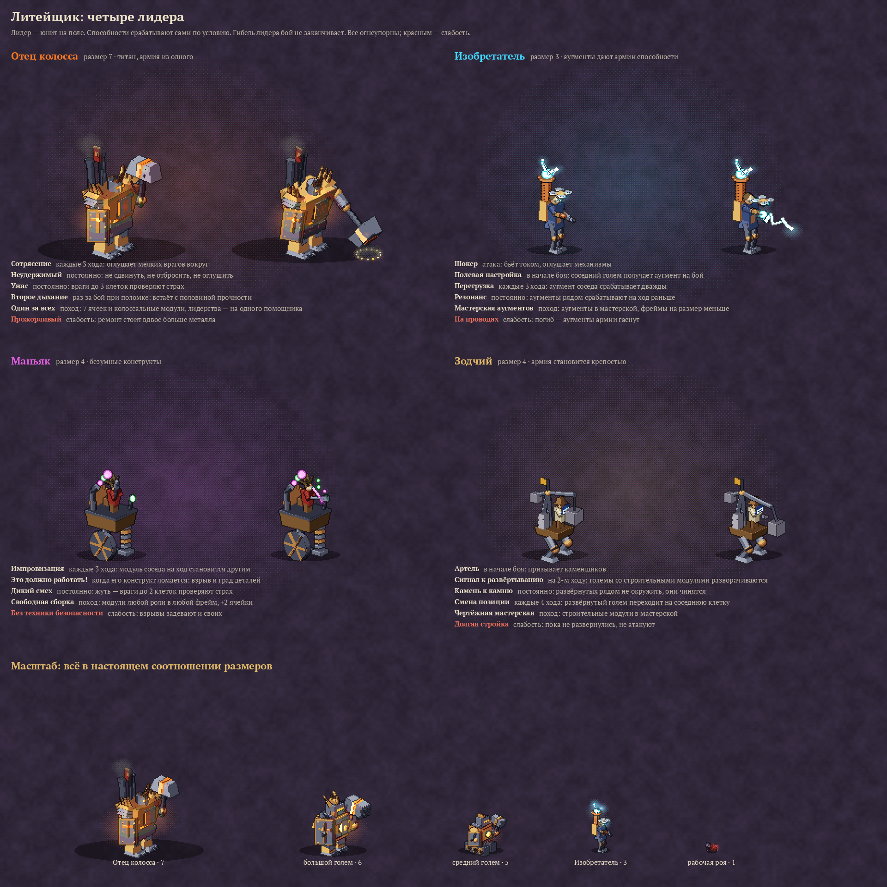

##### Отец колосса — армия из одного

Сам лидер — титан размера 7 (4×4 клетки): почти вдвое выше большого голема, со своей фигурой —
машина для убийства: широкий корпус из тёмного оружейного металла с красными предупредительными
полосами, низкая бронированная голова с тремя красными глазами в щели забрала и решёткой-челюстью,
топка за решёткой в груди, на спине генератор, выхлопные трубы и мачта с красным маяком. В одной
руке электробулава — стальные рёбра вокруг голубого светящегося пояса, медная обмотка на рукояти,
треск разрядов; в другой миниган — шесть стволов в обоймах, привод и короб с лентой. Удар булавы
бьёт молнией в землю — отсюда и Сотрясение.
Лидерства у него почти нет (хватает на одного малого помощника), поэтому он почти всегда один —
и всё, что даёт мастерская, идёт ему.

| Способность | Когда | Что делает |
|---|---|---|
| Сотрясение | каждые 6 ходов | бьёт булавой в землю: 1–6 дробящий по всем вокруг (тело 4×4 — это десятки мелких разом), мелких врагов оглушает |
| **Бросок титана** | каждые 4 хода, вместо удара | хватает самого крупного врага рядом (до размера 5) и швыряет его туда, где его свои стоят гуще всего, до 6 клеток: брошенному 3–12 дробящим, всем вокруг места падения 1–6, мелких оглушает. жук летит в толпу жуков, солдат — на головы рабочим |
| Неудержимый | постоянно | его нельзя сдвинуть, отбросить или оглушить |
| Ужас | постоянно | враги до 3 клеток каждый раунд проверяют страх 1–9 |
| Прожорливый | слабость | ремонт стоит вдвое больше металла — а чинить приходится только его |
| Второе дыхание | раз за бой, при поломке | встаёт с половиной прочности |
| Один за всех | правило похода | свой фрейм Колосс: 7 ячеек, модули из пула любого фрейма и **колоссальные модули**, которые не встают ни на кого другого: плечевая батарея, реактор с трубами |

Развитие: +1 ячейка, новый колоссальный модуль или бросок дальше — каждые 2 хода, на 8 клеток.

**Колоссальные модули** — то, ради чего Колосс один стоит армии: каждый — очень мощное оружие или эффект,
каких нет ни у одного голема. Встают только на Колосса, занимают по ячейке. *(Предложение; числа — до
баланса.)*

| Модуль | Что делает | Минус |
|---|---|---|
| Плечевая батарея | каждые 3 хода — залп шести ракет по шести разным клеткам на дальности до 6: каждая 1–6 +2 огонь по площади (клетка и соседние), поджигает | ближе 2 клеток не стреляет |
| Реактор с трубами | разгон: каждый 3-й ход Колосс ходит дважды; жар из труб — враги в радиусе 1 каждый ход получают огонь 1–4 | сломан — взрывается: радиус 2, огонь 2–12 всем, и своим |
| Рельсотрон | каждые 4 хода — разряд по прямой через всё поле: 4–24 колющий, броня считается вполовину, пробивает каждого на линии | ход перед выстрелом стоит, набирая заряд |
| Ковш-дробилка | каждые 2 хода хватает врага размера до 4 на соседней клетке: 3–18 дробящий, и швыряет обломки на 3 клетки — 1–6 дробящий там, куда упали | пока дробит, не бьёт булавой |

##### Изобретатель — аугменты дают армии способности

Аугментированный человек (размер 3) с механическими ногами и рукой, катушкой за спиной и шокером.
Его армия — много малых големов, на которых он вешает **аугменты**. Аугмент даёт не прибавку
к цифрам, а новую способность:

| Аугмент | Способность |
|---|---|
| Грозовая катушка | если рядом враг — каждые 2 хода бьёт его молнией |
| Отражатель | первый удар в бою отражается в атакующего тем же типом урона |
| Пружинный рывок | в начале боя прыгает к ближайшему врагу |

| Способность | Когда | Что делает |
|---|---|---|
| Шокер | атака | бьёт током, оглушает механизмы |
| Полевая настройка | в начале боя | соседний голем получает случайный аугмент на этот бой |
| Перегрузка | каждые 3 хода | аугмент соседа срабатывает сразу дважды |
| Резонанс | постоянно | аугменты големов в радиусе 2 срабатывают на ход раньше |
| **Тесла-сеть** | постоянно | пока он стоит, каждый его голем связан молнией с двумя ближними своими в 5 клетках; враг, стоящий на линии между двумя, каждый ход получает 1–4 молнией (машина — в полтора раза). Армия Изобретателя — забор под током: толпа, удержанная между големами (Удержание), горит на проводах |
| На проводах | слабость | если он погиб, все аугменты армии гаснут до конца боя, и сеть тоже |
| Мастерская аугментов | правило похода | аугменты в мастерской; фреймы отливаются на размер меньше — ячеек меньше, но лидерство дешевле, поэтому големов больше; у каждого фрейма ячейка аугмента |

Развитие: новый вид аугментов или +1 аугмент на голема.

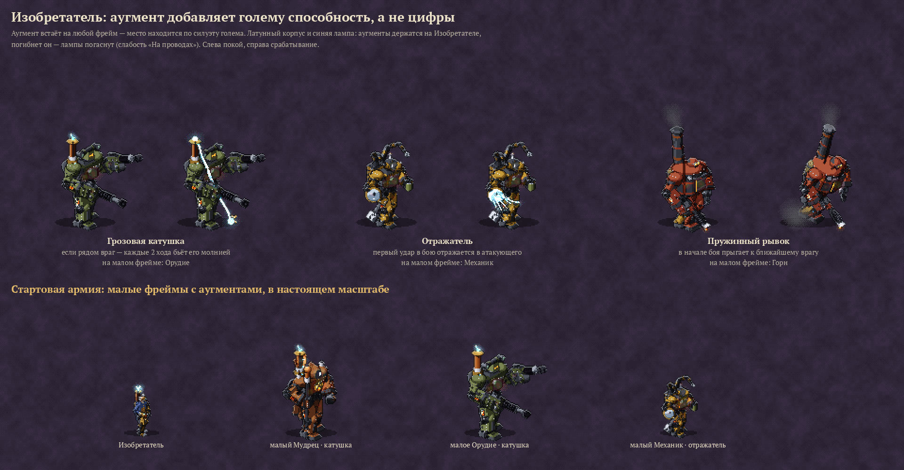

##### Маньяк — безумные конструкты

Безумец в экзоскелете, собранном из хлама (размер 4): сам сидит в открытой кабине-клетке, в очках
и с дыбом стоящими волосами; пластины и ноги разномастные, вместо одной руки циркулярная пила,
вместо другой бур, на спине искрящая катушка и кривая труба. Игнорирует правила сборки: детали
ставятся не на свои места, каждая «незаконная» деталь даёт причуду — полезную или опасную.

| Безумный модуль | Способность |
|---|---|
| Ноги-пилы | постоянно: катится и режет всех на пути |
| Голова-катапульта | каждые 2 хода: бросает лом через строй во второй ряд |
| Кулак на пружине | каждые 3 хода: удар через клетку, отбрасывает |
| Рука-рука-рука | каждый ход: молот, клешня и пушка по очереди |
| Вверх ногами | ходит на руках-колёсах, ноги машут молотами |
| Пылающая катапульта | каждые 3 хода: швыряет горящего врага обратно в его же строй |
| Салют | при поломке: фейерверк по 5 случайным клеткам (огонь), враги в них проверяют страх 1–7 |

Типы урона: Ноги-пилы — рубящий; Голова-катапульта, Кулак на пружине и Вверх ногами — дробящий;
Рука-рука-рука бьёт по очереди дробящим, рубящим и колющим; Пылающая катапульта — дробящий
и огонь; Салют — огонь; град деталей «Это должно работать!» — колющий. Импровизация меняет и тип:
молот, изрыгающий пламя, бьёт огнём.

| Способность | Когда | Что делает |
|---|---|---|
| Импровизация | каждые 3 хода | модуль соседнего конструкта на ход становится другим (молот изрыгает пламя, щит раскрывается в пилу); знак — фиолетово-зелёные искры и значок нового эффекта |
| Это должно работать! | когда его конструкт ломается | тот разлетается взрывом и осыпает врагов деталями |
| Дикий смех | постоянно | жуть: враги до 2 клеток каждый раунд проверяют страх 1–8 |
| **Трофеи** | враг падёт в 3 клетках | отрывает от павшего деталь и прикручивает ближнему голему до конца боя (до двух на голема): крылья осы — голем летает, жало скорпиона — яд, рог жука — разгон, панцирь мокрицы — шипы, косы богомола — два удара, ноги кузнечика — прыжок сразу, мешок бочонка — кислота при поломке, фонарь светляка — вспышка, железа паука — плевок, жвалы муравья — +1 к удару; от машины — её первый модуль, от лидера — голова на пике (ужас) |
| Без техники безопасности | слабость | взрывы его конструктов задевают и своих |
| Свободная сборка | правило похода | модули любой роли в любой фрейм (Мудрец на Ногах-пилах, Страж с Мортирой), +2 ячейки, в мастерской появляются безумные модули |

Развитие: новый безумный модуль или причуды чаще полезны.

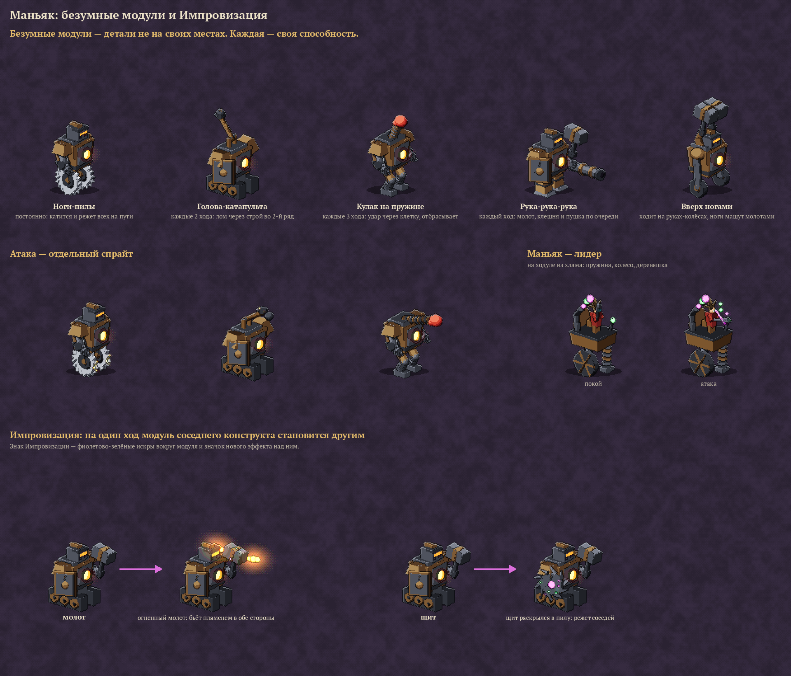

##### Зодчий — армия становится крепостью

Архитектор на шагающем кране (размер 4), сам слаб — бросает кирпичи. Его сила в армии:
у големов два режима, **ходовой и развёрнутый**. Развёртывание — способность по условию
(«на 2-м ходу», «когда враг ближе 3 клеток»…); развёрнутый голем неподвижен, но становится
постройкой. Строительные модули встают в пулы фреймов по роли.

| Строительный модуль | Фрейм | Развёрнутый вид | Что делает |
|---|---|---|---|
| Бойницы | Орудие | башня | каждый ход стреляет во 2–3 ряд |
| Щит-стена | Страж | стена на 3 клетки | мелкие враги не проходят, крупные проламывают |
| Створки | Страж | ворота | свои проходят, враги нет |
| Смоляной котёл | Горн | котёл над топкой | каждые 3 хода льёт кипящую смолу на клетки перед собой: враги в них вязнут и ходят на клетку меньше; смола загорается от огня |
| Пресс | Страж | вкапывается | первый враг рядом расплющен |
| Громовая вышка | Мудрец | вышка с разрядником | каждые 2 хода бьёт молнией ближайшего врага в радиусе 4 |
| Подъёмная стрела | Механик | подъёмный кран | раз в 3 хода переставляет соседнего голема |
| Полевая кузня | Механик | ремонтная кузница | раз в 2 хода чинит голема рядом |

Уровни построек видны на спрайте: I — брёвна и хлам, II — камень и бронза, III — железо, шипы,
руны. Тип брони постройки — по уровню: дерево (горит и рубится), камень, железо.

**Каменщик** — призыв Зодчего: малый голем размера 2 (двое в клетке). Как все големы,
огнеупорен и проводник.

| Способность | Когда | Что делает |
|---|---|---|
| Свой на стройке | постоянно | проходит сквозь свои стены и развёрнутых големов |
| Кладка | каждые 2 хода | кладёт отрезок стены I уровня на соседнюю клетку со стороны врага |
| Заделать пролом | когда рядом разрушена своя стена | за ход восстанавливает её |
| Без хозяина | слабость | если Зодчий погиб, каменщики бросают работу и только стоят |

| Способность | Когда | Что делает |
|---|---|---|
| Артель | в начале боя | призывает каменщиков: 2, и ещё по одному за каждого побеждённого босса (до 5) |
| Сигнал к развёртыванию | на 2-м ходу | големы со строительными модулями разворачиваются разом |
| Камень к камню | постоянно | развёрнутых големов рядом не окружить, они понемногу чинятся |
| **Чертёж** | в начале боя | перед армией, в двух клетках от её фронта, встают 8 стен столбцом — по две с просветом в две: враг идёт коридорами прямо на бойцов, которые держат просветы (Удержание). Стена держит клетку, не бьёт, не армия; враг её обходит, а ломает, только когда больше бить некого; стрелки по ней не бьют |
| **Гарнизон** | пока стоит стена | армия Зодчего ждёт за стенами и выходит только к врагу ближе 3 клеток — до 10-го хода; стрелки бьют из-за стен |
| Долгая стройка | слабость | пока не развернулись, строительные големы не атакуют |
| Смена позиции | каждые 4 хода | развёрнутый голем сворачивается, шагает и разворачивается снова |
| Чертёжная мастерская | правило похода | строительные модули в мастерской |

Развитие: чертёж шире (14 стен), развёртывание на ход раньше, +1 способность развёрнутым, или **Цитадель** — большой
голем, который разворачивается в крепость, где могут стоять другие големы.

Цитадель размером с титана: в походе — ходячий донжон со стенами, сложенными за спиной;
развёрнутая — донжон, две плечевые башни, стены в обе стороны и угловые башни. Големы стоят
на крыше и башнях.

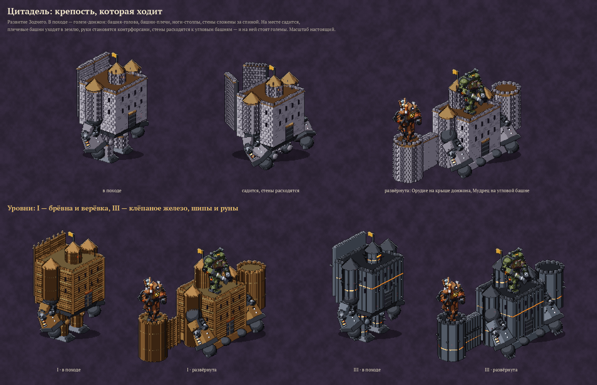

Как играется: сильна против роя (стены режут толпу на коридоры), слабее против гигантов
(проламывают стены) и летающих (перелетают), простаивает, если враг обходит укрепления.

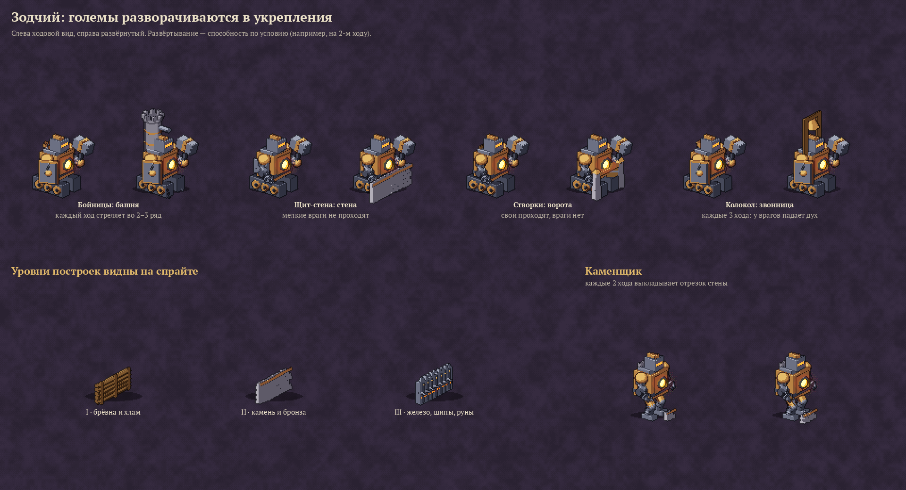

Другие идеи лидеров на потом: Кукловод (големы на нитях), Металлург (материалы), Маршал (строй).

- **Слабости**: медленные, их окружают, подвижной роли нет, каждая потеря — заметная доля армии,
  у врагов есть ответы (кислота разъедает броню, молнии и магниты бьют по механизмам,
  огнеупорные враги не боятся огня).

#### Мастерская — 15–30 секунд между боями

1. После боя — **выбор 1 из 3**: модуль или деталь тела.
2. Модуль сам встаёт на подходящего голема, деталь — на того, кому она нужнее (изменение сразу
   видно на спрайте); можно перетащить на другого. Снятая деталь уходит на стойку.
3. «В бой».

Мастерская — это стапель: голем крупно на подставке перед своим чертежом. Слева от него — тело:
выноски к голове, правой и левой руке, ногам; справа — начинка: грудь с ядром и ячейки модулей
(спина, плечо, ствол, пояс), занятые или пустые.
Выбранная деталь висит на крюке крана над своим гнездом. Слева — вся армия на стойке, справа — ящик
с деталями, которые принёс бой. Так каждый голем собирается деталь за деталью, а не получает бонус.

- **Повтор = улучшение**: взял модуль, который уже стоит, — он поднимается на уровень. Без крафта.
- Справа у стапеля — три вкладки: **добыча** (выбор 1 из 3), **стойка** (щелчок по гнезду тела на
  чертеже — что можно в него поставить: детали со стойки, деталь с другого голема, запасная; снятая
  уходит на стойку, переставлять бесплатно), **ремонт** (сломанный голем — что потеряно, сколько
  стоит, вся армия по строю; красная метка на вкладке, когда есть что чинить).
- Пульт внизу: «Автосборка», «Починить» (вентиль), «Переплавка» (ржавая кнопка — то, что плавит),
  «Пропуск» (даёт металл) и рубильник «В бой».
- Полная пересборка — только в лагере: **Привал у горна**. Там вся армия стоит на подставках, у каждого
  голема видны детали тела, ячейки модулей и ядро, и всё снимается и ставится бесплатно: модули — между
  големами одного корпуса, детали и ядра — между любыми (неподходящие гнёзда тускнеют, подходящее светится).
  Снятое лежит на верстаке. И, как Улей у роя, привал — подарок, а не магазин: «что нашлось», 1 из 3 —
  редкая деталь, ядро или отдых у горна (починить всю армию даром).
- Против монотонности: виды предложений (новый модуль, улучшение, деталь тела, редкий, новый
  голем, переплавка, трофей с побеждённого механизма); редкие модули меняют поведение, а не цифры
  (живой факел, сопла, крюк-кошка); ячеек мало — приходится выбирать.

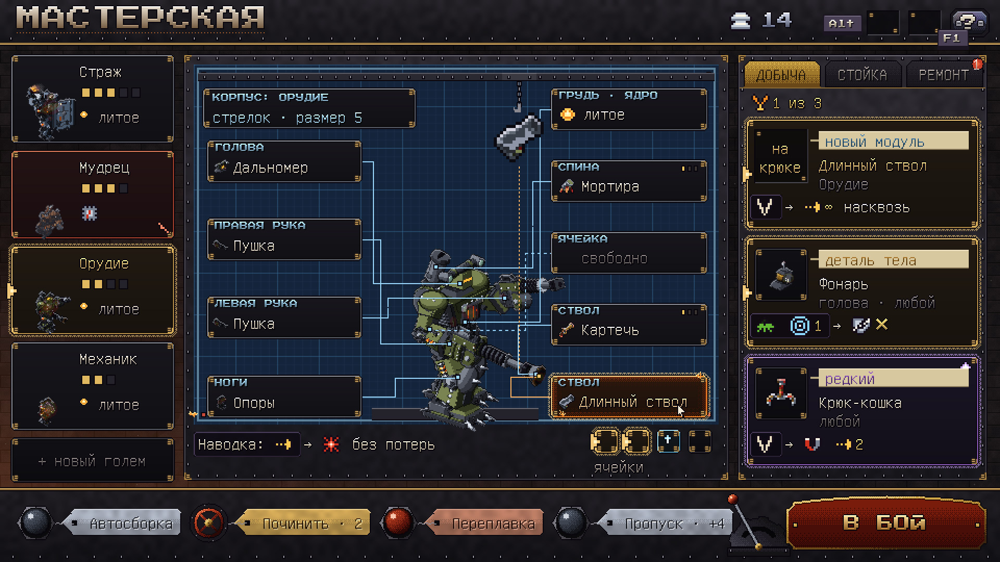

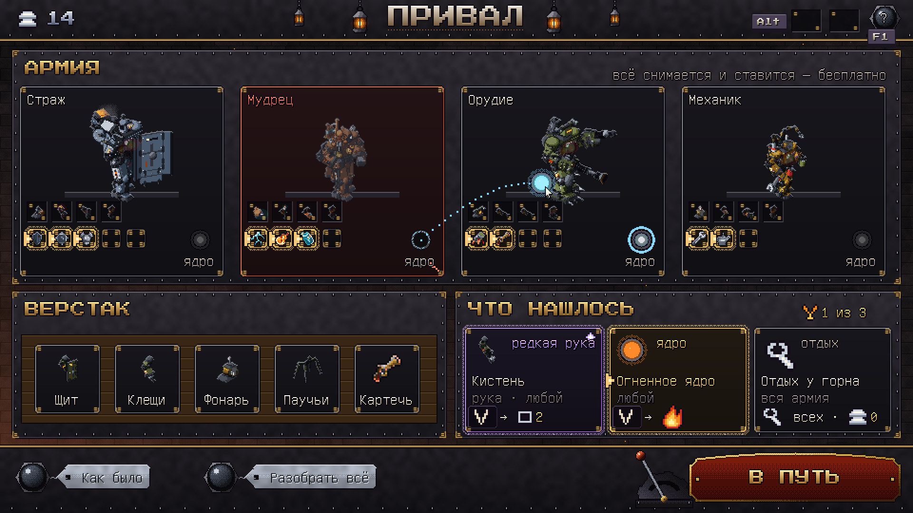

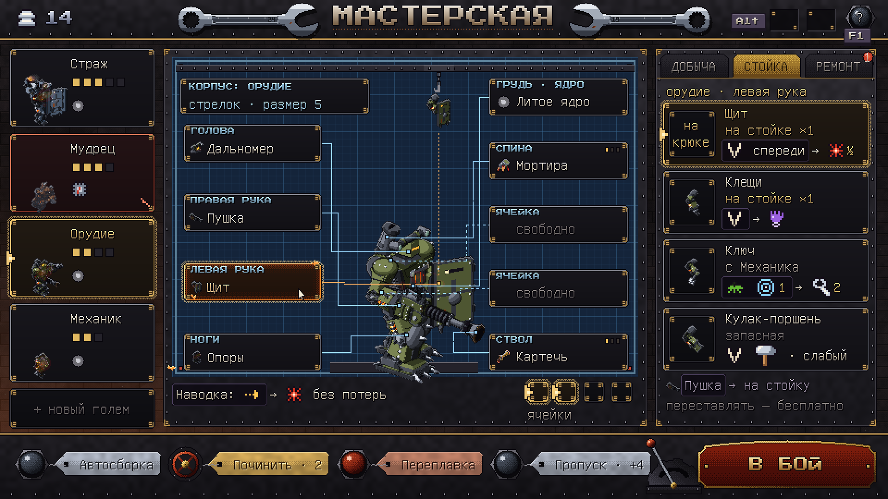

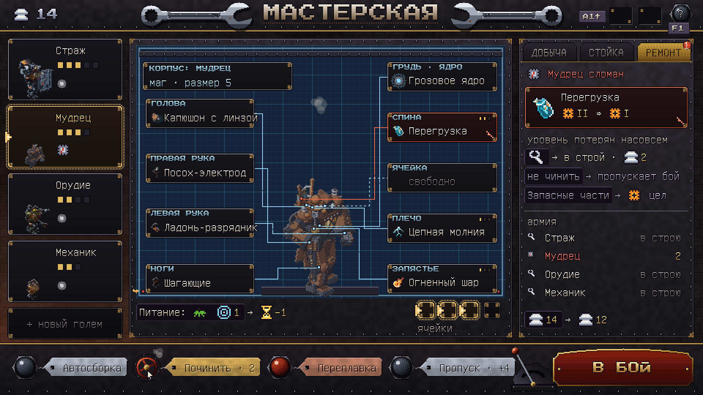

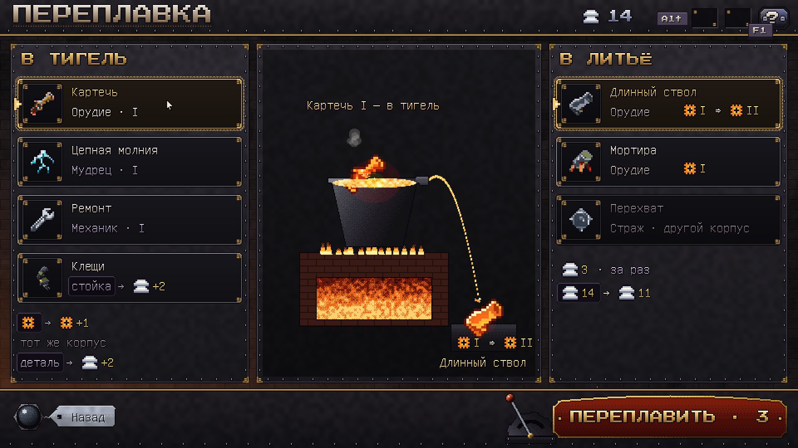

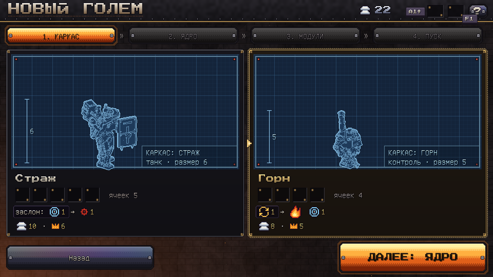

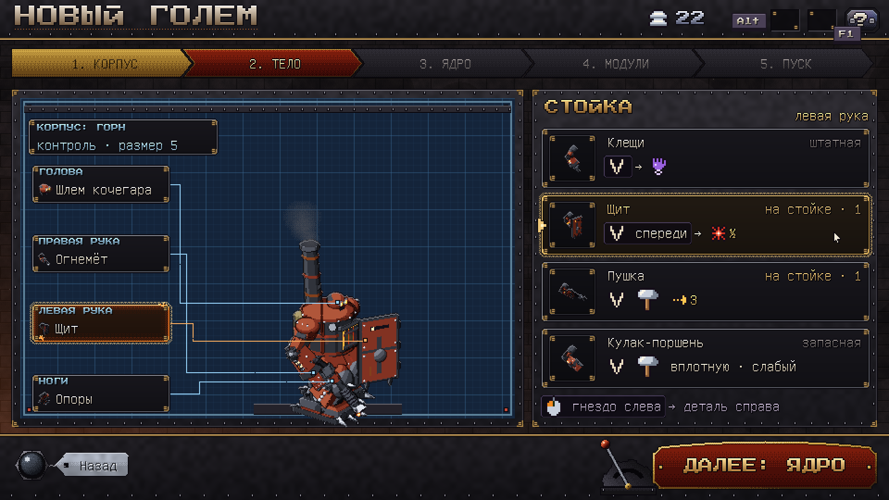

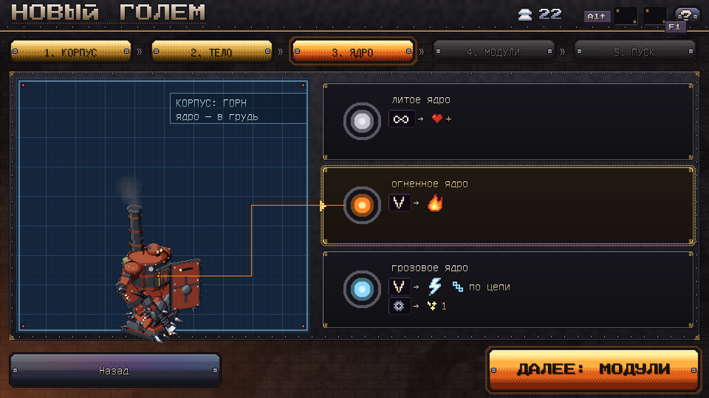

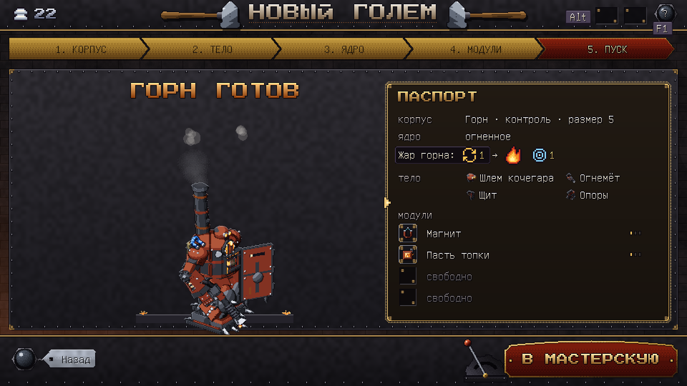

### Рой — масса и селекция

Противоположность Литейщика: много дешёвых существ, отдельная особь ничего не стоит, сила —
в числе, окружении и в породе, которую игрок выводит за поход. Ощущение — «я вывожу породу».

#### Айдентика — где сильнее, где слабее

| Сторона | Уровень | Почему |
|---|---|---|
| Число | очень сильно | окружение, масса |
| Подвижность | сильно | осы, кузнечики — то, чего нет у Литейщика |
| Приспособляемость | очень сильно | выводок, мутации, эволюция форм |
| Яд и кислота | сильно | стихии роя |
| Прочность особи | очень слабо | 5–14 здоровья |
| Броня | слабо | хитин |
| Против растаптывания и ударов по площади | очень слабо | толпа гибнет клетками |
| Огонь | слабо | горящая мелочь бежит (общее правило) |

Способности только биологические: укус, жало, яд, кислота, панцирь, прыжок, полёт, феромоны,
размножение, пожирание — и пси Разума улья, воля роя, а не магия. Никаких механизмов и заклинаний.

#### Пассивки и слабость класса

- **Хитин** — тип брони большинства форм: держит рубящий, ломается от дробящего.
- **Стая** — +1 к боевому духу за каждого своего соседа, до +4: вместе особи смелые,
  поодиночке бегут. Это ответ массы на страх и сокрушительные удары.
- **Пожирание** — убив врага, особь съедает труп и лечится на четверть здоровья; после боя это
  биомасса.
- **Обезглавленный рой** (слабость) — если лидер погиб, все особи проверяют страх 1–9.

#### Касты и предел роя

| Каста | Размер | Очков предела | Основа |
|---|---|---|---|
| Рабочая | 1 | 1 | 6 здоровья, укус 1–3 колющий, инициатива 5, броня 0, скорость 3, боевой дух 6 |
| Солдат | 2 | 3 | 10 здоровья, жвалы 1–5 рубящий, инициатива 5, броня 2, скорость 2, боевой дух 9 |
| Гигант (мутация) | +1 к размеру | вдвое больше | вожак и раздутая способность формы (см. «Гигантизм») |

**Рой — буквально рой.** Особь слаба (рабочая ≈ 0,2 эталонного бойца, солдат ≈ 0,65), зато их сотни.
**Предел роя** считается в очках: рабочая 1, солдат 3. Старт — 100 очков армии и лидер, предел —
100–140 (у каждого лидера свой, разницу дозаполнит выводок), +6 за бой, +20 за босса: к концу похода
225–265 очков, 180–230 особей на поле. Сила роя — в пределе и в породе, а не в отдельной особи: после
победы вылупляется всё (павшие — своей породой, сверху кладки рабочих), рой переполняет предел, лишних
съедают — сначала рабочих, самой многочисленной формы (биомасса за каждые два съеденных очка). Наверху
экрана видно «предел 92/100». Против роя у Литейщика — удары по площади: растаптывание, Сотрясение,
огонь, залп, ядро, накрывающее клетку.

#### Стаи

На поле выходит весь рой, 50–80 особей, и встаёт он **стаями**. Стая — все особи одного вида: одна
форма, каста и набор черт (как группы на экране выводка). Стая встаёт целиком, по общему правилу
строя (см. «Строй сам»): её место задаёт роль вида — мокрицы в первый ряд, осы и кузнечики на края,
бочонки и пауки-плевуны назад; до 4 мелких в клетке или до 2 крупных (размер 2, солдаты); крупные с мелкими в
одной клетке не стоят. Лидер и гиганты встают по одному. Стыки стай
решают и выводок: пары — это соседи на стыке двух стай. Свести двух нужных родителей можно Брачным
полётом Матки — с ним пару выбирают сами, а не по соседству.

**Каждый лидер меняет, как работают все стаи его роя.** Правило — способность стай в карточке
лидера.

| Лидер | Стаи | Плюс | Цена |
|---|---|---|---|
| Матка | **Тесные стаи**: в клетке до 6 мелких вместо 4 | на том же фронте бьёт больше особей, рой занимает меньше места | удары по площади и растаптывание задевают больше особей |
| Разум улья | **Одна мысль на стаю**: вся стая бьёт ту цель, на которую напала первая её особь | стая разбирает врагов по одному | лишний урон пропадает, на других врагов стая не отвлекается |
| Пожиратель | **Свора**: стаи бросаются туда же, куда бросился он; тела убитых оставляют ему | рой давит туда, где прорвался зверь, а вожак всегда сыт | сами особи больше не лечатся пожиранием |
| Чума | **Пёстрые стаи**: в одну стаю можно ставить разные виды; пары в выводке складываются и внутри стаи | порода смешивается быстрее, химеры и гибриды встречаются чаще | пёструю стаю трудно держать в одном очертании: быстрые обгоняют медленных |

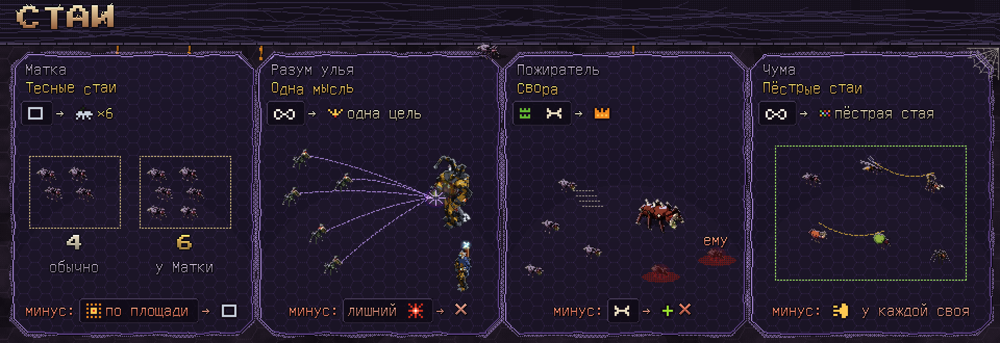

Бой идёт сам, поэтому интерфейс в бою почти пустой: тонкая полоса сверху — перетягивание сторон
(сколько роя, сколько врагов), пауза, скорость одной кнопкой (×1 → ×2 → ×4) и «в конец» — сразу
к итогу; номер хода — мелко. Всё остальное — на поле: здоровье обоих лидеров над ними, срабатывание
способности — иконкой над лидером, состояния — значками над юнитами. Кнопок способностей нет.
На паузе на любого — своего или врага — можно навести и прочитать его карточку. Потери по стаям —
на экране после боя.

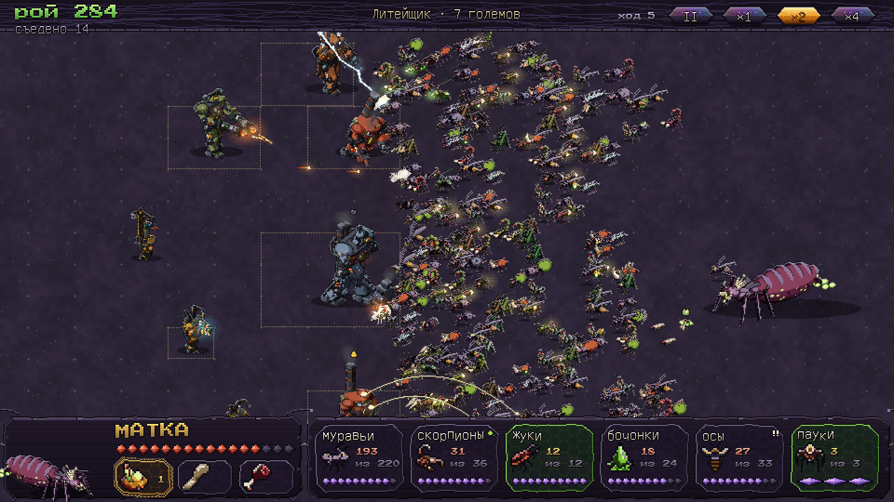

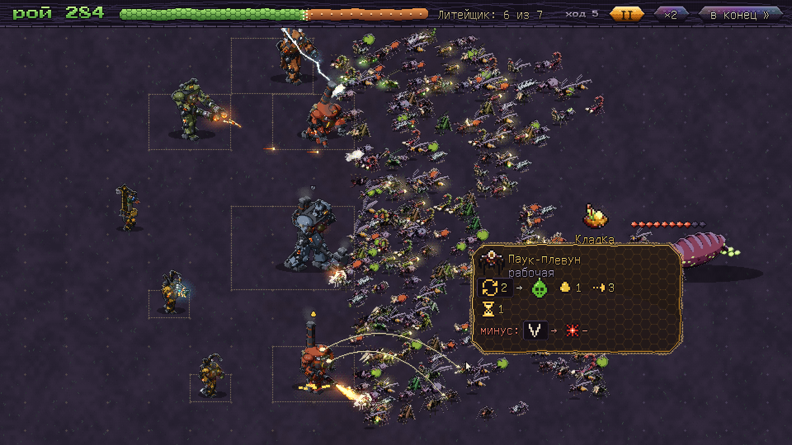

#### Черты и формы

**Первая (главная) черта задаёт форму тела и роль**, остальные добавляются деталями и дают ту же
способность в ослабленном виде — поэтому даже мелкие особи легко различимы:

| Черта | Форма, если главная | Как деталь | Роль |
|---|---|---|---|
| — | муравей | — | масса |
| Крылья | оса: тонкая талия, полосатое брюшко | крылья | прорыв в тыл |
| Жало | скорпион: хвост дугой, клешни | жало на брюшке | убийца крупных |
| Кислотная железа | «бочонок»: огромное светящееся брюшко | светящийся мешок | против брони |
| Рог | жук-носорог: надкрылья куполом | рог на голове | таран |
| Панцирь | мокрица: сегменты-пластины | шипы на спине | танк |
| Прыгучие ноги | кузнечик: длинное тело | мощные задние ноги | прыжок в тыл |
| Серпы | богомол: вертикальная грудь | передние лапы-серпы | рубака |
| Светлячок | светляк: щиток и фонарь | фонарь на брюшке | поддержка |
| Клейкие железы | паук-плевун: головогрудь куполом, восемь длинных ног | раздутые железы над жвалами | держит врага издали |

**Черта-деталь** даёт маленькую версию способности формы — одно простое правило. Слабость тела
формы деталь не переносит (крылатый муравей не хрупкий, как оса), но у некоторых частей есть своя
причуда. У особи не больше двух деталей. Гигантизм и эволюция раздувают способность формы,
а не детали. Числа — черновик.

| Деталь | Что даёт | Причуда части |
|---|---|---|
| Крылья | **Перепархивает**: свой строй его не задерживает — проходит над своими | подожжённая падает и поджигает клетку |
| Жало | **Жальце**: пробивший удар добавляет 1–2 яда | — |
| Кислотная железа | **Кислотный мешок**: раз за бой плевок на 2 клетки, −1 брони цели | при гибели брызжет на одного соседа, своего тоже |
| Рог | **Рожок**: первый удар боя +2 и дробящий | — |
| Панцирь | **Шипы на спине**: кто бьёт вплотную, получает 1 колющего | — |
| Прыгучие ноги | **Скачок**: в первом раунде +2 к скорости (через строй не прыгает) | — |
| Серпы | **Быстрые лапы-серпы**: инициатива +2 — бьёт раньше | — |
| Светлячок | **Фонарик**: раз за бой вспышка — соседние враги раунд промахиваются | светится: стрелки целятся в него первым |
| Клейкие железы | **Клейкий плевок**: раз за бой плюёт на 2 клетки — враг приклеен к своей клетке на раунд | — |

Так сочетания складываются в породу: жук с крыльями проходит над своими к цели и бьёт Разгоном
(«Летучий таран»), муравей с жалом и рогом в первом раунде бьёт дробящим и травит, оса
с кислотным мешком раз за бой снимает броню со стрелка.

| Форма | Способность | Слабость |
|---|---|---|
| Муравей | **Закрыть брешь**: когда соседний муравей гибнет, другой тут же встаёт на его клетку — строй муравьёв не рвётся | — |
| Оса | **Полёт**: летит через строй, бьёт стрелков и лидеров первыми; скорость +1 | хрупкая; подожжённая или сбитая падает |
| Скорпион | **Жало**: колет, и пробивший удар отравляет (1–4 яда у рабочей, 1–6 у солдата; яд копится) и разъедает броню: −1 до конца боя, не больше −2 с одной цели. На машины яд не действует, но броню разъедает и им | медленнее |
| Бочонок | **Плевок** кислотой на 3 клетки, снимает броню | мягкое тело; при гибели **лопается** кислотой на всех соседей, своих тоже |
| Жук-носорог | **Разгон**: первый удар боя ×1,5 и отбрасывает; бьёт дробящим; тяжёлый хитин | медленный |
| Мокрица | **Шипы**: кто бьёт её вплотную, получает колющий; раненая ниже половины **сворачивается** — +3 брони, но не бьёт; тяжёлый хитин | слабый удар, медленная |
| Кузнечик | **Прыжок**: в первом раунде перепрыгивает строй к дальнему врагу; **приземление** сбивает с ног мелких врагов вокруг — раунд они не действуют. Оса — убийца в тылу, кузнечик — бомба в тылу | после прыжка один и окружён |
| Богомол | **Серпы**: два рубящих удара за раунд, инициатива +2 | Стая на него не действует |
| Светляк | **Вспышка** (каждые 3 хода): соседние враги раунд промахиваются; ослеплённый два хода после этого не слепнет снова — туча светляков не держит голема слепым весь бой | светится: стрелки целятся в него первым |
| Паук-плевун | **Плевок** (каждые 2 хода): липкий яд на 3 клетки — цель приклеена к своей клетке на раунд: ходить не может, бить может; яд 1–4 у рабочей, 1–6 у солдата. Клей держит и машины, яд им не страшен. Второй стрелок роя и единственная форма, что держит врага на месте | между плевками не стреляет; слабый укус: до кого дошли вплотную, тот почти беззащитен (вполсилы, дробящий) |

Типы урона: укус рабочей, жало и шипы — колющий, жвалы солдата и серпы — рубящий, рог —
дробящий, плевок бочонка — кислота, плевок паука — яд. Тип брони — по форме тела: хитин у большинства, тяжёлый хитин
у жука-носорога и мокрицы, мягкое тело у «бочонка».

Окрас и пропорции (брюшко, голова, длина ног) тоже наследуются, поэтому в толпе нет двух
одинаковых особей. Спрайт собирается из черт сам, поэтому любое сочетание рисуется без ручной
работы: 10 форм × детали × касты × гигантизм × химеры — больше трёх тысяч вариантов без учёта окраса.

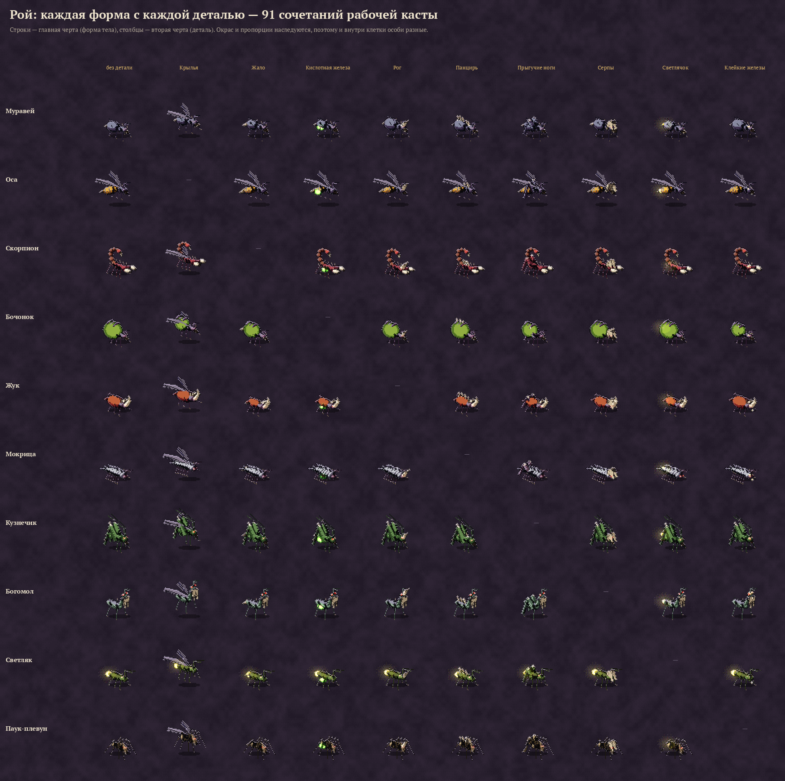

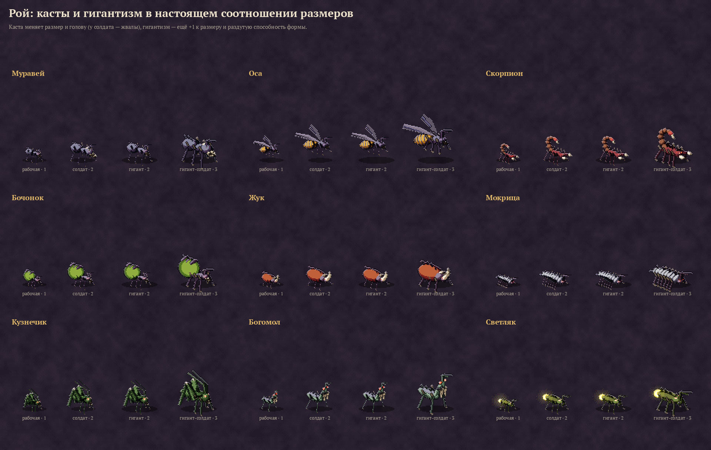

Всё это собрано в карточке особи — большой, на весь экран, как в Conquest of Elysium: **Тело** —
числа столбиком; **Возможности** — каждый удар своей строкой (урон, тип, дальность и что он делает
сверх урона); **Способности** — столбик иконок с именами (форма, деталь, мутация, эволюция, класс,
слабость), описание всплывает при наведении мыши. Ещё — родители, сколько убила стая и что особь
передаст потомкам. Карточка открывается в выводке, при выборе противника и на паузе в бою. У лидера та же
карточка: когда срабатывает каждая способность, развитие на выбор и его мутации сотами — ряд сот на ветку,
ключевая — большая сота; что ещё не проснулось в этом походе, запечатано.

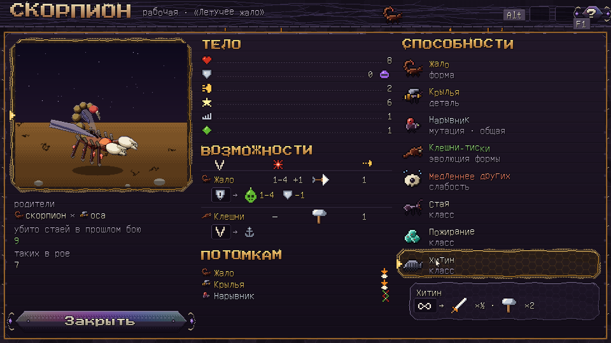

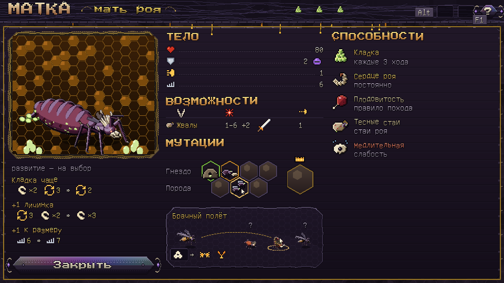

Против Литейщика рой выводит жуков и бочонков, против людей — скорпионов и богомолов, против стрелков
на стенах — пауков:
приспособление к врагу и есть игра.

#### Числа — черновик

Здоровье форм подобрано так, чтобы рабочая любой формы стоила около трети эталона, а солдат —
около одного (утилита `swarm`, сила особи в стае против эталона):

| Форма | Рабочая, эталонов (цель ≈ 0,33) | Солдат, эталонов (цель ≈ 1) |
|---|---|---|
| Муравей | 0,39 (здоровье 8) | 0,85 (здоровье 14) |
| Оса | 0,28 (здоровье 8) | 0,82 (здоровье 11) |
| Скорпион | 0,34 (здоровье 8) | 1,02 (здоровье 14) |
| Бочонок | 0,27 (здоровье 11) | 0,84 (здоровье 19) |
| Жук | 0,40 (здоровье 8) | 1,15 (здоровье 12) |
| Мокрица | 0,41 (здоровье 8) | 0,93 (здоровье 11) |
| Кузнечик | 0,30 (здоровье 8) | 0,82 (здоровье 14) |
| Богомол | 0,29 (здоровье 7) | 1,16 (здоровье 11) |
| Светляк | 0,36 (здоровье 8) | 0,89 (здоровье 14) |
| Паук-плевун | 0,33 (здоровье 12) | 1,00 (здоровье 15) |

Паука-плевуна посчитали позже остальных, уже на нынешней симуляции. На ней же остальные формы при
своём здоровье из таблицы стали сильнее цели: рабочие жук 0,55, мокрица 0,51, муравей 0,42, скорпион
0,40; солдаты жук 1,48, мокрица 1,30, богомол 1,29, скорпион 1,28. Так сказались правки симуляции
после первого расчёта. Подбирать здоровье утилитой (`swarm -- 300 tune`) здесь нельзя: сила рабочей от
здоровья почти не зависит, эталон снимает её одним ударом что с 3, что с 8 здоровья, и утилита уводит
здоровье в бессмысленные 2–3. Поправлять при балансе уроном, ценой или самим эталоном. Стартовые армии
классов друг против друга тоже перекошены (`balance`): от 100/0 до 0/100 в зависимости от пары лидеров.
Старт Изобретателя против старта Пожирателя был ближе всех к равному, 44/56, — но лишь потому, что Изобретатель
выбегал вперёд и принимал первые укусы на себя. С тех пор как лидер держится в тылу, эта пара — 7/93, а Маньяк
против Пожирателя — 74/26 (был 35/65). Баланс пока не трогаем; техно-демо показывает пару Изобретатель — Пожиратель
как есть.

- **Размножение**: соседи по полю, пережившие бой, откладывают яйца. Потомок берёт по черте
  от каждого родителя (форму тела — от одного из них), окрас смешивается. Строй решает две
  задачи: как пройдёт бой и кого с кем скрестить; меняя состав роя, меняешь и пары.
- **Мутации** иногда дают черту, которой не было у родителей. Среди них **гигантизм** —
  случайный сюрприз выводка, а не выбор.
- К концу похода — своя порода, которой ни у кого не было («Кислотный шершень», «Летучий
  таран»…).

#### Гигантизм

Гигант вырастает на размер и получает общие бонусы:

- **Растаптывание** мелочи (по правилу размера).
- **Вожак**: соседние особи получают +2 к боевому духу — вокруг гиганта рой держится.
- **Прикрытие**: выстрелы по мелким соседям летят в гиганта.

Главное — гигантизм раздувает фирменную способность формы: крупнее тело, мощнее приём.

| Форма-гигант | Что меняется |
|---|---|
| Муравей | брешь закрывают все муравьи в радиусе 2: строй стягивается к месту гибели |
| Оса | хватает мелкого врага и уносит его в сторону от строя |
| Скорпион | жало бьёт и цель, и соседа |
| Бочонок | плевок кислотой по клетке и всем соседним |
| Жук-носорог | разгон проходит насквозь и давит всех на пути |
| Мокрица | сворачивается в шар и катится, давя мелочь |
| Кузнечик | прыгает каждые 3 хода, и каждое приземление сбивает с ног |
| Богомол | серпы бьют всю клетку |
| Светляк | вспышка ослепляет в радиусе 2 |
| Паук-плевун | плюёт сетью: клеит всех врагов в ряд до 3 клеток |

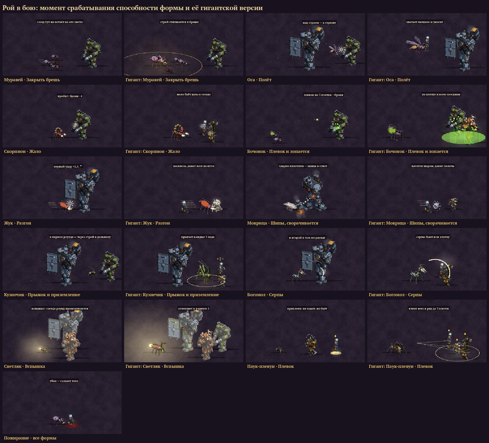

#### Эволюция форм

Ответ роя на врага — не новая особь, а новая порода. У каждой формы **три эволюции**: их берут
по одной в выводке за биомассу, в любом порядке, каждая следующая для той же формы дороже.
Эволюция действует на всех особей, чья форма тела — эта форма, нынешних и будущих, в том числе
на гигантов; черта-деталь её не получает. Эволюция видна на спрайте, так что породу узнают
с поля. Почти у каждой формы одна эволюция закрывает её слабость (медлительный скорпион, лопающийся
на своих бочонок, одинокий после прыжка кузнечик, светляк-мишень), другая — против брони
или стен, третья усиливает приём. Числа — черновик.

| Форма | Эволюция | Что даёт | Как видно |
|---|---|---|---|
| Муравей | **Муравьиная кислота** | пробивший укус снимает 1 броню до конца боя (литому металлу — 2) | брюшко светится кислотой, капает |
|  | **Сомкнутый строй** | муравей, вставший в брешь, получает +1 к броне до конца боя | щитки с шипами на голове, груди и брюшке |
|  | **Живой мост** | у кого рядом трое своих, того стена и постройка не держат: рой лезет по спинам | костяные крючья на лапах |
| Оса | **Жало-шприц** | жало не замечает 2 брони | длинное блестящее жало |
|  | **Жёсткие крылья** | подожжённая или сбитая не падает, огонь бьёт вдвое слабее | тёмные янтарные крылья |
|  | **Пикирование** | первый удар после перелёта строя — двойной | передние лапы-крючья с шипами |
| Скорпион | **Клешни-тиски** | держит соседнего врага: тот не может отойти; клешни бьют дробящим, так что держат и машины | огромные костяные клешни |
|  | **Нейротоксин** | пробивший удар: −1 к скорости и −2 к инициативе до конца боя (не больше −2 скорости) | мешок жала светится фиолетовым |
|  | **Длинные лапы** | больше не медлительный | высокие лапы, тело поднято |
| Бочонок | **Дальний плевок** | плевок на 4 клетки, через головы своих | хоботок-сопло |
|  | **Свой запах** | лопаясь, не задевает своих | предупреждающие полосы на брюшке |
|  | **Едкая лужа** | плевок оставляет на клетке лужу на 2 раунда: кто в ней, теряет 1 брони за раунд | поры и пузыри на брюшке |
| Жук-носорог | **Двойной рог** | Разгон каждые 3 хода, а не только первым ударом | второй рог со спины над головой |
|  | **Бугристые надкрылья** | +2 брони против стрел и снарядов | бугры на надкрыльях |
|  | **Летучий жук** | разгоняется с подлёта: перелетает соседей-своих к цели | раскрытые задние крылья |
| Мокрица | **Длинные шипы** | шипы ранят 1–4; свернувшись, колет всех соседей | шипы вдвое длиннее, и по бокам |
|  | **Известковый панцирь** | свернувшись, +5 брони вместо +3, и дробящий больше не ломает | серая каменная корка на пластинах |
|  | **Щитовые края** | соседние свои получают +1 к броне | широкие боковые пластины |
| Кузнечик | **Стадная фаза** | прыгают стаей: соседние кузнечики приземляются рядом друг с другом, прыгнувший не один | жёлто-чёрная окраска саранчи |
|  | **Шипастые голени** | приземление бьёт цель шипами, колющий 1–6 | крупные шипы на задних голенях |
|  | **Дальний прыжок** | прыжок через всё поле — к лидеру или стрелку | задние ноги длиннее |
| Богомол | **Серпы-пилы** | третий удар за раунд по цели ниже половины здоровья | зубья-пилы на серпах |
|  | **Цветочная мимикрия** | пока не ударил, стрелки и удары по площади его не выбирают | розовые лепестки на лапах и брюшке |
|  | **Глазчатые крылья** | в первом раунде раскрывает крылья: соседние враги проверяют страх 1–6 | поднятые крылья с глазками |
| Светляк | **Яркий фонарь** | вспышка каждые 2 хода | фонарь крупнее и ярче |
|  | **Капюшон** | гасит фонарь между вспышками: стрелки больше не целятся в него первым | тёмный капюшон над фонарём |
|  | **Ложный сигнал** | раз в 3 хода враг до 2 клеток (не крупнее 3) делает шаг к светляку | фонарь в оранжевых кольцах |
| Паук-плевун | **Ловчая сеть** | плевок клеит и соседнего врага | зигзаги шёлка на брюшке |
|  | **Отскок на нити** | когда враг доходит вплотную, отпрыгивает на нити на 2 клетки назад | нить петлёй со спины |
|  | **Стащить со стены** | приклеенный стрелок на стене или в башне падает вниз | крючья на передних лапах |

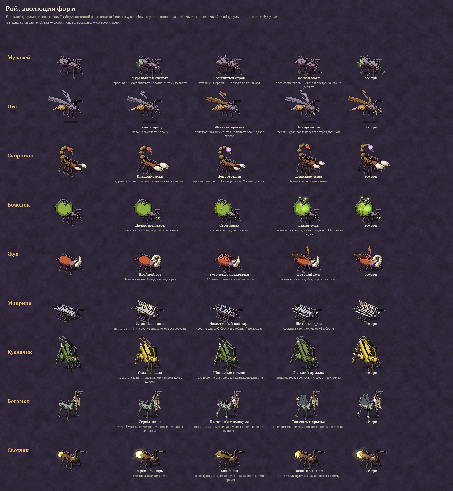

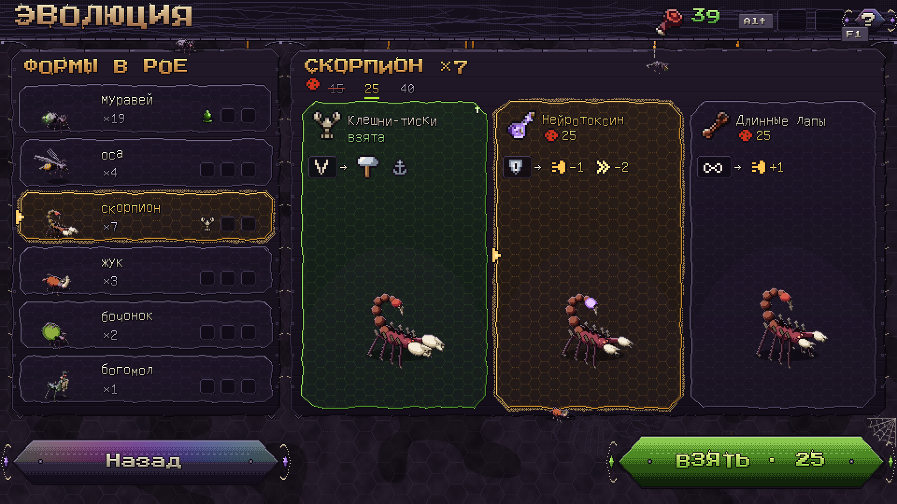

#### Чужие черты — химеры

Рой перенимает у съеденных **живые** свойства — только биология, никаких вещей и механизмов.
Иногда это настоящая биология: улитка с железным панцирем существует, жук-бомбардир брызжет
кипятком. Как безумные модули Маньяка у Литейщика, у каждой чужой черты есть польза и причуда.

- Чужая черта предлагается в выводке редко и только после боя с теми, кого рой съел.
- У одной особи — не больше одной чужой черты; наследуется, как обычная, так что можно вывести
  целую породу химер.
- Видна на спрайте: из брюшка растёт рука, на брюшке лицо, под хитином шевелится червь.

| Чужая черта | Чья | Как выглядит | Польза | Причуда |
|---|---|---|---|---|
| Железный панцирь | големов (рой впитал металл, как улитка с железной раковиной) | хитин в металлических прожилках | литой металл: колющий вдвое меньше | проводник: молния +50%; медленнее на 1 |
| Кипящая кровь | огненных существ (как жук-бомбардир) | брюшко пышет паром | струя кипятка вплотную, поджигает; огня не боится | вода и холод бьют вдвое; при гибели обваривает соседей, своих тоже |
| Человеческая рука | людей-воинов | из брюшка растёт рука | **Хватка**: держит соседнего врага — тот не может отойти или сбежать | хватает что попало: иногда держит своего соседа |
| Человеческое лицо | командиров | на брюшке человеческое лицо | жуть: соседние враги проверяют страх 1–6 | пугает и своих: соседи особи не получают Стаю |
| Чужие кости | нежити | из-под хитина торчат кости | раз за бой встаёт после гибели с 1 здоровьем | дробящий бьёт вдвое |
| Иглы | зверей с иглами | спина ощетинена иглами | выстреливает иглы на 3 клетки | 3 залпа за бой, потом голая спина и −1 брони |
| Волчий нюх | хищных зверей | вытянутая морда, ноздри | чует раненых: по врагу ниже половины здоровья +2 | бросает строй и бежит к раненому через всё поле |
| Слизистая кожа | болотных тварей | блестящая мокрая шкура | не загорается, кислота вдвое меньше | на камне и в засуху теряет 1 здоровья за раунд |
| Червь внутри | заражённых | под хитином шевелится червь | при гибели червь вылезает и кусает убийцу с ядом | червь ест носителя: −1 здоровья за раунд в долгом бою |

Порода химер — дело **Чумы**: у неё чужие черты выпадают чаще и безумнее.

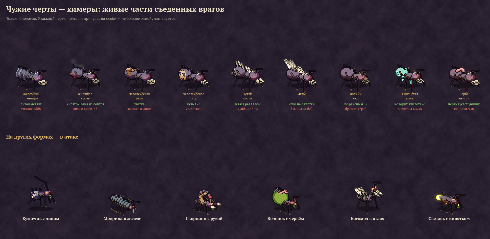

#### Лидеры

Как у Литейщика, лидер — юнит на поле с набором способностей, пассивкой, слабостью, правилом
похода и развитием. Четыре лидера — четыре способа играть роем.

| Лидер | Где сила |
|---|---|
| Матка | в числе и породе |
| Разум улья | в разуме: пси мимо брони, помутнение и захват врагов |
| Пожиратель | в одном звере, который растёт по ходу боя |
| Чума | в чужих телах: рой растёт за счёт врага |

И у каждого — своя вещь в бою и своё правило похода, которых нет ни у кого:

| Лидер | Своя вещь в бою | В походе |
|---|---|---|
| Матка | **Метаморфоз**: её личинки вырастают в ту форму, что убивает лучше всех в этом бою | — (Плодовитость) |
| Разум улья | **Подмена**: стрелок врага просыпается посреди роя, особь роя — у него за спиной | **Память роя**: рой помнит, кто убивал его больше всех, и бросается на него первым |
| Пожиратель | **Глотает целиком**: враг пропадает в брюхе и бьёт изнутри | **Ты — то, что ты ешь**: съел пятерых Стражей — враги рядом бьют его первым |
| Чума | **Эпидемия**: споры через всё поле, зараза сама ходит от врага к врагу | **Пандемия**: чем дальше поход, тем больше врагов приходит больными |

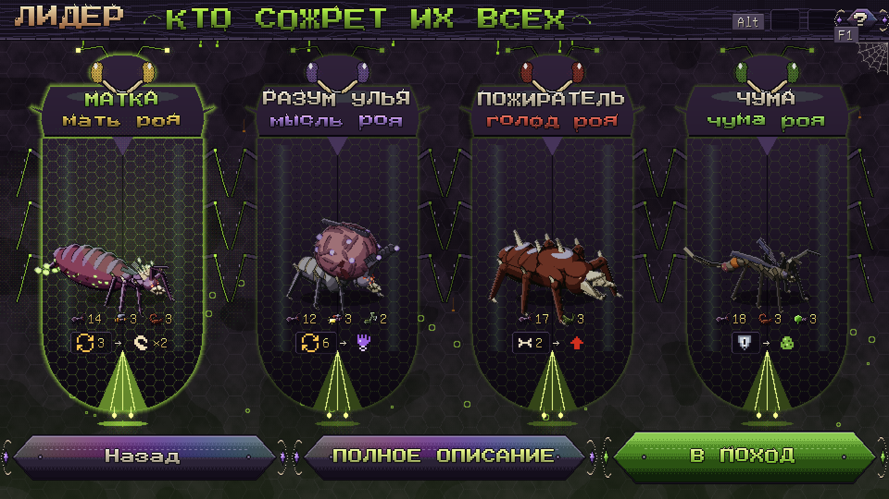

В игре у лидера есть прозвище: Матка — «мать роя», Разум улья — «мысль роя», Пожиратель — «голод роя»,
Чума — «чума роя». Оно стоит рядом с именем в карточке и на экране выбора.

В бою о лидере говорит само поле: здоровье над ним, способность всплывает иконкой, у Пожирателя —
ступени роста и голод, у Чумы — сколько зреть кладке в машине; погиб лидер — над роем значки страха.

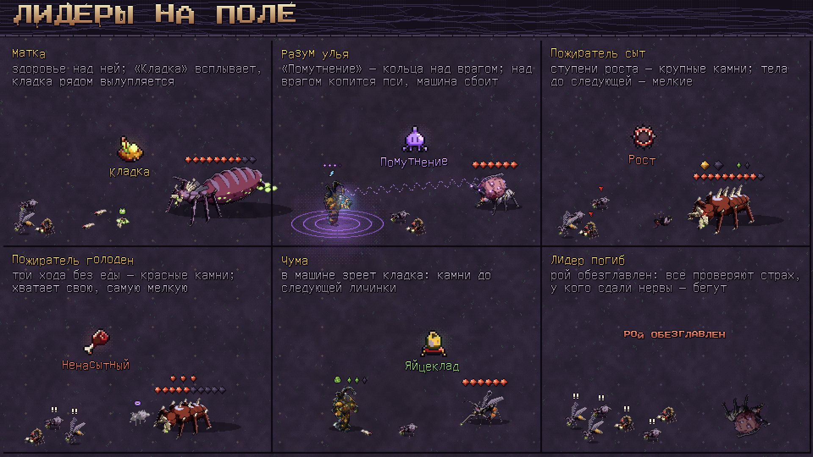

##### Матка — число и порода

Размер 6, здоровье 80, жвалы 1–6 +2 рубящий, броня 2, хитин, скорость 1.

| Способность | Когда | Что делает |
|---|---|---|
| Кладка | каждые 3 хода | рядом вылупляются 2 личинки (призыв), со следующего раунда бьются. Личинки, дожившие до конца боя, уходят в выводок новорождёнными — с чертой, которая в этом бою убила больше всех |
| Сердце роя | постоянно | гнездо: своя особь, погибшая в 2 клетках от Матки, роняет яйцо, и через 2 хода из него вылупляется личинка. Пока Матка жива, гнездо вокруг неё не кончается — враг, прорвавшийся к ней, тонет в личинках |
| **Метаморфоз** | постоянно | её личинка, прожившая 3 хода, окукливается и выходит той формой, что больше всех убила в этом бою, — со всеми её эволюциями и мутациями. Бой выигрывают осы — кладка становится осами; рвут голема богомолы — из кладки лезут богомолы |
| Медлительная | слабость | скорость 1, держится в тылу |
| Плодовитость | правило похода | в выводке на одного потомка больше, кормление вдвое дешевле |

Выжившие личинки не делают рой сильнее сразу: в выводке они идут под предел роя вместе с кладками,
и лишних съедают в отбор. Матка даёт не силу, а выбор: чем лучше её защитили, тем больше материала
для породы, и он сам тянется к тому, что лучше убивало.

Развитие: кладка чаще, +1 личинка или +1 к размеру (размер 7 — гнездо на 3 клетки).

**Мутации Матки** (см. «Мутации»):

| Мутация | Ветка | Что даёт |
|---|---|---|
| Малое гнездо | Гнездо | своя особь, погибшая рядом с ней, роняет яйцо, как у Матки: гнездо выходит на передовую |
| Кормилица | Гнездо | личинка рядом с ней дорастает до рабочей прямо в бою |
| Живородящая | Гнездо | погибнув, выпускает личинку |
| Почкование | Гнездо | впервые раненая, делится надвое: две особи, у каждой половина оставшегося здоровья; новая почковаться не умеет |
| Доминантная линия | Порода | её главная черта передаётся потомкам всегда: породу можно закрепить нарочно |
| Брачный полёт | Порода | пару ей в выводке выбираешь сам из всех выживших, а не по соседству в бою |
| Гибрид | Порода | её потомок от пары с другой формой — гибрид: тело одной формы, а способность обеих (оса со скорпионьим жалом). Минус: гибрид бесплоден, как мул, — в выводке пару не образует, так что породу гибридов не закрепить: каждого выводят заново |
| **Наследница** | ключевая | если Матка погибла, Наследница становится Маткой: Кладка и Сердце роя продолжаются, рой не обезглавлен. Пока Матка жива, сама не бьётся и держится рядом |

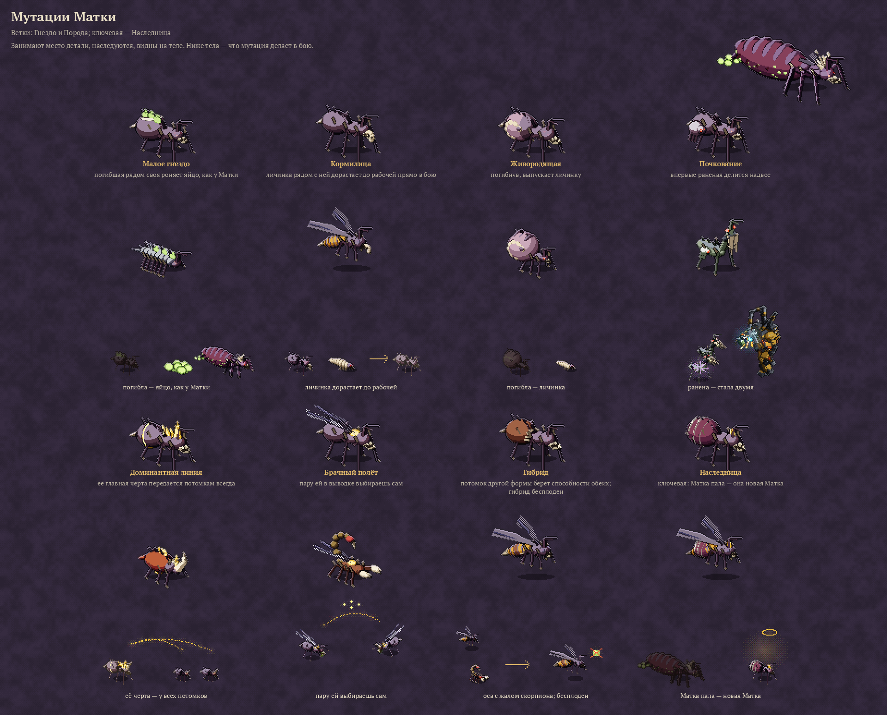

##### Разум улья — рой, который думает

Мозг роя бьёт не жвалами, а мыслью: его урон — **пси**, мимо брони, и он копится до надлома. Он мутит врагу разум,
слышит каждую смерть своих и обращает её против убийцы, а раненых врагов забирает себе.

Размер 4, здоровье 22, пси-удар 1–6 пси, дальность 3, броня 0, мягкое тело, скорость 1.

| Способность | Когда | Что делает |
|---|---|---|
| Пси-удар | атака | бьёт мыслью на 3 клетки, мимо брони |
| Помутнение | каждые 3 хода | пси-волна по врагам в 2 клетках от самой плотной их группы в досягаемости: живые на раунд путают цели и бьют соседа, своего; у безмозглых — големов, нежити — сбоит то, что ими движет: шаг пропускают, способности раунд молчат |
| Предсмертный крик | постоянно | погибая, особь роя кричит в разум убийцы: тот получает 1 пси, мимо брони; безмозглый — 1 пси за каждые две смерти. Чем больше рой гибнет, тем дороже это врагу |
| Захват разума | перезарядка 6 ходов | враг ниже половины здоровья переходит к рою: размер 1–3 — на 5 ходов, 4–5 — на 2 хода; размер 6–7 не переходит, его только оглушает на раунд |
| **Подмена** | каждые 4 хода | мысль меняет местами двоих: стрелка, заклинателя или лидера врага, что прячется дальше всех за своим строем, и особь роя из самой густой толпы. Стрелок просыпается посреди роя, оглушённый, особь — у врага за спиной. Ответ роя на строй, который его держит |
| **Память роя** | правило похода | после боя рой помнит вид врага, убивший больше всех его особей (до трёх видов, новый вытесняет старый), и до конца похода бросается на него первым: из врагов рядом особь бьёт его, а не другого |
| Хрупкий мозг | слабость | мало здоровья и мягкое тело; гибель обезглавливает рой |
| Мыслящая порода | правило похода | в выводке выпадают **пси-мутации** — на пси и страх (см. ниже); чаще у потомков тех, кто стоял в бою рядом с Разумом. В Улье они тоже выпадают |

Развитие: пси-удар на 4 клетки, перезарядка Захвата 4 хода, Помутнение шире — на 3 клетки — или подмена каждые 2 хода.

**Мутации Разума улья** — пси-мутации (см. «Мутации»). Выпадают только в его рое, чаще у потомков
тех, кто стоял в бою рядом с ним. Работают и против машин: страха у големов нет, но ядро сбоит.
Ветки: Безумие (Помутнение), Ужас (страх), Крик (Предсмертный крик), Кукловод (Захват разума).

| Мутация | Ветка | Что даёт |
|---|---|---|
| Пси-железа | основа | укус бьёт пси — мимо брони |
| Резонатор | Безумие | Помутнение бежит дальше по цепочке резонаторов: их строй тянет волну вдоль фронта врага |
| Чутьё на страх | мост Безумия и Ужаса | сильнее бьёт сбитых с толку, надломленных, испуганных и бегущих |
| Жуткий шёпот | Ужас | соседние враги каждый раунд проверяют страх; машины сбоят |
| Стрекот | Ужас | раз за бой стрекочет: враги до 2 клеток проверяют страх 1–6; машины страха не знают, но их детали дребезжат — −2 к инициативе на раунд |
| Эхо крика | Крик | крик погибшей подхватывают соседи с Эхом — по стае идёт цепная реакция пси |
| Последняя воля | мост Крика и Кукловода | погибая, на раунд забирает разум убийцы: тот бьёт своих товарищей |
| Пси-поводок | Кукловод | захваченный враг рядом с ней остаётся у роя, пока она жива, — и враг рвётся её убить |
| **Ретранслятор** | ключевая | Разум бьёт, мутит и захватывает с её места, как будто стоит там; её бьют первой |

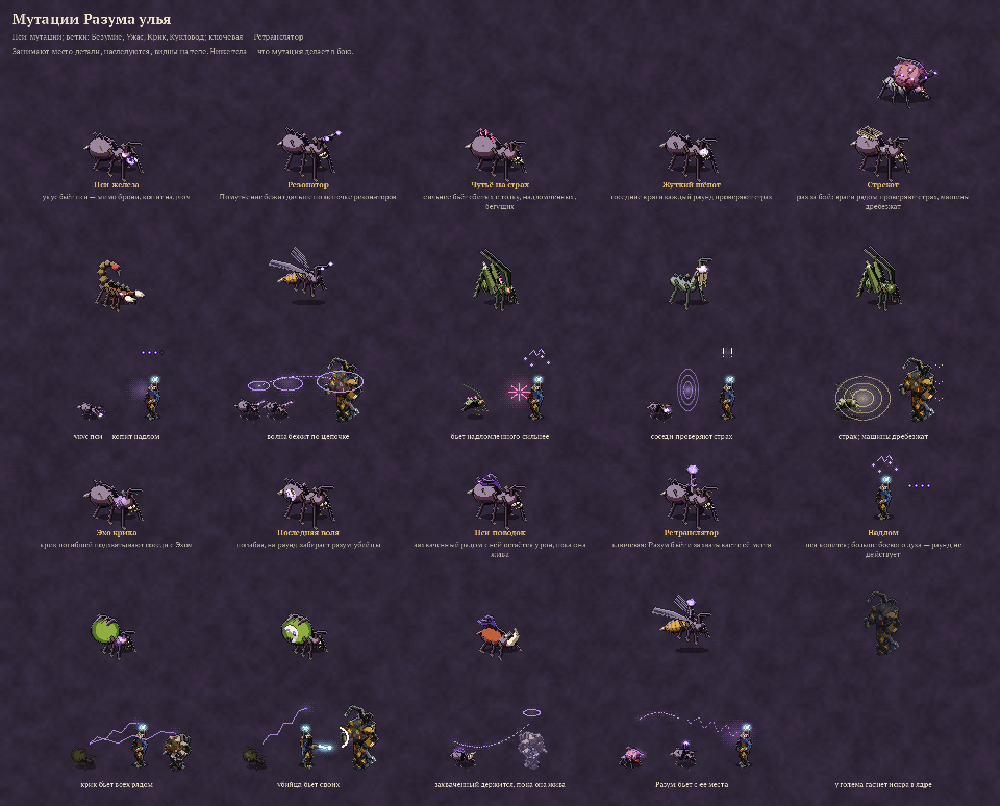

##### Пожиратель — зверь, который растёт в бою

Размер 5, здоровье 41, пасть 1–8 +2 рубящий, броня 2, тяжёлый хитин, скорость 2.

| Способность | Когда | Что делает |
|---|---|---|
| Рост | каждые 2 съеденных врага | он ест каждого врага, павшего рядом с ним, кто бы его ни убил: особи рвут голема — Пожиратель жрёт. Каждый второй съеденный — здоровье ×1,5 и +2 к удару, до двух раз за бой; на поле он вырастает до размера 7 |
| Каннибал | постоянно | ест погибших своих рядом так же, как чужих: лечится и растёт |
| **Глотает целиком** | каждые 3 хода, вместо укуса | глотает врага рядом, что меньше его (каждая ступень роста — на размер больше: на третьей проходит и Страж). Проглоченный пропадает с поля: каждый ход переваривается — 1–6 и +2 за ступень, мимо брони — и сам бьёт изнутри, мимо брони Пожирателя. Переварен — это его еда; падёт Пожиратель — проглоченный вырывается наружу, оглушённый |
| **Ты — то, что ты ешь** | правило похода | съел за поход пятерых одного вида — тот в нём навсегда, повадкой, а не числом: Страж и Каменщик — чугунная шкура (враги рядом бьют его первым, Заслон), Мудрец — ток в укусе, Горн — жар в брюхе (поджигает соседа каждый ход), Орудие — стальные зубы (пробивают половину брони), Механик — масло в жилах (заживает на 2 в ход), лидер Литейщика — его страх |
| Ненасытный | слабость | три раунда без еды — хватает живую свою особь рядом, самую мелкую, и съедает; если рядом никого — теряет десятую часть здоровья каждый раунд |
| Всё в пасть | правило похода | каждое тело, съеденное им в бою, — +1 биомасса после боя; биомасса может идти в его рост между боями; рой меньше |
| Голод | начало похода | пока его рой за поход не убил 30 врагов (примерно до первого босса), он голоден: без еды голодает уже со 2-го раунда и теряет пятую часть здоровья в раунд, а не десятую. Медленный старт, чудовищный конец: сытый Пожиратель с ростом и доктринами — сильнейший лидер роя к концу похода |

Рядом с ним ставят дешёвую стаю — это его запас еды: погибшие свои кормят его, а если еды нет,
он сам берёт живую.

Развитие: стартует на ступень крупнее, растёт с каждого съеденного тела, лечится от пожирания вдвое или бездонное брюхо — глотает каждые 2 хода.

**Мутации Пожирателя.** Он — единственный в рое, кто мутирует сам: мутации его пула ложатся на него, а не на рой,
и занимают место в геноме, как доктрины. Сейчас такая одна:

| Мутация | Что даёт |
|---|---|
| **Третья ступень** | растёт с каждым съеденным врагом, а не с каждым вторым, и трижды, а не дважды; на третьей ступени каждый его удар топчет всех врагов размера 5 и меньше рядом с ним — Пожиратель становится живой мясорубкой посреди строя |

Ниже — прежний каталог мутаций на особей вокруг Пожирателя; из него берутся идеи для его личных мутаций. Ветки: Корм
(особь — его еда), Пир (стая вокруг него, пока он ест), Голод (рой ест сам).

| Мутация | Ветка | Что даёт |
|---|---|---|
| Сытная | Корм | съеденная Пожирателем, засчитывается как два тела; сама неповоротлива |
| Приманка | Корм | погибнув, зовёт его кровью: в свой ход он бросается к её трупу напролом и съедает. Так игрок наводит зверя, которым иначе не управляет, — и рискует: приманка, погибшая в огне или в окружении, утащит его туда же |
| Откормленная | Корм | между боями её можно скормить ему, и он сразу растёт. Каждый пережитый бой она жиреет: чем дольше её держишь, тем больше он вырастет — а пока она жива, она ещё и производитель |
| Кормовое безумие | Пир | когда Пожиратель ест, особи с ней рядом впадают в кормовое безумие: следующий удар сильнее |
| За столом | Пир | когда Пожиратель ест, особи с ней рядом едят с ним и лечатся |
| Голодная | Голод | ест павших, своих и чужих, и растёт в бою, как маленький Пожиратель |
| Кровь Пожирателя | Голод | её потомки чаще рождаются гигантами: рой выходит малочисленным, но крупным |
| **Питательная суть** | ключевая | съеденная, отдаёт ему способность своей формы до конца боя: оса — крылья, скорпион — жало, бочонок — плевок |

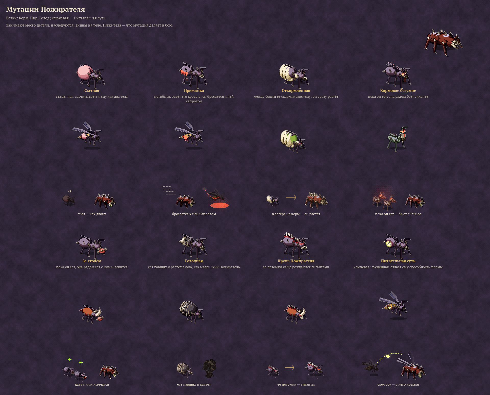

##### Чума — рой растёт за счёт врага

Размер 3, здоровье 12, жало 1–6 колющий, броня 1, хитин, скорость 2.

| Способность | Когда | Что делает |
|---|---|---|
| Длинный яйцеклад | постоянно | колет на 2 клетки и раньше всех — инициатива +3: в первом раунде достаёт врага ещё до того, как тот дошёл |
| Яйцеклад | атака | пробивший удар заражает. В живом яйца ждут его гибели — он выпускает 2 личинки. В машине яйца зреют в тепле топки прямо в бою (**гнездо**): каждые 3 хода из её решёток вылезает личинка, а сломанная выпускает ещё 2; так же в нежити |
| Подкидыш | в начале боя | одна рабочая оказывается в тылу врага |
| Дети хозяина | постоянно | личинка из заражённого берёт черту хозяина: из человека — руку, из голема — железный панцирь, из нежити — чужие кости; дожившие до конца боя уходят в выводок химерами |
| Хрупкая кладка | слабость | огонь выжигает кладку: заражённый, получив огонь — даже свой, — очищается |
| **Эпидемия** | каждые 4 хода и постоянно | плюётся спорами в ближнего врага, как бы далеко он ни был, — тот заражён; пока Чума жива, зараза ходит сама: каждый заражённый враг каждый ход раз из трёх заражает соседа. Строй големов плечом к плечу — лучшая для неё грибница |
| **Пандемия** | правило похода | мир болеет вместе с походом: за каждые 3 выигранных боя ещё один враг приходит в бой уже заражённым |
| Чужие черты | правило похода | чужие черты выпадают чаще и безумнее: у особи их может быть две |

Развитие: личинок 3, заражает и яд скорпионов, или подкидышей двое.

**Мутации Чумы** (см. «Мутации») — хаотичные и странные, вокруг заражения. Ветки: Заражение
(как расходится кладка), Хозяин (что кладка делает с заражённым), Мутации (что из неё выходит).

| Мутация | Ветка | Что даёт |
|---|---|---|
| Паразитоид | Заражение | её пробивший удар заражает, как Яйцеклад |
| Яйца в крови | Заражение | кто её убьёт, получает созревшую кладку: через пару раундов личинки прогрызают его изнутри и вылезают, даже если он жив, и ранят его на выходе. Споры берут числом и ждут гибели хозяина, Яйца в крови бьют наверняка — и по тем, кого не убить: голем, раздавивший пятерых, носит в себе пять кладок |
| Споры | Заражение | заражённый, погибая, лопается спорами и заражает всех соседей — и врагов, и особей роя. Рою это на руку: погибнув, заражённые особи тоже выпускают личинок |
| Зов кладки | Хозяин | её укус будит кладку в заражённом, и кладка гонит хозяина туда, где его убьют: он бросает строй и бредёт в рой |
| Телохранитель | Хозяин | из заражённого, которого она укусила, личинки вылезают ещё при жизни, а он остаётся над ними и бьёт любого, кто подойдёт к кладке, — и рой, и своих товарищей |
| Прожорливая кладка | Хозяин | её укус будит кладку в заражённом, и кладка ест его изнутри: с каждым раундом его удар слабее. Лечение и починка ему не помогают — достаются кладке. Чем дольше хозяин живёт, тем крупнее вылупятся личинки: иногда выгоднее его не добивать |
| Мутагенная кладка | Мутации | из заражённых, которых она кусала, вылупляется что попало: личинка со случайной чужой чертой, иногда урод-гигант, иногда пустышка, которая тут же дохнет |
| Нестабильная | Мутации | каждые 5 раундов получает до конца боя случайную черту — деталь, общую мутацию или чужую черту; прошлая отваливается, мутации не копятся |
| **Королевская кладка** | ключевая | из заражённого крупного врага вылупляется его хитиновая копия — гигант-химера с чертой хозяина |

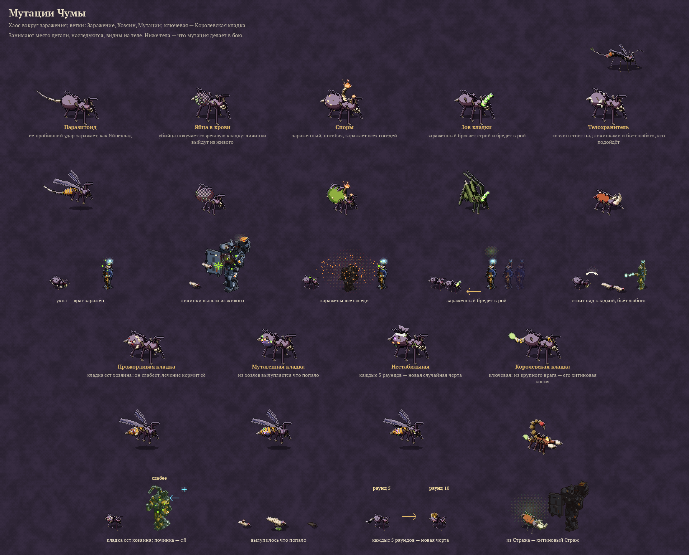

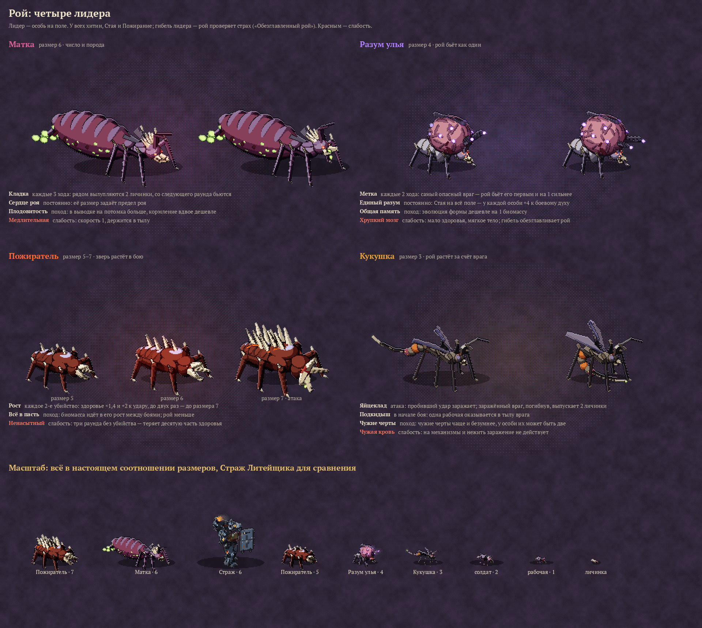

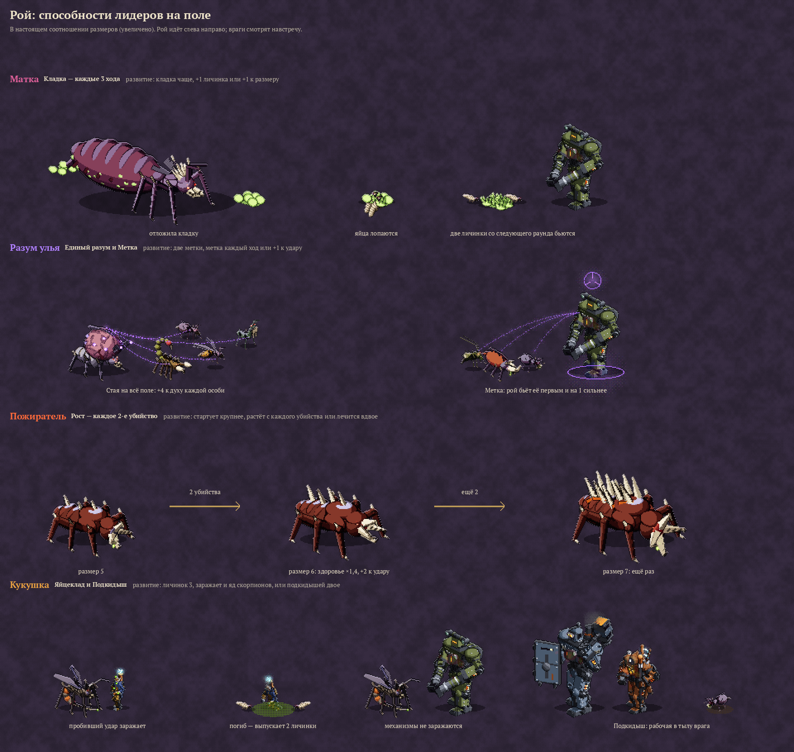

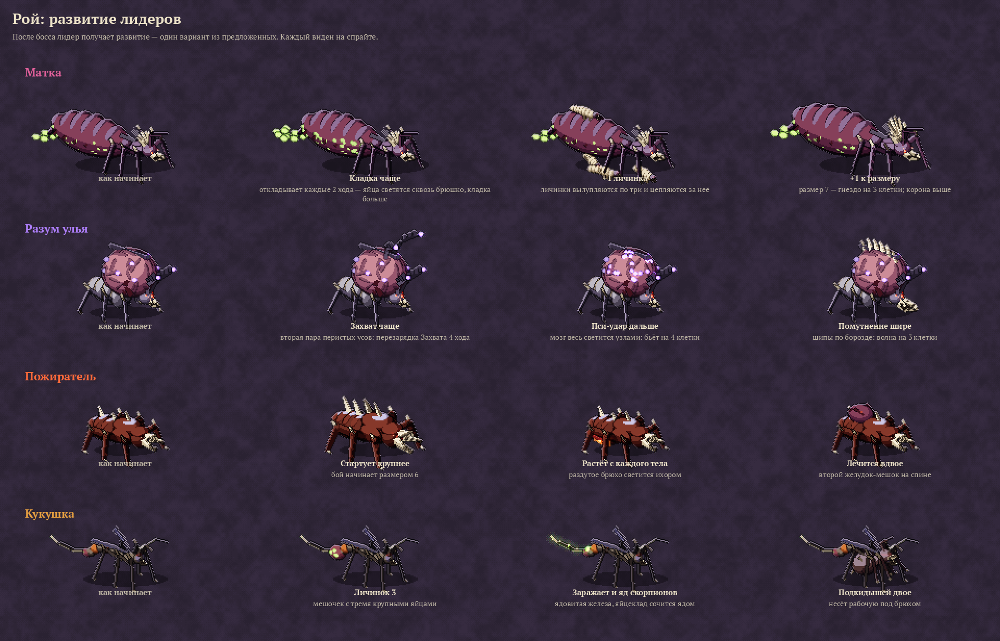

#### Старт похода

100 очков армии и лидер, все особи — I поколения (предел у лидеров разный: Матка 100, Разум улья 115,
Чума 120, Пожиратель 140 — разницу дозаполнит первый выводок):

| Лидер | Армия |
|---|---|
| Матка | 40 муравьёв, 11 ос, 10 скорпионов (рабочие); 6 муравьёв, 3 жука и 4 мокрицы (солдаты) |
| Разум улья | 30 муравьёв и 10 светляков (рабочие); 10 муравьёв, 7 богомолов и 3 скорпиона (солдаты) |
| Пожиратель | 64 муравья и 12 кузнечиков (рабочие); 4 муравья и 4 жука (солдаты) — жуки дробят броню |
| Чума | 50 муравьёв, 10 скорпионов и 10 бочонков (рабочие); 10 муравьёв (солдаты) |

#### Уникальные механики роя

Рой — живой организм: растёт, пожирает, приспосабливается. Литейщик собирает каждого голема
вручную, рой управляется целыми формами и поколениями.

- **Биомасса** — единая валюта роя: от пожирания, отбора в выводке и наград; ещё одна кладка
  в выводке, эволюция формы и **кормление лидера** — лидер навсегда откладывает на одного потомка больше в каждом
  выводке, каждое следующее кормление дороже.
- **Бой меняет породу.** Каждый лидер по-своему превращает бой в материал для породы: у Матки
  выжившие личинки уходят в выводок, у Чумы — дети хозяев химерами, у Пожирателя съеденное
  становится биомассой, у Разума улья пси-мутации выпадают потомкам тех, кто стоял рядом с ним.
  Всё это видно на экране после боя.

  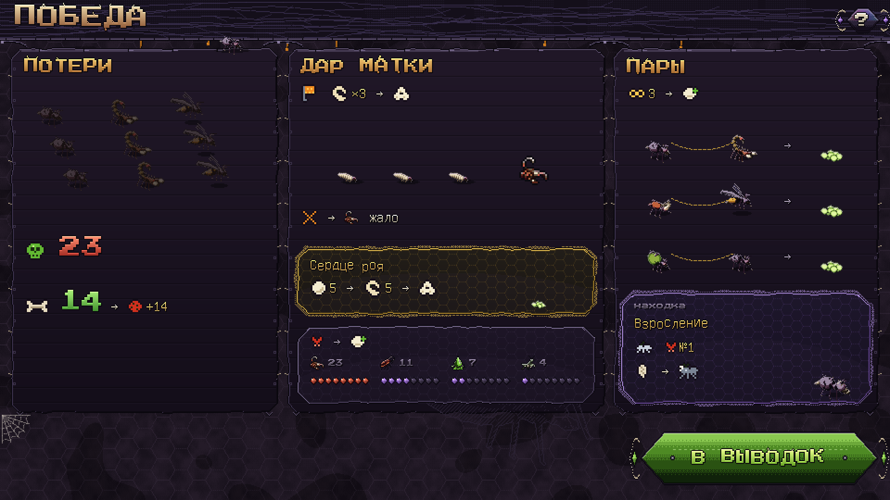
- **Эволюция формы.** Улучшение сразу для всех особей одной формы («Осы: жало пробивает
  броню»). Одно решение действует на десятки особей — никакого поштучного микроменеджмента.
  Три эволюции на форму — в разделе «Эволюция форм».
- **Естественный отбор.** Черты, которые чаще убивали в бою, чаще наследуются; статистика
  видна на экране выводка.
- **Мутации** — общий пул и свой пул у каждого лидера, см. ниже. Артефакты роя (например, *Феромонный след*: где строй прорван,
  остальные идут туда быстрее) — позже, вместе с балансом.

#### Мутации — общий пул и пулы лидеров

**Как игра пишет эффекты.** Как в Conquest of Elysium — значками, без прозы. Строка эффекта —
«условие → результат»: каждый термин — свой значок, число после него, минус — отдельной строкой.
Условие — всё, что до стрелки, — лежит на тёмной плашке, так строка сразу делится на «когда» и «что».
«Было ⇒ стало» (развитие лидера) пишется двойной стрелкой и без плашки: это не условие.
Условия: постоянно, раз за бой, каждые N ходов, атака, пробил броню, ранена, ранена ниже половины,
гибель, гибель своей, радиус N, начало и конец боя, выводок, Улей, против машин.
Эффекты и состояния: яйцо, личинка, призыв, клей, прикован, паутина, мёд, броня ±N, ожог, страх N,
сбой, помутнение, захват, оглушение, перехват, регенерация, лечение, притягивание, заражение, споры,
мимо брони, мимо щита, полёт, деление, гигант, бесплоден, рост, тело, кокон, облако мошки, случайная
черта, хитиновая копия; время — каждые N ходов, через N ходов, на N ходов; типы урона. Характеристики: здоровье, броня и её тип (хитин, тяжёлый хитин, мягкое
тело), скорость, боевой дух, размер, дальность, инициатива, урон, предел роя. Выводок и поход: потомок,
пара, наследие, мутация, одна форма, солдат, новая форма, биомасса, съедена, тело; враги: машины,
живой враг, дикие, босс, стена. Смысл каждого значка — в подсказке при наведении; все значки по главам — в справочнике (кнопка «?» на любом экране); пока зажат Alt, под строками значков видны их названия. Пример —
Малое гнездо: [гибель своей][радиус 1] → [яйцо]; [яйцо][через 2] → [личинка]. Так же, без прозы,
пишутся экраны между боями: выводок, Улей, эволюция, итоги боя, развитие лидера, находки.

**Мутация — доктрина всего роя.** Мутация меняет не одну особь, а весь рой и весь будущий выводок, и меняет
не числа, а то, **чем рой воюет**: летучая туча, ловушка из паутины, ржавчина, съедающая металл. У каждой
мутации есть цена или враг, против которого она слаба. Мутации сочетаются, и две-три вместе дают рою лицо на
весь поход («летучая мошкара», «рой-ловушка в мёде»).

- **Геном держит 4 мутации.** Полный геном больше мутаций не берёт: каждое место — решение на весь поход.
- **Мутации предлагают редко:** одну среди находок после элиты и босса и одну в Улье, пока геном не полон.
  Обычные находки — тела новых форм, эволюции форм покупаются за биомассу.
- **Общий пул** — у любого лидера; **пул лидера** — две мутации, которые доводят его стиль до предела.
- В бою мутация видна на поле: сеть на клетках, мёд под павшими, облака мошкары.

**Общий пул:**

| Мутация | Чем становится рой | Цена, слабость |
|---|---|---|
| **Крылатый рой** | все летают: над строем к стрелкам и лидеру; летящих не растоптать, сотрясение их не берёт | рой бросает строй: фронт держать некому |
| **Мошкара** | каждая третья павшая рассыпается облаком: облако летит к врагу, жалит сквозь любую броню, стрелок с облаком на себе не видит цели; через 2 хода рассеивается | огонь сжигает облако втрое, сгоревшая облаком не станет |
| **Паутина** | раз в 4 хода особь плетёт сеть на своих и соседних клетках — если рядом враг не в сети или бить ей всё равно нечем: враг в сети два хода выпутывается, удары по нему ×1,5; свои бегают по сети свободно | в ход плетения не бьёт; огонь бежит по сети на 2 клетки и поджигает всех на ней |
| **Медовые соты** | раненые рядом со своими заживают по 2 в ход; павшая заливает мёдом клетки вокруг — враг в мёде бьёт вдвое слабее | рой силён, пока держится кучей |
| **Сухой хитин** | павшие оставляют сухую корку, а не слизь: по ней не бежит молния големов — Мудрецы и сеть Изобретателя больше не жгут толпу через её же мёртвых | в корке не зреют личинки Матки и не ходит зараза Чумы |
| **Мимикрия** | рой перенимает оружие последней машины, которую разломал ниже половины (или что пала у него на глазах), — одно за раз, следующая машина сменяет его: Мудрец и Изобретатель — укус бьёт током, Горн — поджигает и +1 к удару, Страж, Каменщик, Зодчий — панцирь на 2 крепче, Орудие и Отец колосса — удар дробящий, Механик — особи заживают по 2 в ход, Маньяк — +2 к удару. Рой меняется по ходу боя: какую машину разломал, тем и бьёт | пока ни одна машина не разломана, мутация пустая |

**Пулы лидеров:**

| Лидер | Мутация | Чем становится рой |
|---|---|---|
| Матка | **Живородящая** | каждая третья павшая выпускает личинку |
| Матка | **Почкование** | впервые раненая делится надвое; убитая с первого удара — каждая третья — оставляет маленькую почку |
| Разум улья | **Стрекот** | скорость +1; раз в 2 хода враг, обсаженный четырьмя особями, дрожит от стрекота и не бьёт — машина тоже: металл входит в резонанс |
| Разум улья | **Мираж** | в начале боя у каждой второй особи — призрачный двойник: он идёт в бой как живой, но не бьёт; враг тратит на него удар, и он тает |
| Пожиратель | **Третья ступень** | мутирует не рой, а сам Пожиратель (см. его раздел): растёт с каждым съеденным, трижды; на третьей ступени удар топчет соседей размера 5 и меньше |
| Чума | **Паразитоид** | заражает и машины: из носителя раз в 3 хода лезет личинка, из павшего — ещё две |
| Чума | **Кукловод** | удар цепляет машину (заражённая — тоже зацеплена); павшая зацепленная машина встаёт за рой: с четвертью здоровья: личинки 2 хода водят её корпус и бьют её же оружием (модули молчат) по Литейщику, потом корпус разваливается — и из него лезут личинки |

Ценность каждой мерит стенд генома (BALANCE.md, «Мутации роя»): сила стартового роя с одной мутацией против
армий Литейщика. Цель — каждая сопоставимо ценна, но сильна против разного.

Ниже — прежний каталог мутаций на отдельную особь: из него берутся идеи для новых доктрин.

| Мутация | Что даёт | Минус |
|---|---|---|
| **Болас** | бросает липкий шарик на нити и подтягивает врага к рою; крупного не сдвинуть — тогда её саму притягивает к нему; между бросками перезаряжается | — |
| **Куколка** | раз за бой, раненая ниже половины, вместо хода окукливается (убитая одним ударом не успевает). Кокон прочный, но его можно разбить — тогда она гибнет; огонь сжигает кокон сразу. Через пару раундов выходит взрослой: здоровой, с крыльями, бьёт сильнее | взрослые живут недолго: после боя она даёт потомство в выводке и умирает |
| **Стража лидера** | рядом с лидером перехватывает удары, направленные в него, — по одному за раунд; удары по площади не перехватывает | — |

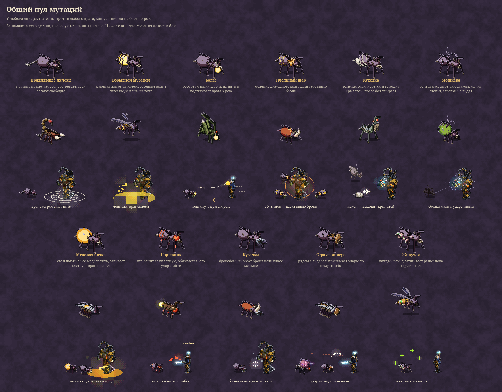

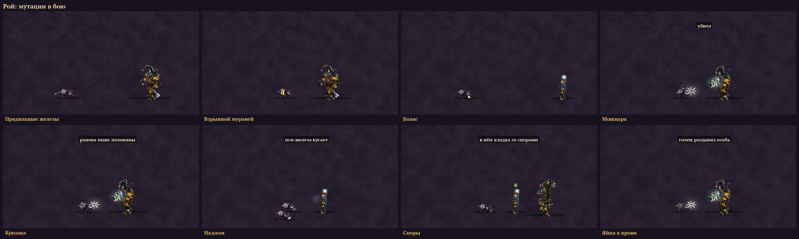

На поле всё, что рой делает с врагом, — одним набором значков над головой; над ними ряд ромбов
пси, полный ряд — надлом.

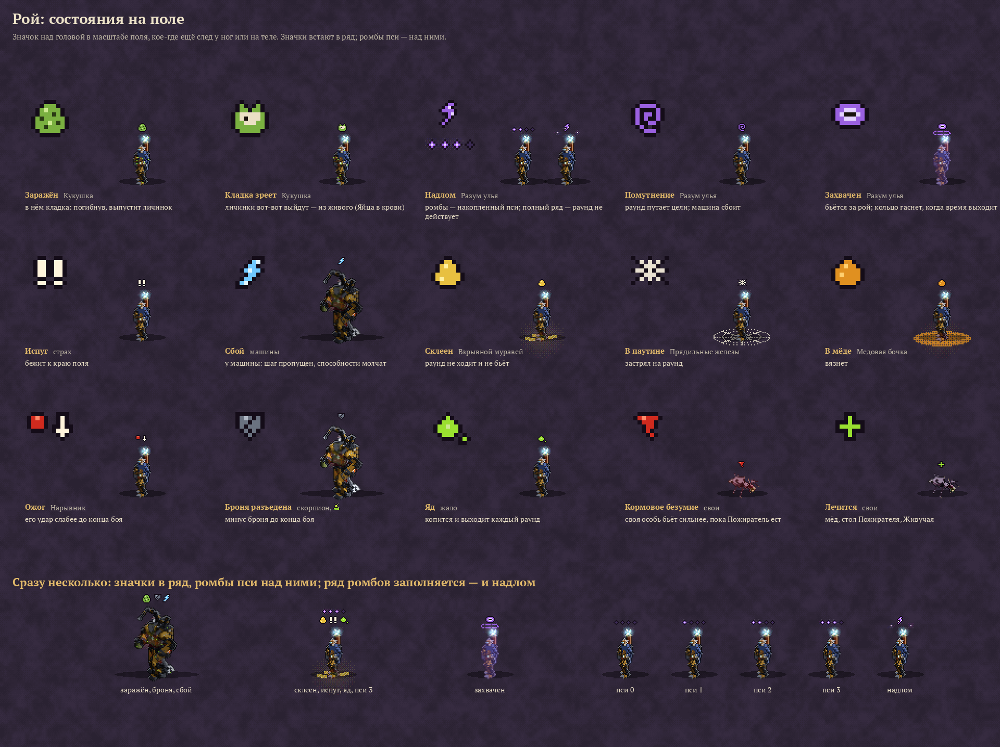

#### Выводок — 15–30 секунд между боями

Экран выводка называется **«Наша судьба»**.

Литейщик между боями выбирает, что добавить. Рой — от чего избавиться: **вылупляется всё**,
а решение игрока — отбор.

1. **Вылупление.** Выжившие, стоявшие в бою рядом, образуют пары; три пары дают кладки — сразу
   несколько потомков (на старте 4). Обычно это две кладки и одна **находка** (см. ниже). Видны
   родители, формы, касты и отметки: мутация, гигант, новая форма, химера. Вылупляются все,
   и рой переполняет свой предел.
2. **Отбор.** Когда экран открывается, автоотбор уже сделан: съедены те, чьи черты реже убивали,
   и рой укладывается в предел. Игрок поправляет, если хочет: щелчок по группе съедает ещё одну
   особь, правый щелчок возвращает; «Отбор заново» возвращает автоотбор. Каждое съеденное очко предела даёт
   биомассу. Так и продолжается линия: съешь простых муравьёв, оставь скорпионов — и пары
   в следующем бою будут со жалом.
3. По желанию — траты биомассы: кормление лидера (каждая кладка навсегда +1 потомок, каждое
   следующее кормление дороже), эволюция формы, ещё кладка (ещё одна пара даёт кладку), переброс
   кладок.
4. «В бой» открыт всегда: рой уже в пределе. Не нужно потомство — «Съесть новых», это и есть
   «пропустить». Если игрок вернул лишних, «В бой» сам доедает их тем же правилом автоотбора.

**Улей — подарок, а не магазин.** Лагерь роя называется Ульем. В нём выпадают три случайных варианта: детали или мутации (общие или
своего лидера), уже встречавшиеся в походе. Игрок выбирает, какая особь изменится, и берёт один из трёх —
или отказывается. Мутации остаются случайными, у игрока только выбор из выпавшего. Гигантизм и чужие
черты в Улье не выпадают: гигант — сюрприз выводка, чужие черты — от съеденных.

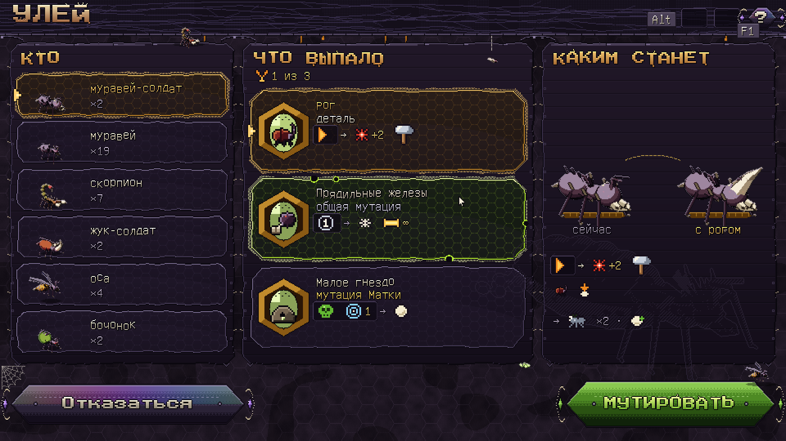

**Находки** — чтобы выводок не повторялся. Какая выпадет, зависит от прошедшего боя:

| Находка | Когда | Что даёт |
|---|---|---|
| **Чистая линия** | в бою рядом выжили двое одной формы | 3 потомка, все этой формы, с деталью одного из родителей, без мутаций: порода закрепляется |
| **Взросление** | рабочая сделала больше всех убийств | она окукливается и к следующему бою выходит солдатом с теми же чертами |
| **Приблудная стая** | бой со зверями или чужим роем | к рою прибиваются 3 дикие особи формы, которой у вас ещё нет — так формы открываются не только мутацией |
| **Яйцо гиганта** | бой с боссом | одно крупное яйцо: из него выходит гигант формы одного из родителей |
| **Химерная кладка** | рой съел тех, у кого есть живые свойства | кладка, где у одного-двух потомков чужая черта (см. «Чужие черты») |

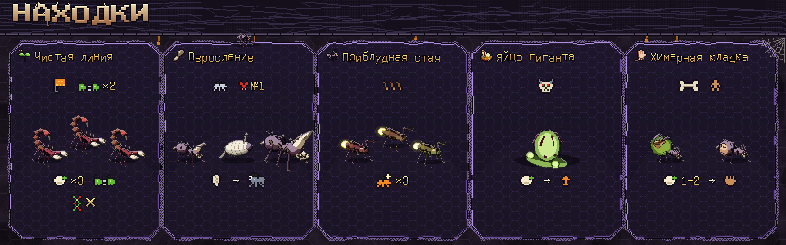

- **Гибель у роя — навсегда**: погибшая особь не возвращается, её место занимают новые кладки.
  Это правило заменяет общее «погибает один раз», как поломка у Литейщика.
- **Формы открываются по ходу похода**: на старте — муравьи и формы своего лидера (те, что
  в стартовой армии), новые приходят мутацией в кладке. Каждый поход складывается по-своему.
- **Естественный отбор**: черты, которые чаще убивали, чаще выпадают в кладках.

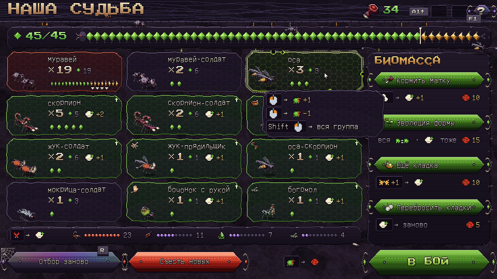

- **Слабости**: отдельная особь хрупкая, растаптывание и удары по площади выкашивают толпу,
  без лидера рой разбегается.

### Позже

- **Ростовщик** — контракты наёмников (срок, условие), ставки на исход боя, долг: при неуплате
  наёмники переходят к врагу посреди боя.
- **Садовница** — растения растут от боя к бою (семя → росток → куст → древо), времена года
  меняются каждые 3 боя, корни захватывают поле.
- **Ловец душ** — выбор боя как выбор добычи, сосуды для душ, призыв призрачных копий врагов,
  слияние душ.

## Артефакты

- **Всегда пассивные**, без кнопок. Восемь, что уже в игре, дают повадки, а не числа — см. «Повадки вместо цифр».
- Проверка для каждого: срабатывает почти в каждом бою **и** меняет хотя бы одно решение игрока.
- Примеры: *Знамя двух ветров* (центр +2 атаки, фланги +2 защиты), *Сапоги преследователя*
  (убийца шагает на клетку жертвы), *Кровавая чаша* (убийство лечит соседей), *Вербовочный
  барабан* (сбежавший враг может перейти к вам), *Тяжёлая наковальня* (+50% урона, ход последним),
  *Колокол тревоги* (гибель союзника усиливает остальных).
- ~85–90% артефактов — широкие; ~10–15% — редкие, меняющие правила. Если артефакт что-то
  отнимает, он обязательно даёт новую игрушку: *Туманный фонарь* (стрелки бьют только по соседнему
  ряду → засады с двойным уроном), *Зеркало одиночества* (без строя → вызов на поединок),
  *Цепь каторжника* (передний ряд не отступает → убийца утаскивается в ваш строй),
  *Песочные часы* (два хода без атак → накопление силы).
- **Артефакты, меняющие сам удар**, задают стиль армии: *Гранёные кости* (разброс −2,
  прибавка +2 — армия надёжнее), *Шальная искра* (разброс вдвое шире, прибавка 0 — лотерея
  против тяжёлой брони).
- **Скрытые пары**: два определённых артефакта вместе включают третий эффект.
- **Пробуждение**: выполнил условие — артефакт становится сильнее.
- Предложение: держать одновременно не больше 4–5 артефактов.

## Враги

Враги не играют картами: у них готовая армия, видимая до боя; встают они по тому же правилу строя. У элиты и боссов —
свои артефакты и особые правила.

## Чтобы было весело и хотелось ещё

- Можно «сломать игру» нелепо сильной связкой; сдерживает рост силы врагов, а не урезание связок.
- Цепные реакции на поле: огонь перекидывается, взрывы отбрасывают, бегство сеет страх.
- Сочные эффекты: заморозка кадра в момент удара, тряска, вспышки, крупные цифры урона.
- Короткие партии, ускорение боя, мгновенный новый поход.
- После поражения видно, сколько не хватило и что открыто.

## Метапрогрессия

Открытие новых существ, модулей, артефактов, лидеров и классов; уровни сложности, каждый
добавляет врагу правило; бестиарий.

## Рамки

- Платформа: только ПК, публикация в Steam.
- Первая версия: два класса — Литейщик и Рой.
- Мир и название — в конце.

## Открытые вопросы

- Точные числа: лидерство, стоимость, размер поля, число ячеек и модулей.
- Наборы способностей, пассивки и слабости врагов; числа черт-деталей роя.
- С кем сражаются Литейщик и Рой: друг с другом, с другими классами, с нейтральными армиями. (В каркасе игры пока
  друг с другом — других армий, которые игра умеет рисовать, нет.)
- Лимит артефактов — подтвердить.
