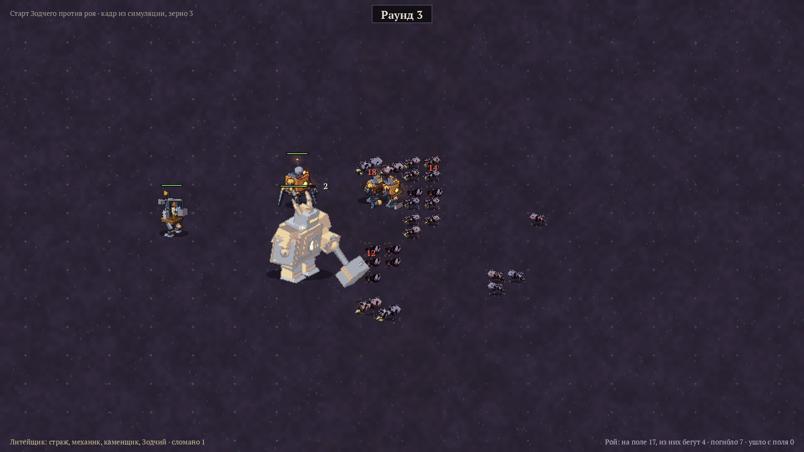

# Симуляция боя

Крейт `sim` — логика боя без графики, по правилам из [концепта](CONCEPT.md): две армии и зерно
случайности на входе, итог и список событий на выходе. Один и тот же бой по зерну повторяется
в точности. Позже на этот же код ляжет отрисовка.

## Запуск

Нужен Rust. Из корня репозитория:

```bash
cargo test --release
```

```bash
cargo run --release --bin balance -- 2000
```

```bash
cargo run --release --bin trace -- molot_orudie 1
```

`balance` прогоняет все сценарии и ищет равный бой, `trace` печатает один бой по раундам.
`cost` меряет силу юнитов в эталонах и подбирает кривую стоимости — см. [BALANCE.md](BALANCE.md).
`snapshot` выдаёт состояние боя после нужного раунда, а `tools/sprites/sim_shot.py` рисует по нему
кадр спрайтами:

```bash
cargo run --release --bin snapshot -- zodchiy 3 3 > tools/sprites/out/shot.json
```

```bash
python3 tools/sprites/sim_shot.py tools/sprites/out/shot.json
```



Числа над юнитами — урон за раунд: красные — по убитым, серые — удар не пробил броню.
Числа лежат в `sim/src/data.rs`.

## Что уже умеет

- Поле 18×14, размеры 1–7: до 4 мелких в клетке, крупные занимают 2×2, 3×3, 4×4.
- Фазы раунда: шаги по скорости, страх, удары по инициативе (равная инициатива — одновременно),
  горение и починка, проверка конца боя; изнеможение с 50-го раунда.
- Удар: разброс и прибавка, повторный бросок на максимуме, броня, уязвимость и сопротивление
  по типу брони, металл проводит молнию, огонь мимо брони, кислота снимает броню,
  +1 по оглушённому, лишний урон пропадает.
- Растаптывание, окружение, сокрушительный удар (отлёт и страх 1–7 у соседей), страх
  и бегство с поля.
- Стрелки: дальность, половина урона на дальней половине, вплотную — запасное оружие.
- Пассивки фреймов: Заслон, Пробивной, Жар горна, Наводка, Наладка, Не боец, огнеупорность,
  Неудержимый, ужас Отца колосса, жуть Маньяка.
- Модули: Мортира, Ремонт, Кистень, Броневые листы, Картечь, Перехват, Грозовая катушка,
  Голова-катапульта.

## Чего пока нет

Магнит, Гусеницы, Таранный нос, Отбойник, Якорь, Ноги-пилы, Пружинный рывок, Отражатель,
Щит-стена и развёртывание, кладка каменщиков, огненные модули кроме Жара горна, слабости
фреймов (открытая спина, без тормозов, гаснет), щиты, стены, яд, рой кроме рабочих и солдат.
Жук-носорог и кислотник — пробные числа, в концепте их ещё нет. Расстановка — одна по умолчанию:
ближний бой впереди, стрелки и поддержка сзади.

## Первые прогоны

2000 боёв на сценарий

| Сценарий | Литейщик | Противник | Ничья | Раундов | Осталось прочности у победившего Литейщика |
|---|---|---|---|---|---|
| Страж против 10 рабочих | 100% | 0% | 0% | 6.0 | 99% |
| Молот против 10 рабочих | 100% | 0% | 0% | 5.9 | 95% |
| Горн против 10 рабочих | 100% | 0% | 0% | 3.0 | 97% |
| Орудие против 10 рабочих | 100% | 0% | 0% | 9.7 | 84% |
| Страж против 4 солдат | 100% | 0% | 0% | 4.5 | 93% |
| Молот против 4 солдат | 100% | 0% | 0% | 3.0 | 88% |
| Молот против 4 воинов | 100% | 0% | 0% | 5.8 | 91% |
| Молот и Орудие против 25 рабочих | 100% | 0% | 0% | 8.1 | 89% |
| Страж и Механик против 25 рабочих | 100% | 0% | 0% | 8.9 | 98% |
| Страж и Механик: рабочие, жуки, кислотники | 90% | 10% | 0% | 13.0 | 37% |
| Старт Отца колосса против роя | 100% | 0% | 0% | 6.5 | 100% |
| Старт Изобретателя против роя | 100% | 0% | 0% | 7.5 | 73% |
| Старт Маньяка против роя | 100% | 0% | 0% | 6.9 | 71% |
| Старт Зодчего против роя | 100% | 0% | 0% | 9.3 | 85% |
| Старт Отца колосса против 8 воинов | 100% | 0% | 0% | 5.0 | 100% |
| Старт Изобретателя против 8 воинов | 100% | 0% | 0% | 8.3 | 82% |
| Старт Маньяка против 8 воинов | 100% | 0% | 0% | 8.4 | 76% |
| Старт Зодчего против 8 воинов | 100% | 0% | 0% | 18.0 | 89% |
| Для сравнения: рой старта против 8 воинов | 13% | 87% | 1% | 8.8 | 29% |

Равный бой: сколько врагов нужно, чтобы армия выигрывала около половины боёв

| Армия | Рабочих | Солдат | Воинов |
|---|---|---|---|
| Страж | 219 | 19 | 20 |
| Молот | 97 | 15 | 17 |
| Горн | 265 | 18 | 55 |
| Орудие | 27 | 6 | 7 |
| Молот и Орудие (лидерство 10) | 139 | 18 | 27 |
| Страж и Механик (лидерство 10) | 241 | 21 | 25 |
| Старт Отца колосса | больше 300 | 57 | больше 80 |
| Старт Изобретателя | 233 | 41 | 40 |
| Старт Маньяка | 183 | 20 | 32 |
| Старт Зодчего | 291 | 22 | 24 |
