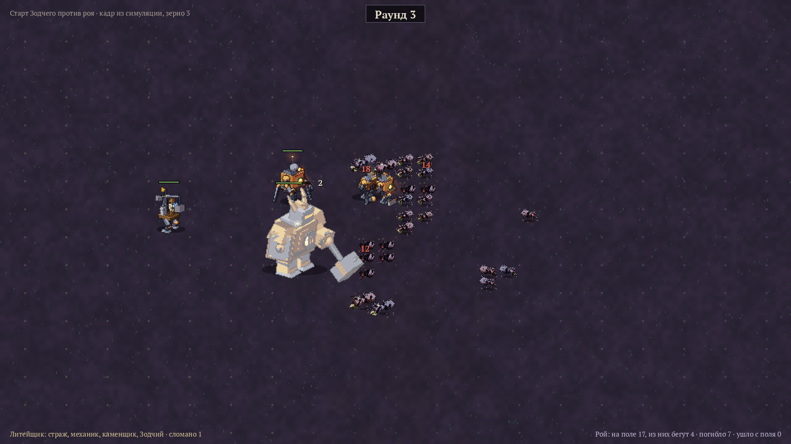

# Симуляция боя

Крейт `sim` — логика боя без графики, по правилам из [концепта](CONCEPT.md): две армии и зерно
случайности на входе, итог и список событий на выходе. Один и тот же бой по зерну повторяется
в точности. Позже на этот же код ляжет отрисовка.

## Запуск

Нужен Rust. Из корня репозитория:

```bash
cargo test --release
```

```bash
cargo run --release --bin balance -- 2000
```

```bash
cargo run --release --bin trace -- strazh_mudrets 1
```

`balance` прогоняет все сценарии и ищет равный бой, `trace` печатает один бой по раундам.
`cost` меряет силу юнитов в эталонах и подбирает кривую стоимости — см. [BALANCE.md](BALANCE.md).
`snapshot` выдаёт состояние боя после нужного раунда, а `tools/sprites/sim_shot.py` рисует по нему
кадр спрайтами:

```bash
cargo run --release --bin snapshot -- zodchiy 3 3 > tools/sprites/out/shot.json
```

```bash
python3 tools/sprites/sim_shot.py tools/sprites/out/shot.json
```



Числа над юнитами — урон за раунд: красные — по убитым, серые — удар не пробил броню.
Числа лежат в файлах `sim/data/*.ron`: `units.ron` — существа, `modules.ron` — модули, `swarm.ron` — касты
и формы роя, `armies.ron` — стартовые армии. Файлы вшиты в программу при сборке, `sim/src/data.rs` их читает.
Тест `sim/tests/data_snapshot.rs` сверяет все числа со снимком `data_snapshot.txt` — после намеренной правки
снимок обновляют: `WRITE_SNAPSHOT=1 cargo test -p sim --test data_snapshot`; `check()` следит, чтобы армии
ссылались только на существующих существ и модули и чтобы числа не роняли бой: размер 1–7, здоровье от 1,
способность «раз в N ходов» — N от 1.

## Поход

`sim/src/run.rs` — поход без графики: класс и лидер, армия (с запасом, если не влезает в зону), валюта, артефакты,
модули на големах и мутации пород (`sim/data/finds.ron`), дороги разной опасности,
развилки, враг по кривой сложности (`sim/data/curve.ron`: сила по номеру боя в отряде класса игрока — Горнах
у Литейщика, очках роя у роя; враг подгоняется прогонами против этого отряда), лидерство Литейщика и предел
роя (`sim/data/run.ron`: найм сверх лидерства не берётся, рой сверх предела съедает лишних), добыча, торговец, события, привал, потери после боя. Всё
детерминировано зерном похода и сохраняется целиком (serde). `cargo test --release -p sim --test run` — бот проходит
походы за всех восьмерых лидеров и печатает, чем кончилось.

## Что уже умеет

- Поле 36×30, зона стороны — 15 столбцов, между зонами 6 пустых; размеры 1–7: до 4 мелких в клетке, крупные
  занимают 2×2, 3×3, 4×4. Армия встаёт в прямоугольник по своему размеру (`BLOCK`, 6×14 — для обычной, больше —
  в тех же пропорциях, до всей зоны) посреди высоты поля. Враг похода растёт по лестнице до заполнения зоны
  (`LADDER` шагов); его размер ищется сначала удвоением, потом делением пополам.
- Фазы раунда: шаги по скорости, страх, удары по инициативе (равная инициатива — одновременно),
  горение и починка, проверка конца боя; изнеможение с 50-го раунда.
- Удар: разброс и прибавка, повторный бросок на максимуме, броня, уязвимость и сопротивление
  по типу брони, металл проводит молнию, огонь мимо брони, кислота снимает броню,
  +1 по оглушённому, лишний урон пропадает.
- Растаптывание, окружение, сокрушительный удар (отлёт и страх 1–7 у соседей), страх
  и бегство с поля.
- **Обход с фланга** (`way_round` в `battle.rs`). Боец ближнего боя в 4 клетках от врага сам выбирает, откуда
  ударить: ищет кратчайший путь вокруг своих и чужих (8 направлений, до 8 шагов) к месту рядом с врагом. Место
  у спины врага стоит 0, у бока — 1, у фронта — 3 лишних шага: боец обходит с фланга или в тыл, когда это не больше
  чем на 2–3 шага длиннее, чем в лоб. Кому путь вперёд закрыт своими, тот обходит строй (до 12 шагов). Быстрые
  фланговые бойцы идут в обход к стрелкам и лидеру. Удар в спину сильнее обычного не бьёт: этой механики больше
  нет (была ×1,5, событие `Rear`, надпись «в спину»), обход нужен, чтобы окружить врага, а не ждать в очереди.
- **Удержание** (`HOLD`, `holds`, `held_by` в `battle.rs`). Боец ближнего боя на ногах (дальность 1, бьёт, не
  летает, не бежит, не облако мошкары) держит врагов в `HOLD` = 2 клетках от себя. Удержанный идёт только на
  ближайшего держащего: шаг ближе к нему или, на двух клетках, вбок к его середине — не вдоль строя, не ему за спину,
  не к стрелкам за ним. Путь обхода (`way_round`) тоже не проходит сквозь удержанную землю: вошедший в неё идёт дальше
  только ближе к держащим. Поэтому строй, где между бойцами не больше четырёх клеток, закрывает тех, кто за ним;
  обойти его можно лишь с конца, дугой не ближе трёх клеток. Не держатся летающие (у них свой полёт), неудержимые и
  бегущие; прыжок кузнечика и Подкидыш — в первый ход, до шагов, их тоже не держат. Тест `a_line_holds_the_crowd`:
  без правила кузнечики проходят строй к Орудию, с ним — нет; осы перелетают.
- Стрелки: дальность, половина урона на дальней половине, вплотную — запасное оружие.
- Заклинатель (Мудрец): заклинание на всю дальность без потери урона, вплотную срабатывает
  раз из четырёх, запасного оружия нет; Питание (у соседних големов огненные и грозовые модули
  перезаряжаются на раунд быстрее), Замыкание (кислота глушит на 2 раунда).
- Пассивки фреймов: Заслон, Жар горна, Наводка, Наладка, Не боец, Питание, огнеупорность,
  Неудержимый, ужас Отца колосса, жуть Маньяка.
- Модули: Мортира, Ремонт, Кистень, Броневые листы, Картечь, Перехват, Грозовая катушка,
  Голова-катапульта, Перегрузка и Огненный шар Мудреца; Пробивной — свойство для будущих модулей.
- Способности лидеров Литейщика: Сотрясение (Отец колосса: каждые 3 хода вместо удара — дробящий по всем врагам
  вплотную, мелкие размера 1–2 оглушены), Аугменты (Изобретатель: в начале боя модули големов в 2 клетках — на ход
  раньше, кубик на 2 больше), Прикручивание (Маньяк: каждые 3 хода голему в 2 клетках — Кистень, Голова-катапульта,
  два броневых листа или Ремонт). Оглушённый пропускает следующую атаку («Неудержимых» не оглушить), событие `Stun`.
- Рой: Стая, Пожирание, Обезглавленный рой, яд; девять форм (Строй, Полёт, Жало, Плевок
  и лопание бочонка, Разгон, Шипы и сворачивание, Прыжок, Серпы, Вспышка); лидеры — Кладка
  Матки, Метка и Единый разум Разума улья (весь рой с полной Стаей), Рост и голод Пожирателя (ест каждого врага, павшего рядом с ним, кто бы его ни
  убил, — `Unit::meals`; растёт с каждым вторым съеденным; голоден, `Hungry`, пока рой за поход не убил 30), Яйцеклад и
  Подкидыш Чумы.
- Мутации роя — доктрины на весь рой (`finds.ron`, геном держит 4, `Run::genome`): Крылатый рой (летящих не
  растоптать, сотрясение их не берёт), Мошкара (облако — отдельный юнит «Мошкара» с чертой `Cloud`: жалит сквозь
  броню, слепит стрелков рядом, огонь втрое, через 2 хода рассеивается), Паутина и Медовые соты (слои поля
  `Battle::web` и `Battle::honey`: чья сеть и чей мёд на каждой клетке; враг в сети два хода выпутывается и получает
  ×1,5, огонь бежит по сети на 2 клетки; враг в мёде бьёт вдвое слабее), Мимикрия (`Battle::mimicry`: что рой перенял
  у машин, разломанных ниже половины, — ток, огонь, панцирь, дробящий удар, починку, +1); пулы лидеров: Живородящая,
  Почкование, Стрекот (резонанс), Мираж (призрачные двойники с чертой `Ghost`), Третья ступень (личная мутация
  Пожирателя, `personal` в `finds.ron`, черта `ThirdStage`: растёт с каждым съеденным, трижды, на третьей ступени удар
  топчет соседей размера 5 и меньше), Паразитоид (и машины: личинка из носителя раз в 3 хода),
  Кукловод (павшая заражённая машина встаёт за рой марионеткой с чертой `Puppet` на 2 хода). Облака, призраки и
  марионетки — не армия (`Template::is_army`): ими одними бой не выиграть, в павших они не считаются.
  Игра рисует сеть и мёд по слоям поля, облака — роем точек, призраков — полупрозрачными, марионеток — с зелёным
  налётом (`render.rs`).

- **Своё у каждого лидера** (CONCEPT.md, «Лидеры»; тест `sim/tests/signatures.rs`, кадры `game --leaders dir`):
  - Отец колосса — Бросок титана (`Ability::Hurl`, `Battle::hurl`): каждые 4 хода вместо удара хватает самого крупного
    врага рядом (до размера 5) и швыряет туда, где его свои стоят гуще всего, в пределах 6 клеток; событие `Thrown`
    несёт, откуда и куда, запись рисует полёт дугой.
  - Изобретатель — Тесла-сеть (`Trait::Tesla`, `Battle::tesla`): в конце хода каждый голем связан с двумя ближними
    своими в `TESLA_REACH` = 5 клетках; враг, чья клетка лежит на линии между серединами двух, получает
    1–`TESLA_DIE` молнией (металл — в полтора раза); событие `Arc` на каждую связь. Нет Изобретателя — нет сети.
  - Маньяк — Трофеи (`Trait::Trophies`, `Battle::trophy`, из `kill`): павший в 3 клетках от него враг отдаёт деталь
    ближнему голему (до двух на голема): черту формы (полёт, яд, разгон, шипы, два клинка, кислотный мешок), вспышку
    светляка, плевок паука, первый модуль машины, у лидера — Ужас; кузнечиковые ноги — прыжок сразу.
  - Зодчий — Чертёж и Гарнизон (`Ability::Blueprint`, `Battle::blueprint`, `garrisoned`): в первый ход встают `n`
    стен (юниты «Стена» с чертой `Wall`: клетка, не бьёт, не армия, камень) столбцом в двух клетках перед армией, по
    две с просветом в две; пока стоит своя стена и Зодчий жив, его армия не идёт к врагу дальше 3 клеток — до
    `GARRISON_ROUNDS` = 10-го хода. Каменщики кладут стены сами (`Ability::Lay`, до `LAY_MAX` = 3 за бой). Стены
    обходят (`nearest_enemy` их не видит), стрелки по ним не бьют, ломают их, только когда рядом больше некого.
  - Матка — Метаморфоз (`Trait::Metamorph`, `Battle::metamorph`): её личинка, прожившая 3 хода, становится копией
    формы, что больше всех убила в этом бою (с её чертами и мутациями); событие `Morph { from, to }` — личинка
    уходит без трупа, на её месте новое тело.
  - Разум улья — Подмена (`Ability::Swap`, `Battle::swap`): каждые 4 хода стрелок, заклинатель или лидер врага, дальше
    всех от роя (не ближе 3 клеток), и особь из самой густой толпы меняются местами; стрелок оглушён. Событие `Swap`
    несёт, откуда оба.
  - Пожиратель — Глотает целиком (`Ability::Swallow`, `swallow`, `digest`): каждые 3 хода вместо укуса глотает врага
    рядом меньше себя (размер с ростом: +1 за ступень). Проглоченный вне поля (`Unit::inside`, у Пожирателя `belly`):
    каждый ход 1–6 +2 за ступень мимо брони, сам бьёт изнутри мимо брони Пожирателя; переваренный — его еда; падёт
    Пожиратель — проглоченный вырывается рядом, оглушённый (событие `Burst`).
  - Чума — Эпидемия (`Trait::Contagion`, `Battle::contagion`): каждые 4 хода споры в ближнего врага, где бы он ни был;
    пока она жива, заражённый враг каждый ход раз из трёх заражает соседа.
- **Поле живёт** (тест `sim/tests/field.rs`, кадры `game --leaders dir`, 72–77):
  - Слои поля `Battle::ground` (`GOO` — слизь павшей особи, `OIL` — масло сломанной машины, `machine()`),
    `Battle::flames` (горящее масло, ходов осталось), `Battle::rift` (трещины). Пятна кладёт `kill`.
  - Пожар: огонь по стоящему на масле (`ignite` из `apply`), горящий на масле — масло горит `OIL_BURNS` = 3 хода,
    поджигает стоящих и перекидывается на соседнее масло (`ground_round`), выгоревшее исчезает.
  - Разряд: молния по стоящему в слизи (`apply`, сеть Изобретателя, гроза) бежит по слизи на `SURGE_REACH` = 3
    клетки и бьёт вполовину всех в ней, своих тоже (`surge`, событие `Surge`).
  - Кегли (`bowl`, `push`): отброшенный врезается в своего прямо за ним (размер не больше на 1), оба 1–3, тот
    отлетает дальше — до `BOWL` = 3; на масле отброшенный скользит ещё на клетку и оглушён. Событие `Bump`.
    Брошенный Отцом колосса отбрасывает тех, на кого упал (`Hit::from`).
  - Погода (`model::Weather`, `Battle::with_weather`, `weather_round`): Гроза — `STRIKES` = 2 молнии в ход, вес цели
    1 + размер + 6 за металл, 1–8 (`Strike`, `Nature`); Землетрясение — каждые `QUAKE_EVERY` = 4 хода, до `RIFTS` = 3,
    трещина по столбцу посередине поля (`Rift`): стоящие на ней 1–6 и оглушены, шагнувший в неё стоит до следующего
    хода (`Unit::stuck_until`); Ночь — стрелки дальше `NIGHT_SIGHT` = 2 клеток видят только горящих, светящихся и
    стоящих в огне и бьют их первыми (`ranged_target`, `lit`). Погода дороги — `Node::weather`; со второго боя у
    дороги в трёх — гроза, землетрясение или ночь (`Run::weather`), враг подбирается под неё (`holds` с
    `fit_weather`), бой похода — `run::play_in`.
- **Таблица реакций и крючки лидеров** (`apply`, `ground_round`, `scavenge`, `spread`; тест `sim/tests/field.rs`):
  огонь по слизи — корка (`CRUST`: не горит, не проводит), огонь по мёду — склеен на ход, кислота по маслу — `corrode`
  всем в луже (2 клетки), кислота по слизи — яд 1–4 всем в ней; стены (`walled`) останавливают пожар и разряд.
  Изобретатель (`Tesla`) заземляет свою сторону от разряда; брошенный на масло поджигает его; Маньяк в масле — лист
  голему (`SCRAP_MAX` = 3, счётчик `laid`); Пожиратель в масле — `OIL_DRINK` = 3 здоровья за клетку; личинки Матки в
  слизи — за 2 хода; зараза Чумы по слизи — на 2 клетки; Подмена ночью — на ход чаще. Находки: модуль «Громоотвод»
  (`rod`, `Trait::Grounded`: вес для грозы ×3, урона от грозы и разряда нет), мутация «Сухой хитин» (`m_dry`,
  `Trait::DryChitin`: павшие оставляют корку).
- **Сеты стихий** (`model::Element`, `tag` у находок в `finds.ron`, `Run::set_count`, `SET_NEED` = 3; тест
  `sim/tests/sets.rs`): три находки одной стихии — лидеру `Trait::Set { e }`, бой собирает их в `Battle::sets` и
  читает `has_set`. Пал — `blaze` (горящее масло там, куда попал огонь армии, и Жар горна), пожар не поджигает её;
  Громовая сеть — сторона заземлена в `surge`, её разряд на 2 клетки дальше; Стальная стена — `hold_of` (3 клетки),
  не отбросить и не сбить; Кегли — удар вплотную с `knock`, `BOWL` + 2; Трясина — враг в слизи `stuck_until`;
  Мор — яд по машинам и сквозь броню; Туча — `holdable` ложь, трещины не держат; Хитиновая стена — −1 с удара, не
  отбросить. Новый модуль «Раскалённая броня» (`hot`, `Trait::HotArmor`).
- **Враги с лицом**: приставка элиты (`model::Affix`, `Node::affix`, выпадает в `fork`, враг подбирается с ней —
  `fit_affix`): Бронированные, Огненные (`Blazing`), В масле (`Oily`), В слизи (`Slimy`), Живучие (`Stubborn`,
  событие `Defy`), Неудержимые. Босс — `Trait::Boss` у лидера армии босса: на половине здоровья `phases` — вторая
  фаза своя у каждого из восьми (событие `Phase`).
- **Правила похода лидеров роя** (`run.rs`, `Run::learn`, `Run::body`): Пандемия Чумы (`Ability::Pandemic`: каждые
  `PANDEMIC_EVERY` = 3 выигранных боя — ещё один враг заражён в начале боя), Память роя Разума (`Run::memory`, до
  `MEMORY` = 3 видов; вид врага, убивший больше всех особей, — `Trait::Knows`, рой бьёт его +2), Ты — то, что ты ешь
  у Пожирателя (`Run::diet`: съел `DIET_STEP` = 5 одного вида — получает его: Страж и Каменщик — броню, Мудрец — ток в
  укусе, Горн — жар, Орудие — +2 к удару, Механик — здоровье, лидер — здоровье и удар). Что бой дал для них, отдаёт
  `BattleResult::foe_kills` и `eaten`.

## Чего пока нет

Магнит, Гусеницы, Таранный нос, Отбойник, Якорь, Ноги-пилы, Пружинный рывок, Отражатель,
Щит-стена и развёртывание, огненные модули кроме Жара горна, слабости
фреймов (открытая спина, без тормозов, гаснет), щиты, черты-детали и гиганты роя, мутации прежнего каталога (Болас, Куколка, Стража лидера);
рост Пожирателя меняет только числа, не размер на поле.

Строй — автоматический, как в игре (`role`, `deploy` в `battle.rs`; правило — в CONCEPT.md, «Строй
сам»): лидер-боец и щиты в середине первого ряда, ударные рядом, летуны и прыгуны по краям,
поддержка вторым рядом, стрелки и прочие лидеры сзади; против Мортиры мелкие встают по 2 в клетке.
`fight` ставит обе армии через `add_armies`, каждая читает другую.

## Первые прогоны

Это самые первые прогоны — ещё с Молотом (его сменил Мудрец) и прежними, неподобранными числами.
Текущие результаты — в [BALANCE.md](BALANCE.md).

2000 боёв на сценарий

| Сценарий | Литейщик | Противник | Ничья | Раундов | Осталось прочности у победившего Литейщика |
|---|---|---|---|---|---|
| Страж против 10 рабочих | 100% | 0% | 0% | 6.0 | 99% |
| Молот против 10 рабочих | 100% | 0% | 0% | 5.9 | 95% |
| Горн против 10 рабочих | 100% | 0% | 0% | 3.0 | 97% |
| Орудие против 10 рабочих | 100% | 0% | 0% | 9.7 | 84% |
| Страж против 4 солдат | 100% | 0% | 0% | 4.5 | 93% |
| Молот против 4 солдат | 100% | 0% | 0% | 3.0 | 88% |
| Молот против 4 воинов | 100% | 0% | 0% | 5.8 | 91% |
| Молот и Орудие против 25 рабочих | 100% | 0% | 0% | 8.1 | 89% |
| Страж и Механик против 25 рабочих | 100% | 0% | 0% | 8.9 | 98% |
| Страж и Механик: рабочие, жуки, кислотники | 90% | 10% | 0% | 13.0 | 37% |
| Старт Отца колосса против роя | 100% | 0% | 0% | 6.5 | 100% |
| Старт Изобретателя против роя | 100% | 0% | 0% | 7.5 | 73% |
| Старт Маньяка против роя | 100% | 0% | 0% | 6.9 | 71% |
| Старт Зодчего против роя | 100% | 0% | 0% | 9.3 | 85% |
| Старт Отца колосса против 8 воинов | 100% | 0% | 0% | 5.0 | 100% |
| Старт Изобретателя против 8 воинов | 100% | 0% | 0% | 8.3 | 82% |
| Старт Маньяка против 8 воинов | 100% | 0% | 0% | 8.4 | 76% |
| Старт Зодчего против 8 воинов | 100% | 0% | 0% | 18.0 | 89% |
| Для сравнения: рой старта против 8 воинов | 13% | 87% | 1% | 8.8 | 29% |

Равный бой: сколько врагов нужно, чтобы армия выигрывала около половины боёв

| Армия | Рабочих | Солдат | Воинов |
|---|---|---|---|
| Страж | 219 | 19 | 20 |
| Молот | 97 | 15 | 17 |
| Горн | 265 | 18 | 55 |
| Орудие | 27 | 6 | 7 |
| Молот и Орудие (лидерство 10) | 139 | 18 | 27 |
| Страж и Механик (лидерство 10) | 241 | 21 | 25 |
| Старт Отца колосса | больше 300 | 57 | больше 80 |
| Старт Изобретателя | 233 | 41 | 40 |
| Старт Маньяка | 183 | 20 | 32 |
| Старт Зодчего | 291 | 22 | 24 |
