# Техническая часть

## Решение

Собственный движок на **Rust**, настоящая игра для ПК под **Windows** (только её: macOS и Linux не делаем),
публикация в Steam.
Не браузерная игра.

Почему Rust: уже используется в другом проекте автора, собирается и тестируется в облачных
сессиях Claude, даёт обычный исполняемый файл под Windows, Steam подключается через
библиотеку `steamworks`.

## Главный принцип — логика боя отдельно от картинки

Логика боя — чистая функция: две армии, артефакты и зерно случайности → список событий
(«А ударил Б на 5», «В сбежал»). Отрисовка только проигрывает события с анимацией и эффектами.

Это даёт:

- тысячи боёв за секунды без графики — автоматическая проверка баланса (какой модуль или
  артефакт слишком силён, кого никто не берёт);
- повтор любого боя по зерну — ошибки воспроизводятся;
- ускорение и пропуск боя бесплатно;
- позже — асинхронные бои против сохранённых армий других игроков.

Особенности, модули и артефакты срабатывают на события боя («перед атакой», «при убийстве»,
«в начале хода», «при бегстве»). Новые существа, модули и артефакты добавляются как данные,
без переписывания движка.

## Части

| Часть | Что делает |
|---|---|
| Логика боя | детерминированная, с тестами и прогоном тысяч боёв для баланса; крейт `sim`, см. [SIM.md](SIM.md) |
| Данные | существа, модули, формы роя и стартовые армии — в файлах RON `sim/data/` (`units`, `modules`, `swarm`, `armies`), вшиты в программу; мутации и артефакты лягут туда же; позже моды через Мастерскую Steam |
| Отрисовка | пиксельная картинка 960×540, увеличенная целым множителем (×2 = 1920×1080, ×4 = 4K); на других экранах холст арта растёт до их пропорций (1440p — 1280×720 ×2, 16:10 — 960×600), масштаб интерфейса — в настройках (целые шаги); см. [STEAM.md](STEAM.md); окно и вывод — `winit` + `pixels` |
| Эффекты | спрайт-листы, в том числе из pixelfx (навык в `.claude/skills/pixelfx`) |
| Интерфейс | свой (`game/src/ui.rs`): детали наборов с нарезкой 9/3 частей, кнопки, карточки, подсказки, текст с переносом; шрифт с кириллицей; экраны — `screens.rs` |
| Звук | `kira` |
| Steam | `steamworks`: достижения, облачные сохранения |
| Сохранения | файлы + облако Steam |
| Сборка | GitHub Actions на каждый пуш гоняет тесты и собирает игру на Windows (`.github/workflows/windows.yml`); готовая техдемка — `game.exe` с папкой `assets` и `README.txt` (как запустить, клавиши, где сохранения) — лежит в артефактах запуска (`gam2-techdemo-windows`). Рантайм C зашит в exe (`.cargo/config.toml`, `+crt-static`), так что пакет Visual C++ на компьютере не нужен; шаг CI проверяет по таблице импорта, что exe не тянет `vcruntime`/`msvcp`. Номер сборки (коммит, `GAM2_BUILD`) виден в главном меню справа вверху. Тест игры `battles_play_back` прогоняет каждую стартовую армию против каждой (с призывом личинок посреди боя) через воспроизведение, звуки, камеру и рисование; `GAME_FUZZ=5` — то же глубже, по пять боёв на пару и каждый третий кадр. Разработка и облачные проверки идут на Linux (там же собирается exe для Windows: `--target x86_64-pc-windows-gnu` с MinGW) |

## Чем свой движок дороже готового

Текст, интерфейс и звук пишутся с нуля, поэтому первое время уходит на основу. Для двумерного
автобатлера это посильно, и всё устроено под эту игру.

## Каркас игры

Игра открывается главным меню, дальше выбор класса, лидера и поход — всё на одном холсте 960×540, увеличенном целым
множителем. Экраны — состояния в `game/src/game.rs`, как каждый выглядит — `game/src/screens.rs`, набор
элементов — `game/src/ui.rs`. Поход — `sim/src/run.rs` (без графики, детерминированный, с тестами), бой похода
проигрывается тем же кодом, что бой демо.

```
меню → класс → лидер → развилка ⇄ бой → добыча (+ находка 1 из 3, после босса — развитие лидера 1 из 2)
                                     | торговец | событие | привал → … → итог похода
                                     пауза (Esc), настройки, армия — поверх любого экрана
```

- **Поход**: 15 боёв, каждый пятый — босс. Перед шагом — развилка из 2–3 дорог: бой (видна армия врага и награда),
  элита (с 3-го боя, даёт артефакт), торговец, событие или привал (не больше одной остановки между боями; перед
  боссом — привал или торговец). Проигранный бой заканчивает поход.
- **Враги** — пока армии другого класса (Литейщик бьётся с роем, рой — с големами): кто против кого — открытый вопрос
  концепта. Враг подгоняется под армию игрока: из лестницы всё более сильных армий берётся самая сильная, которую
  армия игрока ещё побеждает в 97→92 % прогонов (элита 85 %, босс 75 %). Размер армий ограничен зоной расстановки:
  кто не влез — ждёт в запасе. **Числа временные**, это рамка, а не баланс.
- **Потери остаются**: убитый голем сломан и пропускает бои до ремонта (в добыче — 2 металла за голема, на привале
  бесплатно, у торговца), убитая особь роя погибает насовсем, рой растёт выводком (в добыче) и кладкой (Улей). Лидер
  всегда возвращается.
- **Развилка — настоящий выбор**: из двух боёв один обычный, второй труднее — элита (артефакт) или опасная дорога
  (враг сильнее, валюты больше, находка реже), черепа на карточке показывают опасность.
- **Находки по концепту** (`sim/data/finds.ron`): у Литейщика — **модули**, каждый для своих корпусов или для любого
  голема, ставятся на одного голема в свободную ячейку (у Отца колосса 4, у больших корпусов 3, у остальных 2); у
  роя — **мутации**, их получает вся порода, и выводок тоже. Находка — два модуля или мутации и одно тело (голем,
  стая); у торговца так же. Выбрал модуль или мутацию — открывается «Куда поставить» / «Какой породе» с подходящими
  целями; модули и мутации видны значками на карточках армии и привала, карточки показывают бойца таким, каким он
  выйдет в бой. Только то, что симуляция уже умеет (16 модулей, 15 мутаций), числа временные.
- **Добыча** устроена, как принято в жанре: столбик строк, каждую берёшь кликом (валюта, ремонт или выводок,
  находка, артефакт), находка открывает выбор одной карточки из трёх с возможностью пропустить (+3 валюты).
  **Торговец** — прилавок: рекруты сверху, артефакты и услуга снизу, цена латунной биркой под товаром, купленное
  гасится штампом «ПРОДАНО». **Событие** — картинка слева (сцена из спрайтов игры, вдвое крупнее), текст и
  варианты справа, у каждого варианта видно, что он даст или отнимет. **Привал / Улей** — две большие карточки:
  починить всех / закалить одного (у роя — кладка / отбор породы).
- **Лидеры в бою** делают то, что написано на экране выбора: Отец колосса — Сотрясение (каждые 3 хода бьёт всех
  вплотную, мелких оглушает), Изобретатель — Аугменты (в начале боя модули големов рядом на уровень выше),
  Маньяк — модуль наугад голему рядом каждые 3 хода, Зодчий — два каменщика в армии; у роя — кладка Матки, метка
  Разума, рост Пожирателя, заражение Чумы. Оглушённый пропускает атаку, над ним всплывает «оглушён».
- **Армия** (кнопка внизу и в паузе), как в стратегиях старой школы: слева весь список — голем или лидер строкой,
  у роя строка на породу со счётчиком, сломанные отдельно; колесо листает список. Щелчок открывает справа полный лист
  бойца — каким он выйдет в бой: портрет, род и тип брони, здоровье, броня, удар с типом урона, дальность, скорость,
  инициатива, боевой дух, размер; ниже — всё, что он умеет: способности с числами, черты, модули с уровнями (или мутации
  породы), колесо листает и его. Слова для каждой черты и способности — в `ru.json` (`tr.*`, `ab.*.l`).
- **Уровни модулей и мастерская** (Литейщик, CONCEPT.md «Мастерская», «Переплавка»): у модуля уровни I–III —
  взял тот же модуль ещё раз, он поднимается на уровень («Куда поставить» подписывает «до уровня II»); уровень
  выше I — на ход раньше и кубик на 2 больше (у Ремонта +2 починки, у Броневых листов +1 лист), а модулю без таких
  чисел — +1 к удару голема. Уровень виден золотыми точками под значком. На привале у горна — «Мастерская»: все
  големы с ячейками; модуль берётся щелчком и ставится в свободную ячейку другого голема, куда он подходит (даром),
  или переплавляется в другой модуль того же корпуса: +1 уровень за 3 металла. Esc — положить модуль обратно,
  ещё раз — назад; мастерская не тратит выбор привала.
- **Эволюции и пулы роя** (CONCEPT.md «Эволюция форм», «Мутации — общий пул и пулы лидеров»): эволюции в
  `finds.ron` помечены своей формой (`form`), находкой не выпадают — их покупают за биомассу в выводке (кнопка
  «Эволюция» на добыче) и в Улье: 8 биомассы, каждая следующая для той же формы на 4 дороже; эволюция меняет всю
  породу и будущий выводок. Находки роя — общий пул и пул своего лидера (`leader`): у Матки Живородящая и
  Доминантная линия, у Разума улья Стрекот и Пси-железа, у Пожирателя Кормовое безумие и Кровь Пожирателя, у Чумы
  Паразитоид и Споры (только то, что симуляция умеет); на карточке такая мутация подписана «мутация лидера».
- **Развитие лидера** (`sim/data/growth.ron`): после босса (кроме последнего) в добыче строка «Развитие лидера» —
  две карточки, одна навсегда. У каждого из восьми лидеров по три пути по концепту, из тех, что симуляция уже
  умеет: сам лидер сильнее (чаще способность, крепче, сильнее удар), вся армия (+1 броня, +1 к удару, +2 здоровья),
  +1 ячейка големам или тело в армию. Взятое дважды одной способности складывается.
- **Артефакты** (8, на каждый свой значок из набора): всегда пассивные, меняют армию игрока перед боем —
  Знамя (мораль +3), Сапоги скорохода (скорость +1), Кровавая чаша (здоровье +20 %), Тяжёлая наковальня (удар +3,
  ходят последними), Колокол тревоги (инициатива +2), Гранёные кости (разброс −2, удар +2), Песочные часы (броня
  +1), Фонарь дальнобоя (дальность стрелков +1).
- **Вид**: всё из наборов для движка обоих классов — у Литейщика кузнечное железо, латунь, рычаг рядом с литой
  табличкой для главного действия, кнопки-ручки с бирками на проволоке; у роя хитин, кислота, янтарь. Фоны и
  выбор класса и лидера — запечённые фоны макетов без текста (`tools/sprites/bake_screens.py`), огонь в печах
  анимирован. Наведение — карточка приподнимается и светится, рычаг откидывается, с таблички сыплются искры;
  карточки экрана выезжают по очереди; между экранами смыкаются ставни (железные с латунной кромкой / хитиновые с
  кислотой); изменения валюты всплывают у счётчика; в кузне летят искры, в улье — споры.
- **Текст** — только в `game/assets/text/ru.json` (ключ → строка), в коде и в картинках его нет; тест
  `every_key_has_a_line` следит, чтобы у каждого ключа была строка.
- **Сохранение**: поход пишется, когда открывается развилка, в `%APPDATA%\gam2\run.json` («Продолжить» в меню);
  вышел посреди шага (в бою, у торговца, в событии) — шаг начнётся заново с той же развилки и пройдёт так же, поход
  детерминирован (иначе событие или лавку можно было бы брать снова и снова). Настройки — в `settings.json` рядом
  (громкость, экран/окно, камера в бою, масштаб интерфейса, скорость боя).
- Развилка строится прогонами боёв (до десятой-двух доли секунды) в тот миг, когда ставни сомкнуты, — заминки не
  видно. Esc закрывает выбор находки, на привале из выбора есть «Назад».
- **Проверка**: `cargo run -p game --release -- --screens dir` снимает каждый экран обоих классов в PNG без окна;
  тест `a_run_through_the_screens` проходит поход каждого класса через все виды экранов и действий, рисуя каждый
  экран, `the_leader_grows_after_a_boss` — выбор развития кликом, `the_workshop_by_the_mouse` — перестановка и
  переплавка мышью, `evolution_by_the_mouse` — эволюция мышью, `every_letter_is_in_the_fonts` — что у каждой буквы текста есть глиф; глубже, вручную: `random_player` (`--ignored`, `GAME_PLAYER=N`) доигрывает до конца походы всех восьми лидеров со случайным выбором на каждом экране — с мастерской, переплавкой и эволюциями — и после каждого шага проверяет поход (модулей не больше ячеек, уровни I–III, валюта не в минусе, лидер на месте); `monkey` (`--ignored`, `GAME_MONKEY=N`) — случайные клики и клавиши тысячи кадров подряд; тест `sim/tests/run.rs` — походы бота за всех
  восьмерых лидеров (бот, берущий первое попавшееся, проходит 5–6 из 8), то, что каждое развитие что-то меняет,
  и уровни, перестановку и переплавку модулей, эволюции и пулы лидеров роя; `sim/tests/leaders.rs` — что способности лидеров
  Литейщика срабатывают в бою.
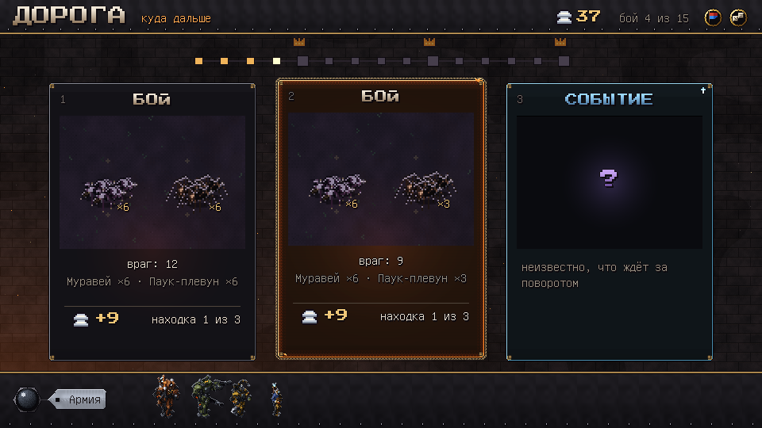 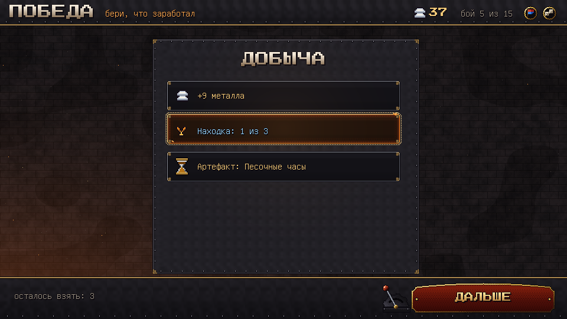
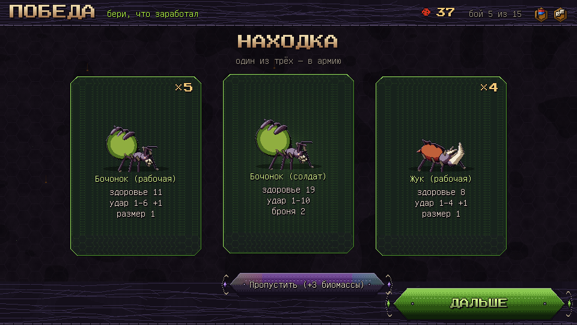 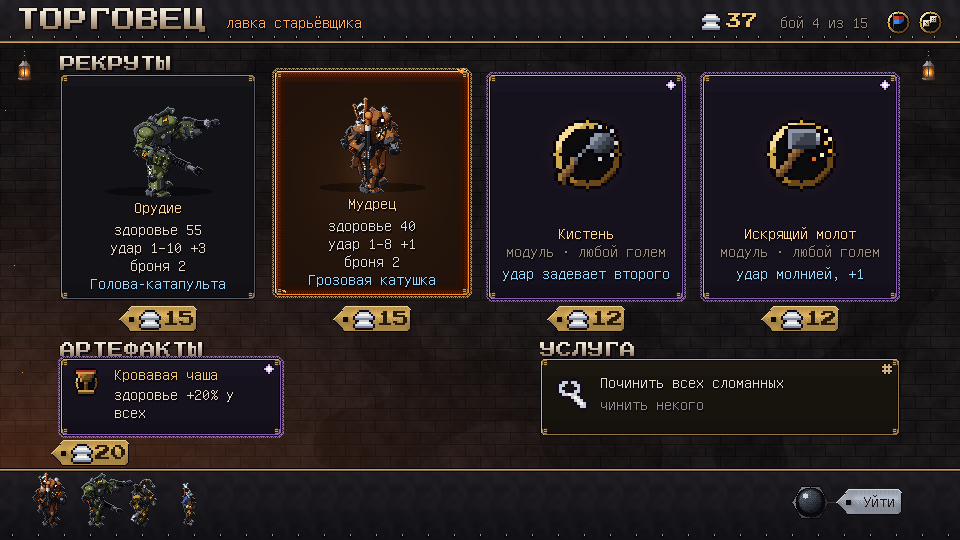
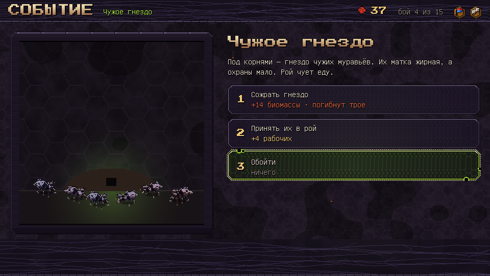 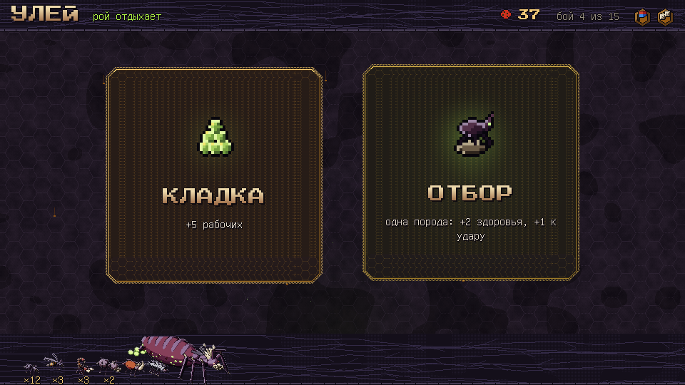
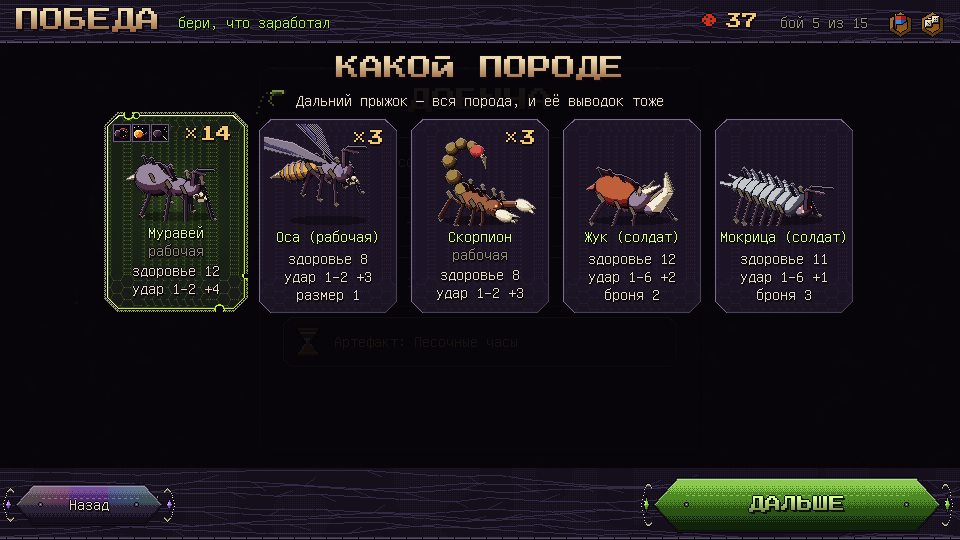 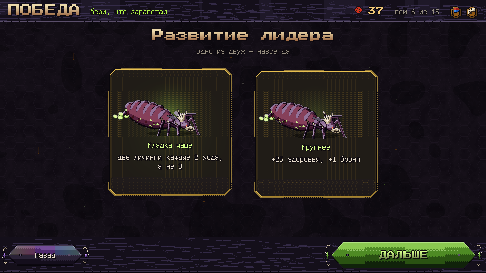
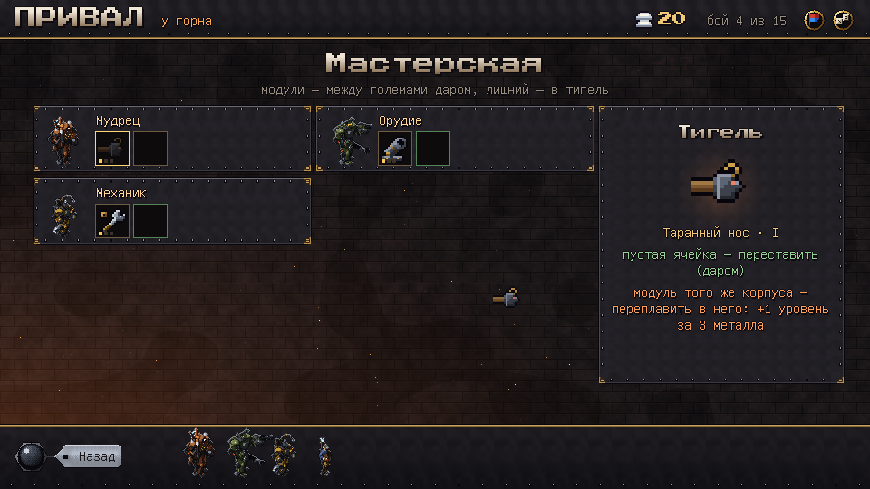 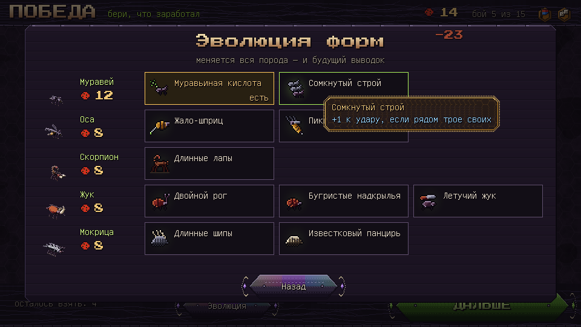

- Пока нет: мастерской (переставить модули, уровни I–III, переплавка), эволюции форм роя и пулов мутаций лидеров,
  развития лидера после босса, способностей лидеров в бою (описаны на экране выбора по концепту), музыки, широкого
  холста 1280×720.

## Техно-демо

Крейт `game` — первый запускаемый кусок игры: один бой, старт Изобретателя против старта Пожирателя (баланс
пока не трогаем: с лидером в тылу рой выигрывает 93 боя из 100, см. CONCEPT). Изобретатель держится за своими
големами и бьёт молнией тех, кто до него добрался. Бой ведёт симуляция (`sim`), игра только проигрывает её события:
сначала все шагают, потом удары ложатся один за другим, у каждого свой эффект и своя цифра, убитые остаются
лежать — темнее и серее живых, чтобы груда мёртвых не читалась живым роем. Мелкие особи одной клетки (в
симуляции их до 4 в клетке, против ударов по площади — до 2, у Матки — до 6; крупных, размера 2, — до 2, и с
мелкими в одной клетке они не стоят) стоят **стаей** — каждая из особей одного размера: видно не больше трёх
тел — одно впереди, два выглядывают из-за него, — тень одна на всю стаю, а если в клетке больше трёх, под стаей
ряд точек, по точке на особь (без цифр — нечего переводить). Замах или попадание скрытой особи показывает тело,
стоящее за неё; гибнущая выпадает из стаи на своё место на земле. Так рой в 50–80 особей не заваливает экран. Бой живой:
  - **шаг** — настоящие кадры ходьбы: у големов четыре (шаг с одной ноги, перенос, шаг с другой, перенос; тело
    приседает на шаге и поднимается в переносе, свободные руки ходят против ног), у особей и Пожирателя два —
    ноги переставляются тройками, как у насекомых, у кузнечика по очереди толкаются и большие задние ноги; запечены теми же сборщиками, что и остальные позы;
  - **покой** — тело дышит: на пиксель вверх и вниз, каждое в своём темпе, машина медленнее зверя;
  - **атака** — замах назад, выпад к цели в миг удара, возврат; стрелок и маг, наоборот, получают отдачу;
  - **попадание** — цель мигает белым два кадра и отлетает на пару пикселей от удара;
  - **смерть** — тело вспыхивает и вздрагивает три кадра, потом падает с отскоком на своё место на земле,
    поднимая пыль (голем — тёмную крошку и искры). Вспышка гибнущего и пыль рисуются поверх эффектов, так что
    смерть видна и внутри разрыва Мортиры; хвост любого эффекта (дым разрыва) к концу редеет, а не закрывает поле. При запуске — бой 184: рой побеждает, потеряв 20 особей из 21,
Изобретатель падает последним. Цифры встают над головой (у лидера — над его здоровьем), не на теле и не на чужой шкале здоровья: тело
и удар остаются видны. Удары
по одной цели подряд складываются в одну цифру, которая растёт и подскакивает с каждым (4 → 8 → 10), но не больше здоровья цели, повторный
промах заменяет прежний; разные цифры над одной целью встают строкой выше друг друга. Мудрец и Изобретатель бьют молнией: она
вылетает из навершия посоха (у Изобретателя — из зубцов шокера), за три кадра дотягивается до цели,
четыре кадра трещит, каждый кадр перерисовываясь, с двумя отростками, и гаснет. Молния рисуется кодом
(`render.rs`, `bolt`), а не готовым листом: цель может стоять где угодно; точка вылета — `emit` в `assets.json`. Сверху тонкое крыло роя: перетягивание, счёт роя, имя лидера Литейщика
и сколько его големов стоит («Изобретатель 3/4»), ход, скорость; кнопка под курсором светлеет, подсказка её
клавиши видна под ней только при наведении и в первые три секунды боя, а не висит на поле. Над лидером его
здоровье — маленькая шкала в десять делений с короной (около 50 px), всегда над ним. Трупы с каждым ходом темнеют
ступенями и уходят в цвет земли, не копясь грудой. В конце плита победы, поражения или ничьей (обе армии пали разом или вышли ходы) с кнопкой «новый бой» (или R).

- Картинка собирается программно в кадре 960×540; окно (`winit` + `pixels`) показывает её в своём размере
  через камеру (`camera.rs`, общая с видео): всё поле, пока армии далеко, и ближе на схватке;
  пиксели при любом увеличении остаются ровными квадратами, интерфейс поверх — целым множителем. Насколько близко
  камера может подойти, решает игрок: колесо мыши или − / + — пять уровней (всё поле, дальше, обычно ×1,5, ближе,
  вплотную ×2,25), на миг вверху подпись «камера: …»; C — выкл./вкл. (выкл. — всё поле всё время), уровень
  помнится в настройках («Камера в бою» перебирает уровни). Тот же код снимает кадры без окна — так демо проверяется в облаке. Бой тикает
  24 раза в секунду (удары, звуки), а рисуется с частотой экрана: ходьба считается и между тиками, на 60 и 144 Гц
  движение плавное. Сборка кадра — в два прохода (строки поля растягиваются один раз, потом складываются): 4K —
  около 10 мс на четырёх ядрах (было около 70).
- Игра открывается на весь экран без рамки (окно 1920×1080 не влезает в экран 1080p с заголовком и панелью
  задач, а при масштабе Windows 125–150 % — тем более); F11 или Alt+Enter — окно: наибольшее кратное 960×540,
  что помещается, по центру. Свёрнутая игра не рисует (бой и звук идут). Клавиши — по месту на клавиатуре, не
  по букве: R и C работают в любой раскладке и с Caps Lock; зажатая клавиша не повторяет действие; при Alt
  считается только Alt+Enter. После зависания (перетаскивание окна, сон) бой идёт с того же места, не
  перескакивая вперёд с пачкой пропущенных звуков. Ошибка при запуске или падение — окно с текстом ошибки
  (у выпускной сборки нет консоли).
- Спрайты, эффекты, шрифты и куски интерфейса запечены заранее (`tools/sprites/demo_bake.py` → `game/assets`):
  големы и особи собираются кодом на Python, перенос этих сборщиков в Rust — позже.
- Звук — `kira`. Рой кусает — хруст жвал и звон металла под ними; голем бьёт — хруст тела; разряд Мудреца и
  Изобретателя — щелчок, треск настоящей искры и раскат грома, сжатые для плотности, звучит, когда молния
  срывается с посоха; Мортира — выстрел (хлопок заряда с басом ствола), через миг разрыв снаряда (жёсткий край,
  взрыв, дрожь земли); гибнет особь — мокрый шлепок и низкий хрип, ломается голем — механический взрыв
  и падающее железо; Механик чинит глухим выдохом пара; промахи, шаги големов — короткие глухие удары металла,
  кнопки; в конце — напористая минорная фанфара победы или короткая нисходящая тема поражения; под всем боем, пока рой жив, — тихий стрёкот (петля). Писклявого нет: варианты с резким
  тоном выше 4 кГц убраны, у остальных при нужде срезан верх, шаги понижены и укорочены. Все звуки — CC0: наборы Kenney и звуки других авторов с OpenGameArt,
  у каждого файла записаны автор и страница (`game/assets/sfx/SOURCES.md`); собирает их `tools/audio/sfx_build.py`.
  У каждого звука несколько вариантов; играет случайный, чуть выше или ниже, слева или справа — по месту на поле;
  за тик не больше четырёх звуков и не два одинаковых; за треть секунды — не больше двух смертей (третья и дальше
  тонут в шуме), второй одинаковый звук тише на 3 дБ. Громкость выровнена по слышимой (A-взвешенной), а не по пику:
  варианты одного звука не прыгают, у каждого звука своё место — разрыв, поломка и музыка громче всего, выстрел и
  разряд следом, удары и смерти ниже, укусы, шаги и промахи тише, стрёкот роя далеко внизу. На выходе — запас
  4 дБ и ограничитель: залп, убивший пятерых, громкий, но не хрипит. Игра — только под Windows;
  разработка и проверки в облаке идут на Linux, там для сборки нужны заголовки ALSA (`libasound2-dev`); без звука:
  `--no-default-features --features window`. Ресурсы игра ищет в `GAME_ASSETS`, иначе в папке `assets` рядом
  с exe, иначе в исходниках.

```
cargo run -p game --release                         # Пробел — пауза, Tab — скорость, End — в конец, R — новый бой, C — камера, колесо или − / + — камера дальше/ближе, F11 / Alt+Enter — окно, Esc — выход
cargo run -p game --release -- --seed 12            # другой бой
cargo run -p game --release -- --shot 120 a.png     # кадр 120 в PNG (×2), без окна
cargo run -p game --release -- --strip s.png        # шесть кадров через весь бой
cargo run -p game --release -- --frames dir 2       # каждый второй кадр боя
cargo run -p game --release -- --cues cues.json     # звуки боя с их кадрами
python3 tools/video/demo_video.py                   # видео: бои 184 и 142, 1920×1080, 60 кадров/с, со звуком
cargo build -p game --release --no-default-features # сборка без окна
```

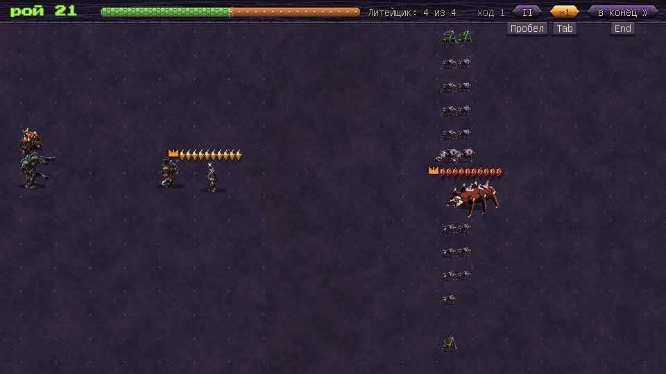

Видео со звуком: [demo_battle.mp4](images/demo_battle.mp4) — два боя подряд (рой еле побеждает; Литейщик
побеждает; снято до того, как Изобретатель стал держаться в тылу, и до последних правок звука — пересобрать той же
командой), 1920×1080, 60 кадров/с. Кадры рисует сама игра (`--video`): поле под камерой, которая держит схватку —
×2, пока армии далеко, до ×3, когда они сошлись (дальнее орудие может остаться за краем, его снаряд влетает в кадр);
пиксели при дробном увеличении остаются ровными квадратами (резкая билинейная выборка), интерфейс поверх — ×2.
Шаги между кадрами плавные: позиция при ходьбе считается и между игровыми кадрами. Звук сведён из тех же звуков
и в те же моменты, что играет игра, громкость держит лимитер (`tools/video/demo_video.py`).
